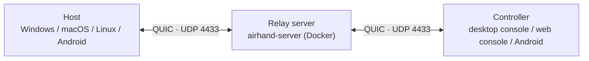

<p align="center"></p>

<h1 align="center">Airhand</h1>

<p align="center"><b>高性能・低遅延のリモートデスクトップ</b><br>QUIC 通信 · ハードウェアエンコード／デコード · 最大 120 fps<br>Windows · macOS · Linux · Android · ブラウザー</p>

<p align="center"><a href="README.md">English</a> · <a href="README.zh-CN.md">简体中文</a> · <b>日本語</b></p>

---

Airhand は**高性能・低遅延**のリモートデスクトップです。画面は GPU でエンコード（AV1 / HEVC / H.264）され、最大 120 fps で QUIC を通じて送られます。ネットワークが遅くなると、遅延をため込まずに最新のフレームまでスキップします。また、マウスポインターはローカルで描画されるため、遅れなく動きます。

同じプログラムが**ホスト**（操作される側のデバイス）にも**コントローラー**（操作する側のデバイス）にもなります。両者は、自分でデプロイする**中継サーバー**を介してつながります。サーバーは小さく、Docker Compose ならコマンド 1 つでデプロイできます。相手の 6 桁の**コントロールコード**を入力すると接続できます。

> [!NOTE]
> **開発中（0.2.1）です。** バージョン間でプロトコルがまだ変わるため、クライアントとサーバーは同じバージョンにそろえる必要があります。不一致は検出され、通知されます（[Protocol versions](docs/development.md#protocol-versions) を参照）。

## パフォーマンス

キャプチャから表示までのすべての段階が、低遅延のために作られています。

- **ハードウェアエンコード／デコード**: ホストは B フレームなしの低遅延モードで GPU エンコード（NVENC / Quick Sync / AMF、VideoToolbox、MediaCodec）を行い、コントローラーは GPU でデコード（WebCodecs / MediaCodec）します。4K 画面を 1080p で配信した実測では、ハードウェア AV1 エンコードは 1 フレームあたり約 7 ms です（RTX グラフィックスカード）
- **最適なフォーマット**: AV1 > HEVC > H.264 の順で、両者が対応する最も効率的なフォーマットを自動で選びます。スケーリングと色変換には SIMD を使い、バッファーはすべて再利用します
- **遅延をため込まない**: ホストは送信中のフレーム数を制限し（≈ RTT × フレームレート + 2）、遅いネットワークでは最新のフレームまでスキップします。アダプティブビットレートは輻輳時に下がり、徐々に回復します
- **QUIC + BBR**: Wi-Fi や長距離回線のようにロスのあるネットワークでは、BBR 輻輳制御は Cubic より安定します。制御メッセージ・音声・映像は別々のキューに入るため、マウス入力や ping が大きなフレームの後ろで待たされることはありません。中継サーバーはバイトを転送するだけで、映像を解析することはありません
- **デコードしてすぐ表示**: デコーダーは低遅延モードで動き、各フレームはデコードされるとすぐに、vsync を待たずに非同期キャンバスへ描画されます
- **ローカルポインター**: リモートカーソルの形はローカルに反映され、移動はローカルで処理されます
- **低帯域**: 画面が静止している間はフレームを送らないため、アイドル状態のデスクトップはほとんど帯域を使いません。画面に表示されていないセッションは 5 fps に落とします

詳しくは [How it works → Video](docs/architecture.md#video) を参照してください。

## 機能

- **Windows システムサービス**: ロック画面、サインイン画面、UAC プロンプトも表示・操作でき、起動後、誰かがサインインする前からコンピューターに接続できます
- **固定コントロールコード**: 自分で変更するまで、再起動やアップグレード、さらにはサーバーの再起動後も変わりません
- **コンソール**: ブラウザーのようなタブで複数のコンピューターを同時に操作でき、マルチ画面の一覧ですべてを見守れます。接続したことのあるコンピューターは保存され、ワンクリックで再接続できます。オフラインのものは、戻ってきた時点で接続されます
- **Web コンソール**: コントローラーは Docker でも動かせてブラウザーから使えるため、操作する側のコンピューターには何もインストールする必要がありません
- **Android**: スマートフォンをトラックパッドやタッチスクリーンとして使い、コンピューターやスマートフォンを操作できます。また、自分の画面を共有して手助けしてもらうこともできます（既定では接続ごとに承認します）。テレビではリモコンで視聴できます
- **音声**: ホストのシステム音声がコントローラーで再生されます（Opus + アダプティブジッターバッファー）。動画視聴向けに、オプションで音声と映像の同期もできます
- **便利なツール**: 双方向のクリップボード同期、クリップボードの内容をキー入力として打ち込む機能、システムショートカット（Win、Alt+Tab、Ctrl+Shift+Esc…）、マルチモニター、フルスクリーン時のキーボードロック、画質プリセット
- **デフォルトで安全**: 証明書ピンニング付きの TLS 1.3、コントロールコードへのブルートフォース対策。ホスト側では誰が接続しているかが常に表示され、ワンクリックで切断できます
- **何も残さない**: ホストはトレイアイコンだけで、WebView を起動しません。残す価値のあるものはすべて 1 つの `config.toml` にまとまり、その他の実行時ファイルは終了時に削除されます
- **英語と中国語**: システムの言語に従います。相手のコンピューターやサーバーからの通知も**あなたの**言語で表示されます

## 対応プラットフォーム

| プラットフォーム | ホスト | コントローラー | 備考 |
|---|:-:|:-:|---|
| Windows 10 / 11 | ✅ | ✅ | インストール型。ホストはシステムサービスとして動作します |
| macOS 13+ | ✅ | ✅ | ホストには「画面収録とシステムオーディオ録音」と「アクセシビリティ」の権限が必要です |
| Linux | ✅ | ✅ | ホストは現時点で X11 デスクトップのみ対応で、ソフトウェアエンコードです |
| Android 7+ のスマートフォン／タブレット | ✅ | ✅ | ユーザー補助サービスをオンにするまでは視聴のみです。コントローラーは一度に 1 台のデバイスに接続します |
| Android TV / Google TV | — | 視聴のみ | すべてリモコンで操作します |
| ブラウザー（Web コンソール） | — | ✅ | Chrome / Edge、Safari 16.4+、Firefox 130+ |

プラットフォームごとの注意点は [Known limitations](docs/limitations.md) を参照してください。

## 仕組み



ホストは中継サーバーに接続して 6 桁のコントロールコードを受け取り、コントローラーはそのコードを使ってホストを見つけます。サーバーはコードの登録、セッションのペアリング、バイトの転送だけを行い、映像を解析することはありません。ホストもコントローラーも外向きにサーバーへ接続するため、どちらも開放ポートやグローバル IP を必要としません。詳しくは [How it works](docs/architecture.md) を参照してください。

## クイックスタート

必要なもの:

- 両者から到達でき、Docker が入っていて **UDP 4433** が開いているマシン
- クライアントのビルドに Rust、Node.js 20+、CMake（プラットフォームごとの要件は [Building](docs/building.md#requirements) を参照）

### 1. 中継サーバーをデプロイする

```bash
git clone https://github.com/sqlpxc/airhand.git
cd airhand
docker compose up -d
docker compose logs airhand | grep fingerprint   # note the certificate's SHA-256 fingerprint
```

証明書とコントロールコードのデータベースは `data/` にあります。**このディレクトリは残しておいてください**。証明書が新しくなると、ビルド済みのクライアントは接続できなくなります。サーバーの設定は [Deployment](docs/deploy.md#relay-server) にあります。

### 2. クライアントをビルドする

サーバーのアドレスと、手順 1 のフィンガープリントを組み込んでコンパイルします。

Windows（PowerShell）:

```powershell
cd client
npm install
$env:AIRHAND_SERVER    = "relay.example.com:4433"
$env:AIRHAND_SERVER_FP = "<fingerprint from step 1>"
npm run tauri build
```

macOS / Linux:

```bash
cd client
npm install
export AIRHAND_SERVER=relay.example.com:4433
export AIRHAND_SERVER_FP=<fingerprint from step 1>
npm run tauri build
```

パッケージは `client/src-tauri/target/release/bundle/` の下にできます。

| システム | パッケージ |
|---|---|
| Windows | `nsis/Airhand_<version>_x64-setup.exe` |
| macOS | `macos/Airhand.app`、`dmg/Airhand_<version>_<arch>.dmg` |
| Linux | `deb/Airhand_<version>_amd64.deb` |

サーバーのアドレスとフィンガープリントは、あとから [`config.toml`](docs/usage.md#configuration-file) で変更することもできます。Android APK については [Building → Android](docs/building.md#android-apk) を参照してください。

### 3. 接続する

1. 両方のコンピューターに Airhand をインストールします（Windows ではインストーラーを実行します。管理者権限が必要です。macOS では初回に求められる権限を許可します）
2. **操作される側**のコンピューターでトレイアイコンを右クリックすると（macOS ではメニューバーのアイコンをクリック）、6 桁の**コントロールコード**が表示されます
3. **自分の**コンピューターで、トレイメニューから **Open console**（macOS / Linux では **Switch to controller**）を選び、コードを入力します

詳しいガイドは [Usage](docs/usage.md) にあります。

### クライアントをインストールせずに使う: Web コンソール

Docker が入っている任意のマシンで Web コンソールを起動し、ブラウザーから使います。

```bash
cd web
AIRHAND_SERVER=relay.example.com:4433 AIRHAND_SERVER_FP=<fingerprint> docker compose up -d
```

そのマシンでは `http://localhost:8080` を、ほかのコンピューターからは `https://<its address>:8080` を開きます。アクセスパスワード、HTTPS 証明書、リバースプロキシについては [Deployment → Web console](docs/deploy.md#web-console-docker) を参照してください。

## ドキュメント

| ドキュメント | 内容 |
|---|---|
| [Usage](docs/usage.md) | ホスト、Windows へのインストール、設定ファイル、コンソール、画質、言語 |
| [Deployment](docs/deploy.md) | 中継サーバーの設定、Web コンソール、リバースプロキシ |
| [Android](docs/android.md) | スマートフォンからの操作、スマートフォンの共有、ジェスチャー、テレビ |
| [Building](docs/building.md) | プラットフォームごとの要件とパッケージ、署名、APK |
| [How it works](docs/architecture.md) | アーキテクチャ、ソース構成、Windows サービス、映像と音声のパイプライン、音声と映像の同期、ディスク上のファイル |
| [Security](docs/security.md) | 暗号化とピンニング、ブルートフォース対策、コントロールコードと再開トークン |
| [Known limitations](docs/limitations.md) | プラットフォームごとの既知の問題 |
| [Development](docs/development.md) | テスト、デバッグツール、プロジェクトの規約 |

## セキュリティに関する注意

- 通信はすべて TLS 1.3（QUIC）上で行われ、クライアントは証明書のフィンガープリントでサーバーを検証します。フィンガープリントなしでビルドしたクライアントはサーバーを**検証しません**。開発用途に限って使ってください
- **中継サーバーはセッションの内容を見ることができます**（TLS はサーバーで終端します）。そのため、信頼できるマシンで動かしてください。Web コンソールも同様です
- **コントロールコードは鍵です**: Windows のホストは SYSTEM として動作するため、コードを持つ人は管理者権限でコンピューターを操作できます。信頼できる人にだけ渡してください。ホストのトレイには誰が接続しているかが常に表示され、切断したりコードを変更したりできます

詳しくは [Security](docs/security.md) を参照してください。

## コントリビュート

| ディレクトリ | 内容 |
|---|---|
| `crates/` | プロトコル（`airhand-proto`）と、クライアントと中継サーバー間の接続（`airhand-link`） |
| `server/` | 中継サーバー |
| `web/` | Web コンソールサービス |
| `client/` | デスクトップクライアント: Tauri (Rust) + React UI。Web コンソールもこれを使います |
| `android/` | Android アプリ（Kotlin + Jetpack Compose）とその Rust コア |

テストの実行方法、デバッグツール、プロジェクトの規約（プロトコルのバージョン、UI の文字列…）は [Development](docs/development.md) にあります。

## ライセンス

[MIT](LICENSE)
