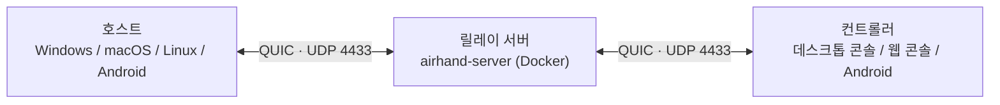

<p align="center"></p>

<h1 align="center">Airhand</h1>

<p align="center"><b>고성능·저지연 원격 데스크톱</b><br>QUIC 전송 · 하드웨어 인코딩/디코딩 · 최대 120 fps<br>Windows · macOS · Linux · Android · 브라우저</p>

<p align="center"><a href="README.md">English</a> · <a href="README.zh-CN.md">简体中文</a> · <b>한국어</b></p>

---

Airhand는 **고성능·저지연** 원격 데스크톱입니다. 화면을 GPU(AV1 / HEVC / H.264)로 최대 120 fps까지 인코딩해 QUIC으로 전송하고, 네트워크가 느려지면 밀린 프레임을 버리고 최신 프레임으로 따라가서 지연이 쌓이지 않으며, 마우스 포인터는 로컬에서 그리기 때문에 커서가 지연 없이 움직입니다.

같은 프로그램이 **호스트**(제어받는 기기)이자 **컨트롤러**(제어하는 기기)입니다. 두 기기는 직접 배포하는 **릴레이 서버**를 통해 만납니다. 서버는 가볍고 Docker Compose 한 줄로 띄울 수 있습니다. 상대방의 6자리 **제어 코드**를 입력하면 연결됩니다.

> [!NOTE]
> **개발 중(0.2.2).** 프로토콜이 버전마다 아직 바뀔 수 있어 클라이언트와 서버는 같은 버전을 써야 합니다. 버전이 맞지 않으면 감지해서 알려 줍니다([프로토콜 버전](docs/development.md#protocol-versions) 참고).

## 성능

화면 캡처부터 표시까지 모든 단계가 저지연을 위해 설계돼 있습니다:

- **하드웨어 인코딩/디코딩**: 호스트는 GPU(NVENC / Quick Sync / AMF, VideoToolbox, MediaCodec)로 B-프레임 없는 저지연 모드에서 인코딩하고, 컨트롤러는 GPU(WebCodecs / MediaCodec)로 디코딩합니다. 4K 화면을 1080p로 송출할 때 실측 기준 하드웨어 AV1 인코딩은 프레임당 약 7 ms입니다(RTX 그래픽 카드)
- **최적 포맷 자동 선택**: AV1 > HEVC > H.264 순서로 양쪽이 모두 지원하는 가장 효율적인 포맷을 자동으로 고르고, 스케일링과 색상 변환은 SIMD로 처리하며 버퍼는 전부 재사용합니다
- **지연 누적 없음**: 호스트는 전송 중인 프레임 수를 제한하고(≈ RTT × 프레임 레이트 + 2), 네트워크가 느리면 최신 프레임으로 건너뜁니다. 적응형 비트레이트는 혼잡할 때 낮추고 여유가 생기면 서서히 올립니다
- **QUIC + BBR**: BBR 혼잡 제어는 Wi-Fi나 장거리 회선처럼 패킷 손실이 잦은 네트워크에서 Cubic보다 안정적입니다. 제어 메시지·오디오·비디오가 각각 따로 큐에 들어가서 마우스 입력과 핑이 큰 프레임 뒤에서 기다리지 않고, 릴레이는 바이트만 전달하고 비디오를 절대 해석하지 않습니다
- **디코딩 즉시 표시**: 디코더를 저지연 모드로 돌리고, 프레임이 디코딩되는 대로 vsync를 기다리지 않고 desynchronized 캔버스에 바로 그립니다
- **로컬 포인터**: 원격 커서 모양을 로컬로 가져와 그리고, 커서 이동도 로컬에서 처리합니다
- **대역폭 절약**: 화면에 변화가 없으면 프레임을 보내지 않아 한가한 데스크톱은 대역폭을 거의 쓰지 않고, 화면에 보이지 않는 세션은 5 fps로 낮아집니다

자세한 내용은 [작동 방식 → 비디오](docs/architecture.md#video)를 참고하세요.

## 기능

- **Windows 시스템 서비스**: 잠금 화면, 로그인 화면, UAC 확인 창도 보고 조작할 수 있고, 부팅 후 로그인 전에도 접속할 수 있습니다
- **고정된 제어 코드**: 직접 바꾸기 전까지 재시작, 업그레이드, 서버 재시작에도 바뀌지 않습니다
- **콘솔**: 브라우저처럼 탭으로 여러 컴퓨터를 동시에 제어하고, 멀티 모니터 전체 보기로 모든 화면을 한눈에 봅니다. 연결했던 컴퓨터는 저장돼 클릭 한 번에 다시 연결되고, 꺼져 있으면 켜지는 순간 연결됩니다
- **웹 콘솔**: 컨트롤러도 Docker로 띄워 브라우저에서 쓸 수 있어, 제어하는 쪽 컴퓨터에는 아무것도 설치하지 않아도 됩니다
- **Android**: 휴대폰에서 트랙패드·터치스크린 방식으로 컴퓨터와 휴대폰을 제어하거나, 내 화면을 공유해 도움을 받을 수 있습니다(연결은 기본적으로 직접 승인). TV에서는 리모컨으로 시청합니다
- **오디오**: 호스트의 시스템 소리를 컨트롤러에서 재생합니다(Opus + 적응형 지터 버퍼). 영상을 볼 때 쓸 수 있는 A/V 동기화도 있습니다
- **편리한 도구**: 양방향 클립보드 동기화, 클립보드 내용을 키 입력으로 타이핑하기, 시스템 단축키(Win, Alt+Tab, Ctrl+Shift+Esc…), 다중 모니터, 전체 화면 키보드 잠금, 화질 프리셋
- **기본적으로 안전**: TLS 1.3과 인증서 피닝, 제어 코드 무차별 대입 방어. 호스트는 항상 누가 접속했는지 볼 수 있고 클릭 한 번으로 끊을 수 있습니다
- **흔적을 남기지 않음**: 호스트는 트레이 아이콘 하나뿐이고 WebView를 띄우지 않습니다. 보관할 것은 `config.toml` 하나에 다 들어 있고, 나머지 실행 중 생성 파일은 종료할 때 지웁니다. [제거](docs/usage.md#uninstalling) 뒤에는 아무것도 남지 않습니다(Windows는 제거 프로그램, macOS는 메뉴의 "Airhand 제거…", Linux는 명령 두 줄)
- **영어·중국어 지원**: 시스템 언어를 따라가고, 상대방 컴퓨터와 서버가 보내는 알림도 **내** 언어로 표시됩니다

## 지원 플랫폼

| 플랫폼 | 호스트 | 컨트롤러 | 비고 |
|---|:-:|:-:|---|
| Windows 10 / 11 | ✅ | ✅ | 설치 필요. 호스트는 시스템 서비스로 실행 |
| macOS 13+ | ✅ | ✅ | 호스트에 '화면 및 시스템 오디오 녹화'와 '접근성' 권한 필요 |
| Linux | ✅ | ✅ | 호스트는 X11 데스크톱만 지원하며, 현재는 소프트웨어 인코딩만 가능 |
| Android 7+ 휴대폰 / 태블릿 | ✅ | ✅ | 접근성 서비스를 켜기 전까지는 보기만 가능. 컨트롤러는 한 번에 한 대만 연결 |
| Android TV / Google TV | — | 보기 전용 | 리모컨으로만 조작 |
| 브라우저(웹 콘솔) | — | ✅ | Chrome / Edge, Safari 16.4+, Firefox 130+ |

플랫폼별 주의 사항은 [알려진 제한 사항](docs/limitations.md)을 참고하세요.

## 작동 방식



호스트는 릴레이 서버에 접속해 6자리 제어 코드를 받고, 컨트롤러가 그 코드로 호스트를 찾습니다. 서버는 코드 등록, 세션 매칭, 바이트 전달만 담당하고 비디오를 절대 해석하지 않습니다. 호스트와 컨트롤러 모두 서버로 아웃바운드 연결만 하므로 열어 둔 포트도 공인 IP도 필요 없습니다. 자세한 내용은 [작동 방식](docs/architecture.md)을 참고하세요.

## 빠른 시작

준비물:

- 양쪽 모두에서 접근할 수 있는 머신 한 대. Docker 설치, **UDP 4433** 개방
- 클라이언트를 빌드할 Rust, Node.js 20+, CMake(플랫폼별 요구 사항은 [빌드](docs/building.md#requirements) 참고)

### 1. 릴레이 서버 배포

```bash
git clone https://github.com/sqlpxc/airhand.git
cd airhand
docker compose up -d
docker compose logs airhand | grep fingerprint   # 인증서의 SHA-256 지문 기록
```

인증서와 제어 코드 데이터베이스는 `data/`에 저장됩니다. **이 디렉터리는 보존하세요**: 인증서가 바뀌면 이미 빌드해 둔 클라이언트는 더 이상 연결되지 않습니다. 서버 설정은 [배포](docs/deploy.md#relay-server)에 있습니다.

### 2. 클라이언트 빌드

빌드할 때 서버 주소와 1단계에서 확인한 지문을 실행 파일에 포함시킵니다.

Windows(PowerShell):

```powershell
cd client
npm install
$env:AIRHAND_SERVER    = "relay.example.com:4433"
$env:AIRHAND_SERVER_FP = "<1단계에서 확인한 지문>"
npm run tauri build
```

macOS / Linux:

```bash
cd client
npm install
export AIRHAND_SERVER=relay.example.com:4433
export AIRHAND_SERVER_FP=<1단계에서 확인한 지문>
npm run tauri build
```

빌드 결과물은 `client/src-tauri/target/release/bundle/` 아래에 생깁니다:

| 시스템 | 패키지 |
|---|---|
| Windows | `nsis/Airhand_<버전>_x64-setup.exe` |
| macOS | `macos/Airhand.app`, `dmg/Airhand_<버전>_<아키텍처>.dmg` |
| Linux | `deb/Airhand_<버전>_amd64.deb` |

서버 주소와 지문은 나중에 [`config.toml`](docs/usage.md#configuration-file)에서도 바꿀 수 있습니다. Android APK는 [빌드 → Android](docs/building.md#android-apk)를 참고하세요.

### 3. 연결

1. 두 컴퓨터 모두에 Airhand 설치(Windows는 관리자 권한이 필요한 설치 프로그램 실행, macOS는 처음 실행할 때 요청하는 권한 허용)
2. **제어받을** 컴퓨터에서 트레이 아이콘 우클릭(macOS는 메뉴 막대 아이콘 클릭)해 6자리 **제어 코드** 확인
3. **내** 컴퓨터의 트레이 메뉴에서 **콘솔 열기**(macOS / Linux는 **컨트롤러로 전환**)를 선택하고 코드 입력

전체 사용법은 [사용법](docs/usage.md)에 있습니다.

### 클라이언트 설치 없이: 웹 콘솔

Docker가 설치된 아무 머신에서나 웹 콘솔을 띄워 브라우저로 사용합니다:

```bash
cd web
AIRHAND_SERVER=relay.example.com:4433 AIRHAND_SERVER_FP=<지문> docker compose up -d
```

그 머신에서는 `http://localhost:8080`, 다른 컴퓨터에서는 `https://<그 머신의 주소>:8080`을 엽니다. 접속 비밀번호, HTTPS 인증서, 리버스 프록시는 [배포 → 웹 콘솔](docs/deploy.md#web-console-docker)을 참고하세요.

## 문서

| 문서 | 내용 |
|---|---|
| [사용법](docs/usage.md) | 호스트, Windows 설치, 설정 파일, 제거, 콘솔, 화질, 언어 |
| [배포](docs/deploy.md) | 릴레이 서버 설정, 웹 콘솔, 리버스 프록시 |
| [Android](docs/android.md) | 휴대폰으로 제어, 화면 공유, 제스처, TV |
| [빌드](docs/building.md) | 플랫폼별 요구 사항과 패키지, 서명, APK |
| [작동 방식](docs/architecture.md) | 아키텍처, 소스 구조, Windows 서비스, 비디오·오디오 파이프라인, A/V 동기화, 디스크 파일 |
| [보안](docs/security.md) | 암호화와 인증서 피닝, 무차별 대입 방어, 제어 코드와 재개 토큰 |
| [알려진 제한 사항](docs/limitations.md) | 플랫폼별 알려진 문제 |
| [개발](docs/development.md) | 테스트, 디버깅 도구, 프로젝트 규칙 |

## 보안 참고 사항

- 모든 트래픽은 TLS 1.3(QUIC)으로 암호화되며, 클라이언트는 인증서 지문으로 서버를 검증합니다. 지문 없이 빌드한 클라이언트는 서버를 **검증하지 않으므로** 개발용으로만 쓰세요
- **릴레이 서버는 세션 내용을 볼 수 있습니다**(TLS가 서버에서 종료됨). 신뢰할 수 있는 머신에서 실행하세요. 웹 콘솔도 마찬가지입니다
- **제어 코드가 곧 열쇠입니다**: Windows 호스트는 SYSTEM 권한으로 실행되므로, 코드를 가진 사람은 관리자 권한으로 컴퓨터를 조작할 수 있습니다. 신뢰하는 사람에게만 알려 주세요. 호스트 트레이에는 항상 접속자가 표시되고, 바로 끊거나 코드를 바꿀 수 있습니다

자세한 내용은 [보안](docs/security.md)을 참고하세요.

## 기여하기

| 디렉터리 | 내용 |
|---|---|
| `crates/` | 프로토콜(`airhand-proto`)과 클라이언트-릴레이 링크(`airhand-link`) |
| `server/` | 릴레이 서버 |
| `web/` | 웹 콘솔 서비스 |
| `client/` | 데스크톱 클라이언트: Tauri(Rust) + React UI — 웹 콘솔도 같이 사용 |
| `android/` | Android 앱(Kotlin + Jetpack Compose)과 Rust 코어 |

테스트 실행법, 디버깅 도구, 프로젝트 규칙(프로토콜 버전, UI 문구…)은 [개발](docs/development.md)에 있습니다.

## 라이선스

[MIT](LICENSE)
