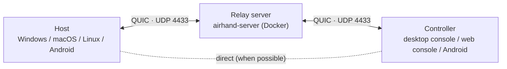

<p align="center"></p>

<h1 align="center">Airhand</h1>

<p align="center"><b>High-performance, low-latency remote desktop</b><br>QUIC transport · hardware encoding and decoding · up to 120 fps<br>Windows · macOS · Linux · Android · browser</p>

<p align="center"><b>English</b> · <a href="README.zh-CN.md">简体中文</a></p>

---

Airhand is a **high-performance, low-latency** remote desktop: the screen is encoded on the GPU (AV1 / HEVC / H.264) at up to 120 fps and sent over QUIC; when the network slows down it skips to the latest frame instead of letting lag pile up; and the mouse pointer is drawn locally, so it moves without delay.

The same program is both the **host** (the device being controlled) and the **controller** (the device you control it from). The two sides meet through a **relay server** that you deploy yourself. It's small, and Docker Compose deploys it with one command. Enter the other side's 6-digit **control code** to connect.

> [!NOTE]
> **Work in progress (0.2.3).** Since protocol v9, client ⇄ server and host ⇄ controller each support a range of versions, new features are negotiated with capability bits and unknown messages are skipped, so later versions can be mixed; versions before v9 are incompatible, which is detected and reported (see [Protocol versions](docs/development.md#protocol-versions)).

## Performance

Every stage from capture to display is built for low latency:

- **Hardware encoding and decoding**: the host encodes on the GPU (NVENC / Quick Sync / AMF, VideoToolbox, MediaCodec) in low-latency mode without B-frames; the controller decodes on the GPU (WebCodecs / MediaCodec). Measured with a 4K screen streamed at 1080p, hardware AV1 encoding takes about 7 ms per frame (RTX graphics card)
- **The best format**: AV1 > HEVC > H.264, automatically picking the most efficient format both sides support; scaling and color conversion use SIMD, and all buffers are reused
- **No lag build-up**: the host limits the bytes in flight (≈ bitrate × (RTT + 50 ms)) and skips to the latest frame on a slow network; the bitrate follows the measured queueing delay and bandwidth on every acknowledgement, backing off within a few hundred milliseconds and recovering gradually
- **Direct path**: besides the relay, the two ends punch a direct path through their NATs (on the same LAN, or whenever the NAT isn't symmetric), so video and audio stop detouring through the server; the lower-latency path is picked automatically, and if the direct path breaks the session falls back to the relay without dropping
- **QUIC + BBR**: BBR congestion control is steadier than Cubic on lossy networks such as Wi-Fi or long-distance links; control messages, audio and video are queued separately, so mouse input and pings never wait behind a large frame; the relay only forwards bytes and never parses the video
- **Decode and show**: the decoder runs in low-latency mode, and each frame is drawn to a desynchronized canvas as soon as it's decoded, without waiting for vsync
- **Local pointer**: the remote cursor's shape is mirrored locally, and moving it happens locally
- **Low bandwidth**: no frames are sent while the screen is still, so an idle desktop uses almost nothing; sessions that aren't on screen drop to 5 fps

See [How it works → Video](docs/architecture.md#video) for details.

## Features

- **Windows system service**: the lock screen, the sign-in screen and UAC prompts can be seen and controlled, and the computer can be reached after boot, before anyone signs in
- **Fixed control codes**: they survive restarts, upgrades and even server restarts until you change them yourself
- **Console**: browser-style tabs to control several computers at once, plus a multi-screen overview to watch them all. Computers you've connected to are saved and reconnect with one click; if one is offline, it connects as soon as it comes back
- **Web console**: the controller can also run in Docker and be used from a browser, with nothing to install on the computer you control from
- **Android**: control computers and phones from a phone as a trackpad or touchscreen, or share your own screen to get help (you approve each connection by default); watch on a TV with the remote
- **Audio**: the host's system audio plays on the controller (Opus + adaptive jitter buffer), with optional A/V sync for watching videos
- **Handy tools**: two-way clipboard sync, typing the clipboard as keystrokes, system shortcuts (Win, Alt+Tab, Ctrl+Shift+Esc…), multiple monitors, keyboard lock in fullscreen, quality presets
- **Secure by default**: sessions are end-to-end encrypted, so the relay server can't see the screen or keystrokes; the first connection needs the pairing code from the other computer's tray (it never goes through the server), and its identity is recognized afterwards; TLS 1.3 with certificate pinning, brute-force protection for control codes; the host always sees who is connected and can disconnect them with one click
- **Leaves nothing behind**: the host is just a tray icon and doesn't start a WebView; everything worth keeping is in one `config.toml`, other runtime files are deleted on exit, and nothing is left after [uninstalling](docs/usage.md#uninstalling) (Windows has an uninstaller, macOS has "Uninstall Airhand…" in the menu, Linux takes two commands)
- **English and Chinese**: follows the system language; notices from the other computer and the server also appear in **your** language

## Platforms

| Platform | Host | Controller | Notes |
|---|:-:|:-:|---|
| Windows 10 / 11 | ✅ | ✅ | Installed; the host runs as a system service |
| macOS 13+ | ✅ | ✅ | The host needs the Screen & System Audio Recording and Accessibility permissions |
| Linux | ✅ | ✅ | The host supports X11 desktops only, with software encoding for now |
| Android 7+ phones / tablets | ✅ | ✅ | Can only be watched until the accessibility service is turned on; the controller connects to one device at a time |
| Android TV / Google TV | — | View only | Operated entirely with the remote |
| Browser (web console) | — | ✅ | Chrome / Edge, Safari 16.4+, Firefox 130+ |

See [Known limitations](docs/limitations.md) for platform-specific caveats.

## How it works



The host connects to the relay server and gets a 6-digit control code; the controller uses that code to find it. The server only registers codes, pairs sessions and forwards bytes; sessions are end-to-end encrypted, so it can't see their content. Both the host and the controller connect out to the server, so neither needs an open port or a public IP. Once a session starts, the two ends also try to punch a direct path; when that works, the video no longer goes through the server (otherwise it stays on the relay). See [How it works](docs/architecture.md) for details.

## Quick start

You need:

- A machine both sides can reach, with Docker and **UDP 4433** open
- Rust, Node.js 20+ and CMake to build the client (per-platform requirements in [Building](docs/building.md#requirements))

### 1. Deploy the relay server

```bash
git clone https://github.com/sqlpxc/airhand.git
cd airhand
docker compose up -d
docker compose logs airhand | grep fingerprint   # note the certificate's SHA-256 fingerprint
```

The certificate and the control-code database live in `data/`. **Keep that directory**: with a new certificate, clients you've already built can no longer connect. Server settings are in [Deployment](docs/deploy.md#relay-server).

### 2. Build the client

Compile in the server address and the fingerprint from step 1.

Windows (PowerShell):

```powershell
cd client
npm install
$env:AIRHAND_SERVER    = "relay.example.com:4433"
$env:AIRHAND_SERVER_FP = "<fingerprint from step 1>"
npm run tauri build
```

macOS / Linux:

```bash
cd client
npm install
export AIRHAND_SERVER=relay.example.com:4433
export AIRHAND_SERVER_FP=<fingerprint from step 1>
npm run tauri build
```

The packages are under `client/src-tauri/target/release/bundle/`:

| System | Package |
|---|---|
| Windows | `nsis/Airhand_<version>_x64-setup.exe` |
| macOS | `macos/Airhand.app`, `dmg/Airhand_<version>_<arch>.dmg` |
| Linux | `deb/Airhand_<version>_amd64.deb` |

The server address and fingerprint can also be changed later in [`config.toml`](docs/usage.md#configuration-file). For the Android APK, see [Building → Android](docs/building.md#android-apk).

### 3. Connect

1. Install Airhand on both computers (on Windows run the installer, which needs administrator rights; on macOS grant the permissions it asks for the first time)
2. On the computer **to be controlled**, right-click the tray icon (on macOS, click the menu bar icon) to see its 6-digit **control code**
3. On **your** computer, choose **Open console** from the tray menu (**Switch to controller** on macOS / Linux) and enter the code. The first time you connect to that computer, also enter the 6-digit **pairing code** from its tray menu; after that it isn't needed

The full guide is in [Usage](docs/usage.md).

### Without installing a client: the web console

Start the web console on any machine with Docker and use it from a browser:

```bash
cd web
AIRHAND_SERVER=relay.example.com:4433 AIRHAND_SERVER_FP=<fingerprint> docker compose up -d
```

Open `http://localhost:8080` on that machine, or `https://<its address>:8080` from other computers. For the access password, the HTTPS certificate and reverse proxies, see [Deployment → Web console](docs/deploy.md#web-console-docker).

## Documentation

| Document | Contents |
|---|---|
| [Usage](docs/usage.md) | Host, Windows installation, configuration file, uninstalling, console, quality, language |
| [Deployment](docs/deploy.md) | Relay server settings, web console, reverse proxies |
| [Android](docs/android.md) | Controlling from a phone, sharing the phone, gestures, TVs |
| [Building](docs/building.md) | Per-platform requirements and packages, signing, APK |
| [How it works](docs/architecture.md) | Architecture, source layout, Windows service, video and audio pipelines, A/V sync, files on disk |
| [Security](docs/security.md) | Encryption and pinning, brute-force protection, control codes and resume tokens |
| [Known limitations](docs/limitations.md) | Known issues by platform |
| [Development](docs/development.md) | Tests, debugging tools, project conventions |

## Security notes

- Everything runs over TLS 1.3 (QUIC), and clients verify the server by its certificate fingerprint. A client built without a fingerprint remembers the server's certificate on its first connection and refuses a different one later, so only that first connection is unprotected; pin the fingerprint for releases
- **End-to-end encryption**: the picture, sound, keyboard and mouse input and the clipboard are encrypted between the host and the controller, so the relay server can neither read nor alter them; it only knows who connected to whom, when, and how much traffic flowed. The web console is where end-to-end encryption ends, so the machine running it can see the picture
- **Control code + pairing code**: the server knows every control code, so the first connection also needs the pairing code from the host's tray (it never goes through the server, and pairing pauses after 5 wrong codes); the host then remembers that controller. The Windows host runs as SYSTEM, so whoever can connect controls the computer with administrator rights; the host's tray always shows who is connected and lets you disconnect them or change the control code or pairing code

See [Security](docs/security.md) for details.

## Contributing

| Directory | Contents |
|---|---|
| `crates/` | The protocol (`airhand-proto`) and the client-to-relay link (`airhand-link`) |
| `server/` | Relay server |
| `web/` | Web console service |
| `client/` | Desktop client: Tauri (Rust) + React UI, which the web console uses too |
| `android/` | Android app (Kotlin + Jetpack Compose) and its Rust core |

How to run the tests, the debugging tools and the project conventions (protocol versions, UI strings…) are in [Development](docs/development.md).

## License

[MIT](LICENSE)
