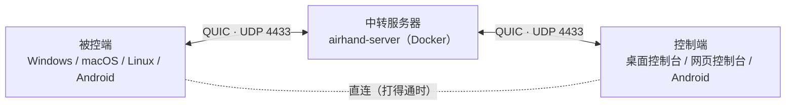

<p align="center"></p>

<h1 align="center">Airhand</h1>

<p align="center"><b>高性能、低延迟的远程桌面</b><br>QUIC 传输 · 硬件编解码 · 最高 120 fps<br>Windows · macOS · Linux · Android · 浏览器</p>

<p align="center"><a href="README.md">English</a> · <b>简体中文</b></p>

---

Airhand 是一个**高性能、低延迟**的远程桌面：画面用 GPU 硬件编码（AV1 / HEVC / H.264），最高 120 fps，经 QUIC 传输；网络变慢时直接跳到最新一帧，延迟不会越积越多；鼠标指针在本地绘制，移动感觉不到延迟。

同一个程序既是**被控端**（被远程控制的设备），也是**控制端**（你用来操作的设备）。两端通过你自己部署的**中转服务器**相连，服务器很小，用 Docker Compose 一条命令就能部署。输入对方的 6 位**控制码**就能连上。

> [!NOTE]
> **开发中（0.2.2）。** 从协议 v9 起，客户端和服务器、被控端和控制端之间各有一个版本区间，新功能用能力位协商、不认识的消息跳过，以后的版本可以混用；和 v9 之前的版本不兼容，会检测出来并提示（见[协议版本](docs/development.zh-CN.md#协议版本)）。

## 性能

从采集到显示，每一环都为低延迟设计：

- **硬件编解码**：被控端用 GPU 硬件编码（NVENC / Quick Sync / AMF、VideoToolbox、MediaCodec），低延迟模式、无 B 帧；控制端用 GPU 解码（WebCodecs / MediaCodec）。实测 4K 屏输出 1080p 时，硬件 AV1 编码每帧约 7 ms（RTX 显卡）
- **最好的格式**：按 AV1 > HEVC > H.264 自动选用双方都支持的、压缩率最高的格式；缩放和颜色转换用 SIMD，缓冲区全部复用
- **延迟不堆积**：被控端限制在途字节（≈ 码率 ×（RTT + 50 ms）），网络慢时跳到最新一帧；码率每次确认都按量到的排队时延和带宽调整，几百毫秒内降下来，恢复后逐步回升
- **直连**：两端在中转之外打洞直连（同一个局域网、或者 NAT 不是对称型时），画面、声音不再绕道服务器；自动选延迟低的那条路，直连断了马上回到中转，会话不断
- **QUIC + BBR**：BBR 拥塞控制在 Wi-Fi、跨境等丢包网络上比 Cubic 更稳；控制消息、声音、画面分开排队，鼠标和 Ping 不会排在大帧后面；中转服务器只转发字节，不解析画面
- **解码即显示**：解码器开启低延迟模式，解完立即画到 desynchronized Canvas，不排队等 vsync
- **本地指针**：远端光标的形状同步到本地，移动在本地完成
- **省带宽**：画面不变就不发帧，静止的桌面几乎不占带宽；不在屏幕上的会话自动降到 5 fps

详见[工作原理 → 画面](docs/architecture.zh-CN.md#画面)。

## 功能

- **Windows 系统服务**：锁屏、登录界面和 UAC 确认框也能看到、能操作，开机后登录之前就能被控制
- **固定的控制码**：重启、升级，甚至服务器重启之后都不变，直到你主动更换
- **控制台**：浏览器式标签页，同时控制多台电脑，多屏总览同时看所有画面。连接过的设备自动保存，下次点一下就连；对方离线时，等它上线自动连上
- **网页控制台**：控制端也能用 Docker 部署，浏览器打开就能用，操作的电脑上什么都不用装
- **Android**：在手机上用触控板或触屏的方式控制电脑、手机，也能共享自己的屏幕让别人协助（默认要你先同意）；在电视上用遥控器看画面
- **声音**：被控端的系统声音同步到控制端（Opus + 自适应抖动缓冲），看视频时可以打开音画同步
- **实用工具**：剪贴板双向同步、以键盘输入方式发送剪贴板、系统快捷键（Win、Alt+Tab、Ctrl+Shift+Esc……）、多显示器、全屏时锁定键盘、画质预设
- **默认安全**：会话端到端加密，中转服务器看不到画面和键盘输入；第一次连接要输入对方托盘里的配对码（不经过服务器），之后认得出对方的身份；TLS 1.3 + 证书指纹固定，控制码防暴力猜测；被控端随时能看到谁连着，一键断开
- **不留痕迹**：被控端只有一个托盘图标，不启动 WebView；要保存的东西都在一个 `config.toml` 里，其余运行时文件退出时删除；[卸载](docs/usage.zh-CN.md#卸载)后什么都不剩（Windows 用卸载程序，macOS 在菜单里选“卸载 Airhand…”，Linux 两条命令）
- **中英双语**：跟随系统语言；对方电脑和服务器发来的提示也按**你**的语言显示

## 支持的平台

| 平台 | 被控端 | 控制端 | 说明 |
|---|:-:|:-:|---|
| Windows 10 / 11 | ✅ | ✅ | 需要安装，被控端作为系统服务运行 |
| macOS 13+ | ✅ | ✅ | 被控端需要“屏幕与系统录音”和“辅助功能”权限 |
| Linux | ✅ | ✅ | 被控端只支持 X11 桌面，目前只有软件编码 |
| Android 7+ 手机 / 平板 | ✅ | ✅ | 开启无障碍服务后才能被操作，否则只能被看；控制端同一时间连一台 |
| Android TV / Google TV | — | 只看画面 | 全部用遥控器操作 |
| 浏览器（网页控制台） | — | ✅ | Chrome / Edge、Safari 16.4+、Firefox 130+ |

各平台的已知问题见[已知限制](docs/limitations.zh-CN.md)。

## 工作方式



被控端启动后连上中转服务器，领到一个 6 位控制码，控制端用控制码找到它。服务器只负责登记控制码、配对会话和转发字节；会话是端到端加密的，服务器看不到内容。被控端和控制端都是主动连接服务器，不需要开放端口，也不需要公网 IP。会话开始后两端还会试着打洞直连，打通了画面就不再经过服务器（打不通就一直走中转）。详见[工作原理](docs/architecture.zh-CN.md)。

## 快速开始

需要准备：

- 一台两端都能访问到的机器，装好 Docker，开放 **UDP 4433**
- 构建客户端用的 Rust、Node.js 20+ 和 CMake（各平台的依赖见[构建](docs/building.zh-CN.md#依赖)）

### 1. 部署中转服务器

```bash
git clone https://github.com/sqlpxc/airhand.git
cd airhand
docker compose up -d
docker compose logs airhand | grep fingerprint   # 记下证书的 SHA-256 指纹
```

证书和控制码数据库都在 `data/` 目录里，**请保留这个目录**：证书换了，已经构建好的客户端就连不上了。服务器的配置项见[部署](docs/deploy.zh-CN.md#中转服务器)。

### 2. 构建客户端

把服务器地址和第 1 步记下的指纹编译进程序。

Windows（PowerShell）：

```powershell
cd client
npm install
$env:AIRHAND_SERVER    = "relay.example.com:4433"
$env:AIRHAND_SERVER_FP = "<第 1 步的指纹>"
npm run tauri build
```

macOS / Linux：

```bash
cd client
npm install
export AIRHAND_SERVER=relay.example.com:4433
export AIRHAND_SERVER_FP=<第 1 步的指纹>
npm run tauri build
```

生成的文件在 `client/src-tauri/target/release/bundle/` 下：

| 系统 | 安装包 |
|---|---|
| Windows | `nsis/Airhand_<版本>_x64-setup.exe` |
| macOS | `macos/Airhand.app`、`dmg/Airhand_<版本>_<架构>.dmg` |
| Linux | `deb/Airhand_<版本>_amd64.deb` |

装好之后也可以在 [`config.toml`](docs/usage.zh-CN.md#配置文件) 里修改服务器地址和指纹。Android APK 的构建见[构建 → Android](docs/building.zh-CN.md#androidapk)。

### 3. 连接

1. 两台电脑都装上 Airhand（Windows 运行安装程序，需要管理员权限；macOS 第一次打开时按提示授予权限）
2. 在**被控**的电脑上右键托盘图标（macOS 是单击菜单栏图标），看到 6 位**控制码**
3. 在**你自己**的电脑上，从托盘菜单选择**打开控制台**（macOS / Linux 是**切换为控制端**），输入控制码。第一次连接这台电脑时还要输入它托盘菜单里的 6 位**配对码**，之后就不用了

完整的使用说明见[使用指南](docs/usage.zh-CN.md)。

### 不装客户端：网页控制台

在任意一台装了 Docker 的机器上启动网页控制台，用浏览器操作：

```bash
cd web
AIRHAND_SERVER=relay.example.com:4433 AIRHAND_SERVER_FP=<指纹> docker compose up -d
```

在这台机器上打开 `http://localhost:8080`，从其它电脑打开 `https://<这台机器的地址>:8080`。访问密码、HTTPS 证书、反向代理等见[部署 → 网页控制台](docs/deploy.zh-CN.md#网页控制台docker)。

## 文档

| 文档 | 内容 |
|---|---|
| [使用指南](docs/usage.zh-CN.md) | 被控端、Windows 安装版、配置文件、卸载、控制台、画质、界面语言 |
| [部署](docs/deploy.zh-CN.md) | 中转服务器的配置、网页控制台、反向代理 |
| [Android](docs/android.zh-CN.md) | 用手机控制别人、共享本机、手势、电视 |
| [构建](docs/building.zh-CN.md) | 各平台的依赖和安装包、签名、APK |
| [工作原理](docs/architecture.zh-CN.md) | 架构、代码目录、Windows 服务、画面和声音、音画同步、磁盘上的文件 |
| [安全](docs/security.zh-CN.md) | 加密和证书固定、防暴力猜码、控制码和重连凭证 |
| [已知限制](docs/limitations.zh-CN.md) | 按平台列出的已知问题 |
| [开发](docs/development.zh-CN.md) | 测试、调试工具、项目约定 |

## 安全须知

- 全程 TLS 1.3（QUIC），客户端用证书指纹校验服务器。构建时不设置指纹，客户端就在第一次连上服务器时记住它的证书，之后证书变了就拒绝连接，只有第一次连接防不了中间人；正式发布时请固定指纹
- **端到端加密**：画面、声音、键盘鼠标、剪贴板在被控端和控制端之间加密，中转服务器看不到、也改不了；它只知道谁在什么时候连了谁、流量多大。网页控制台是端到端加密的终点，它所在的机器看得到画面
- **控制码 + 配对码**：服务器知道所有控制码，所以第一次连接还要输入被控端托盘里的配对码（不经过服务器，输错 5 次就暂停），配对之后被控端记住这个控制端。Windows 被控端以 SYSTEM 身份运行，能连上的人就能以管理员权限操作这台电脑；被控端的托盘里随时能看到谁连着，可以断开他们、更换控制码或配对码

详见[安全](docs/security.zh-CN.md)。

## 参与开发

| 目录 | 内容 |
|---|---|
| `crates/` | 协议（`airhand-proto`）和客户端到服务器的链路（`airhand-link`） |
| `server/` | 中转服务器 |
| `web/` | 网页控制台服务 |
| `client/` | 桌面客户端：Tauri（Rust）+ React 界面，界面也给网页控制台用 |
| `android/` | Android 应用（Kotlin + Jetpack Compose）和它的 Rust 核心 |

怎么跑测试、调试工具和项目约定（协议版本、界面文案等）见[开发](docs/development.zh-CN.md)。

## 许可证

[MIT](LICENSE)
