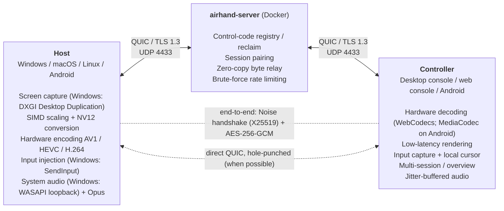

# How it works

[← Back to README](../README.md) · [简体中文](architecture.zh-CN.md)

## Architecture

For how the host is implemented on each platform, see the [table below](#the-host-on-each-platform). How the two ends also talk without the relay: see [Direct path](#direct-path).

The first bidirectional stream on every QUIC connection is the **signaling stream**. When a controller starts a session it hands the first message of the end-to-end handshake to the server along with the request (`ClientMsg::Connect::init`), and once the server approves, it passes it on unchanged in the notification to the host (`ServerMsg::Incoming::init`): the host can answer as soon as it is notified instead of waiting for the controller to get the approval and open its lanes first, saving a round trip. Each "lane" of a session (control, video, bulk) is a **unidirectional stream**: each end opens streams only for the lanes it sends on, starting with a 16-byte session header (session ID, lane number, priority); the server opens a unidirectional stream to the other end, writes the same header and then **only forwards bytes**. The server doesn't pair streams and doesn't know how many lanes a session has or what they are (each end may open each lane once, and the number is limited), so new lanes don't need a server update; the session ends when either end's control lane (lane 0) ends. Once the **end-to-end handshake** is done on the control lane (Noise, see `crates/airhand-proto/src/handshake.rs` and [Security](security.md#end-to-end-encryption)), every frame on every lane and every datagram is encrypted (AES-256-GCM, one key per lane and direction), so the server can't read or alter the session. Each ciphertext carries its counter (the nonce): on the control and bulk lanes they must follow one another (the relay can't drop or reorder a single input message); for video and audio they only have to be new, so video can later be split across streams or drop stale frames without changing the encryption format. Each audio packet is a **QUIC datagram** starting with the 8-byte session ID and a kind byte (audio, path probe or control) in the clear, followed by the ciphertext; the server forwards it unchanged to the other end of that session if the sender is one of its two ends (see `datagram` in `crates/airhand-proto/src/lib.rs`). Pings, pongs and frame acknowledgements, control messages where only the latest value matters and a lost one does no harm, are datagrams too (`session::ControllerDatagram` / `HostDatagram`): they never queue behind other control messages or wait for a lost packet. Ordering is guaranteed within each lane, not across lanes; capture timestamps synchronize audio and video. Every message is a `u32` length prefix followed by a payload: numbered CBOR messages on the signaling stream and the session's control and bulk lanes (unknown messages and fields are skipped, see [Protocol evolution](#protocol-evolution)), and **media packets** on the video lane (a header, 24 bytes for now, plus the bitstream, see `crates/airhand-proto/src/media.rs`; audio datagrams carry audio packets in the same format). Large messages (clipboard text up to 1 MiB, cursor images) go on the bulk lane, which has the same priority as video: on the control lane a 1 MiB clipboard would hold up input for over a second on a 5 Mbps uplink, and stale-input protection could drop real input. The media header's fourth byte is its length, so fields can be appended later without breaking older UIs (they read the payload from that offset and ignore what they don't know). The controller decrypts a packet in place, peeks at the header and hands it to the UI (WebView, browser, Android) **unchanged**: no re-encoding, no extra copy. When a controller reconnects it presents the resume token it got when it connected; if the host is offline the server remembers the request and sends `HostOnline` when the host is back (see "Resume tokens" in `crates/airhand-proto/src/signal.rs`).

All three UIs talk to the controller service with the same JSON (the desktop and web consoles over the same WebSocket protocol, Android over JNI): operations on a session are `airhand_link::controller::Command`, session events are `SessionEvent`. `crates/airhand-link/tests/protocol.json` holds protocol samples (media packets, input events, commands) generated by a Rust test; the TypeScript and Kotlin tests read the same file, so the three implementations can't drift apart silently.

The host's connection to the server (registering, reclaiming the code, disconnecting all controllers, changing the code), the session's lanes and the session itself live in `airhand_link::host`, shared by the desktop and Android hosts. Everything protocol-level happens once, in `host::serve`: the approval flow, detecting a silent controller, sending `Bye` when the local user disconnects everyone, validating quality settings. Pings are answered, and frame acknowledgements handed to the platform (`host::Platform::acks`), right in the session's read task rather than in that loop: the loop may be waiting for the platform to do something slow (switching displays waits for the encoder thread to exit), and late pongs and acknowledgements would look like a slower network to the controller's RTT and to the host's rate control. Each platform implements the `host::Platform` trait for what really differs: capture, encoding, input injection and how to ask the local user. Messages to the controller go through `host::Outbox`, which picks the lane per message (clipboard and cursor shapes on the bulk lane) and keeps only the latest value of pure state (display list, cursor visibility), sent ahead of queued messages, the same design as the controller's command queue.

**The mouse** normally uses absolute positions (where the local pointer is on the picture, the remote cursor is). When the host hides its cursor (holding the right button to turn the camera in a game, first-person games) the controller switches to relative movement: the game keeps pulling the cursor back and only looks at how far it moved, so absolute positions fight it (the camera jumps, and stops turning at the edge of the picture). Hosts inject relative movement like a real mouse (Windows `SendInput`, macOS `CGEvent` with deltas, X11 XTEST relative motion). The console then locks the local pointer (Pointer Lock with raw movement), Esc releases it; it can also be locked manually (Ctrl+Alt+Shift+M or the toolbar). On Android, trackpad slides and touch drags send relative movement and an external mouse is captured (pointer capture); the menu also has a mouse lock. macOS hosts can't detect a hidden cursor: lock the mouse manually there.

The two ends first complete the end-to-end handshake: they check each other's identity (the controller only accepts the host key it remembered; the host decides whether to let this controller in: paired, entered the pairing code, or the host lets anyone in), and agree on the session version and capability bits. Then the host answers with `Hello` (platform, whether it accepts multi-touch, which system actions it supports) and starts sending video, as soon as it has sent its handshake verdict and without waiting for the controller's confirmation (see "Starting the session" below). A host may first answer "awaiting approval" and send `Hello` only after the person at it allows the connection (Android does by default, and recognizes controllers it allowed before by their public keys; see the module docs of `crates/airhand-proto/src/session.rs`).

### Direct path

Through the relay every byte is encrypted and decrypted by QUIC twice, retransmitted by two separate loops and queued on the relay; when the relay is far away (cross-border) that is very noticeable. The end-to-end encryption doesn't care how frames travel, so once a session has started the two ends also open a **direct path** and send the very same sealed frames (same keys, same counters) over it (`crates/airhand-link/src/direct/`, protocol notes in `crates/airhand-proto/src/lib.rs`):

- **Addresses**: at session start the server tells each end the public address it sees *for that end* (`ServerMsg::Incoming::observed`, `SessionGrant::observed`). After the session has started (after the user at the host allowed it), the host sends its candidates and the fingerprint of its direct-path certificate (`HostMsg::Direct`: that public address, the address it uses toward the relay, and the IPv4 (usually a LAN address) and IPv6 addresses it uses toward the internet, all on the relay socket's port) over the encrypted control lane, and the controller answers with its own (`ControllerMsg::Direct`). The relay socket is dual-stack, so the two ends can connect over public IPv6 even when the relay is reached over IPv4: IPv6 usually has no NAT and often works where IPv4 hole punching fails (symmetric or carrier-grade NAT). The relay never sees LAN addresses, and a controller that hasn't been let in never learns the host's address
- **Punching**: both ends use **the UDP socket they use for the relay** (same port, so the same NAT mapping the server saw). The host sends a few 4-byte punch packets (not QUIC, quinn drops them) to the controller's candidates to open its own NAT; the controller starts a QUIC connection (ALPN `airhand-direct/1`) to each of the host's candidates, the first one to connect wins. Several candidates can reach the same host (a LAN address and IPv6, a hairpinned public address, two addresses of one machine), so several connections may complete: the controller decides, opens its control lane on the winner right away and closes the rest, and the host uses the connection on which that lane arrives rather than the first one it accepted (otherwise the two ends could pick different connections and the path would never be usable). The host's endpoint only accepts direct connections while one of its sessions is offering candidates. With a symmetric NAT (or a firewall dropping UDP) this fails, and the session simply stays on the relay; the host retries a couple of times and gives up
- **Authentication**: each end has a throwaway self-signed certificate whose fingerprint it sends over the encrypted control lane (`DirectOffer::cert`), and mutual TLS on the direct connection only accepts those two fingerprints (just like WebRTC puts DTLS certificate fingerprints into its signaling): when the TLS handshake completes, each side already knows the other is this session's other end, a man in the middle can't impersonate either side, and nothing needs to be proven after connecting. The frames on it are end-to-end encrypted anyway
- **The control lane and control datagrams go both ways**: every frame is written to the relay (a complete copy) and, while the direct path is up, also to the direct path (lanes there are unidirectional streams with the same session header). The receiver merges them by counter and drops duplicates (`crates/airhand-link/src/merge.rs`; a control datagram is the same copy on both paths, and the replay window drops whichever arrives second): input, acknowledgements and pings always take whichever path is faster, and nothing is lost if the direct path dies. On the relay copy the counters must still follow one another, as before. The bulk lane (clipboard, cursor images) only uses the relay: it isn't latency-sensitive, and a 1 MiB clipboard doesn't need to be sent twice
- **Video and audio take one path**, chosen by the host: every 250 ms it sends a probe datagram on each path, which the controller re-encrypts and bounces back on the same path; per path the host takes the smallest round trip of the last 10 s, i.e. the latency of the path itself (the path carrying the video always has some queueing, which is the rate control's business; comparing that against an idle path would make the video flip back and forth). It switches to direct as soon as the direct path is measured and isn't slower than the relay (by more than 2 ms; when they're about the same, direct saves the relay's bandwidth), and back to the relay only after the relay has been clearly faster (5 ms or 10%) for 3 s. The direct path can be slower than the relay (carriers routing around each other); then the video simply stays on the relay. Paths only change between frames, and the receiver puts video frames back in counter order (new-path frames wait for the old path's last ones)
- **When the direct path breaks** (no echo for a second, or writing to it stalls): the host moves video and audio back to the relay immediately, tells its rate control that frames in flight are gone (`host::Acks::path_changed`, so the encoder isn't stuck waiting for acknowledgements that will never come; the delay baselines are re-measured on every switch) and encodes a keyframe; the receiver doesn't wait for frames lost on the direct path, because **a keyframe never waits for earlier frames** (and after 1 s it stops waiting anyway and asks for a keyframe). Input and control messages are unaffected (the relay has a full copy). Once the direct connection is gone the host offers another round
- The console shows which path the video takes (Direct / Relayed after the latency, `SessionEvent::Stats::direct`)

### Protocol evolution

- **Two versions**: the signaling version (client ⇄ server, including the session header and the datagram's session ID) and the session version (host ⇄ controller, never checked by the server). Neither has to match exactly: each side supports a range and the highest common version wins. The server only checks the signaling version, so changing the session layer never requires a server update; the session version is negotiated inside the encrypted handshake
- **Only the version range of the version handshake is frozen**: `ClientHello` / `ServerHello` are CBOR maps whose keys 0 and 1 are always the supported version range (`signal::Versions`). The server reads just those two keys first and computes the highest common version; without one it answers with its own range, so any two versions can still tell each other that they're incompatible, while the handshake's other fields can still be added or dropped (`version_handshake_is_frozen` guards this)
- **Unknown messages are skipped, not fatal**: messages are minicbor CBOR with explicit numbers for every variant and field. A message from a newer version is skipped; a message that is known but undecodable is still an error, including an unknown variant somewhere it wasn't explicitly allowed (silently dropping, say, a whole `Hello` would leave the session hanging with no error). Fields can be added as `Option`s. Enums that are just a number (codec, platform, end reason, handshake pattern…) are "open": an unknown value decodes as `Unknown(n)` and keeps the raw number for logs. Enums with fields can only be skipped at three marked places: a whole message, `opt` (an optional field) and `open_vec` (an element of a list); see `crates/airhand-proto/src/cbor.rs` for why
- **The end-to-end handshake has no version number**: how it works is decided by the pattern (`Known` / `First` / `Pairing`). Changing it means adding a pattern; a host that doesn't know the pattern lists the ones it does, so the controller can tell which side needs updating
- **Starting the session**: the controller's introduction in the handshake carries the initial quality settings and whether it wants sound, so the host builds the right encoder once instead of starting with defaults and rebuilding a moment later. The host starts capturing and sending video as soon as it has sent its verdict, without waiting for the controller's confirmation (saving a round trip, and overlapping the encoder's start-up with it); it only shows the controller, or asks the local user, after decrypting the confirmation (the controller's first encrypted frame on the control lane), and ends the session if it doesn't arrive within 10 s. A replayed first `Noise_IK` message gets an answer but can't produce the confirmation, and can't decrypt the video either (only the real controller can derive the session keys)
- **Capability bits**: the version handshake and the end-to-end handshake each carry a `Features` bitset (signaling and session namespaces). Only what both sides support is used (both ends of a session compute the same `Negotiated { version, features }` and hand it to the session code); unknown bits are ignored; bits are never reused. Device abilities (touch, codecs, displays) stay data in `HostHello`, not capability bits
- The version only goes up for changes that can't be made compatibly

The web console splits the controller on the right in two: the QUIC connection and session handling run in `airhand-web` (the container), while decoding, rendering and input capture stay in the browser, with one WebSocket in between. Media packets are forwarded to the browser unchanged (with a 4-byte session number in front), and the browser acknowledges the frames.

The desktop console speaks the same WebSocket protocol (`crates/airhand-link/src/console.rs`) to a server inside the app that only listens on 127.0.0.1, with a random token in the URL and only the console page's Origin accepted. It doesn't use Tauri's IPC for sessions: its commands and channels run on the main thread, where a stream of frames would hold up input and acknowledgements. In both consoles the WebSocket, WebCodecs decoding and drawing to an OffscreenCanvas run in a Worker (`client/src/lib/console-worker.ts`); the page's main thread only handles JSON and the UI, and decoded audio goes from the Worker straight to the AudioWorklet.

The console's Worker acknowledges each frame as it arrives, so the last hop is counted too. Acknowledgements are cumulative, so frames arriving within 8 ms of each other are acknowledged once (as 9-byte binary WebSocket messages, not JSON). An acknowledgement also carries the time the frame started arriving from the network (the controller's clock, taken by the controller service in Rust when it reads the frame's length prefix): the host subtracts its own send time and the recent minimum, which gives how long the frame queued on the way, excluding the UI hop and the frame's own transmission time; the bytes received between two such times give the delivery rate (see below). Acknowledgements and pings are control datagrams and never queue behind input. Datagrams can be lost, and if the lost one is the last acknowledgement (the picture stopped, or the host's in-flight window is full and waiting for it) the host would wait forever, so without a newer acknowledgement the controller resends the latest one every 30 ms, three times, and then once a second with each ping. Controller commands are bounded to 128 messages / 2 MiB. Quality settings keep only their latest value and are sent ahead of queued input; adjacent mouse movements are coalesced. Input queued for more than two seconds (or a full queue) is dropped and replaced by a "release all keys", and the session carries on instead of replaying stale operations; a genuinely lost host is detected by the 20-second timeout. Writing to QUIC doesn't block while the network is down, so input that was already written waits in QUIC's send buffer and still goes out once the network recovers. Each input batch therefore also carries the time the controller received it (the same clock as pings): the host keeps the minimum of "time received − that time" as its baseline (clock offset plus the fastest trip, no clock synchronization needed), and input arriving more than two seconds later than the baseline isn't executed but replaced by one "release all keys" (`InputClock` in `airhand_link::host`). The baseline may rise by at most 1 ms per second, enough to follow clock drift; five seconds of nothing but late messages means the path itself got slower, and the baseline is taken again. A desktop host hands the input it receives to a per-session injection thread and the session task doesn't wait for it (typing a long text on X11 takes seconds): pings, frame acknowledgements and disconnects are still handled meanwhile, and later input isn't read late and mistaken for stale. WebSocket output has both a message limit and a 32 MiB byte budget.

Video flow control and the bitrate live in `airhand_link::flow`, one per session. End-to-end congestion control can only happen there: the relay splits the QUIC connection in two, and each half's congestion control only sees its own hop. Unacknowledged video is limited in **bytes**: bitrate × (base RTT + 50 ms), the base RTT being the sliding 10-second minimum, at most 32 frames and 4 MiB (the relay's connection to a controller has one send window shared by all its sessions, and video filling it would also hold up `Bye`); when nothing is in flight one frame can always go, however large. The bitrate is updated on every acknowledgement. If the last three frames all queued more than 30 ms (or queued at all while the byte limit was already holding frames back), it drops to 85% of the bandwidth measured while the link was busy (by at least 10%), then waits a round trip plus the queue before looking again; if two cuts don't shrink the queue, the path itself got slower (a new route, another download filling the router's buffer) and the current delay becomes the new baseline. With less than 10 ms of queueing and the encoder actually using at least half the estimate, it rises by about 15% a second (4% near the bandwidth of the last congestion) up to the quality setting; an idle screen doesn't raise it. The encoder only gets a new value when it moves by 5% or more. With adaptive bitrate off the encoder keeps the configured bitrate, but the byte limit still follows the estimate, so a slow network costs frames instead of building up lag. If the oldest frame remains unacknowledged for 20 seconds, the session ends so the controller can reconnect even if control heartbeats still work.

Control frames are limited to 64 KiB. Long input batches are split at UTF-8 boundaries, preserving order and their original timestamp. Bulk frames are limited to 2 MiB, and both ends check message lane assignments. The host uses separate control and bulk inboxes, so clipboard traffic cannot fill the input inbox.

The Android controller's reliable Kotlin inbox is bounded to 256 messages / 32 MiB. Audio keeps the latest 16 packets in a separate queue, and stats keep only their latest value. Audio cannot evict video waiting for an ACK. Reliable overflow ends the session with a separately retained terminal event, allowing the UI to reconnect.

The Android host shares one encoder but accounts for each viewer separately (bytes in flight and bitrate estimate). Slow viewers skip frames and resume at a keyframe while other viewers continue; encoding waits only when every viewer's window is full, and the shared encoder uses the highest estimate among the viewers still receiving. Shared quality combines the viewers' requests: the highest frame rate and target bitrate, the strictest nonzero size limit, and the common H.264 baseline when codec preferences differ. A background viewer therefore cannot force the foreground viewer down to 5 fps. Sharing one encoder still means viewers cannot receive different codecs or resolutions simultaneously.

Cursor visibility and the shape reference (`HostMsg::Cursor`, latest value only) use the control lane, while images (`CursorImage`) use the bulk lane. References include a slot and generation, so late images cannot undo the latest visibility or overwrite a reused slot. The link library merges them before forwarding the existing media format to each UI.

The desktop input thread checks cancellation between every event and every text piece of at most 512 characters; the frontend splits by Unicode code point. Clipboard reads and writes each use one background task. Reads are cached by the system clipboard sequence; sessions only collect completed results. Writes are serialized and keep only the latest pending update, suppressing intermediate echoes. Browser clipboard writes are also serialized, with the latest pending value replacing old retries; update generations discard reads superseded by remote changes.

Fixed codes are queried from an in-memory index. A dedicated SQLite worker coalesces updates per code. When a binding really changes (a new binding, a new secret) the registration waits outside broker locks until that write is committed, then publishes; the wait is by write sequence number, so later writes from other hosts don't delay it. Shutdown also flushes. Runtime write failures retain in-memory ownership and retry. Failure to open or read the configured database, or an unsupported schema version, prevents server startup instead of replacing existing ownership with an empty index. A persistence-barrier timeout is logged and service continues in memory; a forced exit can then lose uncommitted updates.

Host secrets are issued by the server (a nonce plus an HMAC with the server's own key, stored in `airhand.db`): getting a free code back requires a secret issued for that code, so registration can't be used to probe which codes are in use. When the user at the host disconnects all controllers, the host asks the server for a new secret (`Rekey`), which voids every resume token handed out so far. A host that sent `Rekey` but never got the answer (it got disconnected) registers next time with `rekey` set, and the server changes the secret while giving the code back: the server may never have received the `Rekey`, or restarted before recording it, which would make the old secret valid again and bring the old tokens back with it.

`Rekey` carries the secret the host has received and handed to local persistence (`secret`). Repeated requests with the same previous secret return the same result, so losing successive replies cannot discard ownership. The host allows one outstanding rekey; further kicks are coalesced into another rekey after the reply.

A resume token has two halves: the first is the server's signature (with its own key) over the **control code**, proving that whoever holds it connected to that code before (verifiable while the host is offline and after a server restart); the second is derived from the code and the host's current secret, so it stops matching when the secret changes. That lets the server tell "the host is offline" (`Offline`, wait for it) apart from "the token is void" (`Revoked`: the host is online but changed its secret, or the token wasn't issued for this code at all). Opening an offline device from My devices just waits; the controller no longer tries the control code alone to rule out a void token (which would count as a wrong guess). After `Revoked`, a connection the user asked for (opened from My devices) tries again without the token; an automatic reconnect stops.

### Source layout

| Directory | Contents |
|---|---|
| `crates/airhand-proto` | Protocol: signaling and the version handshake, the end-to-end handshake messages, session control messages, media packets, framing and compatibility rules. Encoding and decoding only: no IO and no async runtime, so it builds for wasm and every parser takes plain bytes (easy to fuzz) |
| `crates/airhand-link` | The client side of the relay link: QUIC, certificate pinning, reconnects, end-to-end encryption (`secure`: identities, Noise handshake, per-lane encryption), reading and writing frames on streams (`wire`), where a session's lanes and datagrams come from and go to (`lanes`), the direct path between the two ends (`direct`: hole punching, TLS that only accepts the peer's certificate fingerprint, which path the video takes) and merging frames from several paths by counter (`merge`), UI-independent controller sessions and UI commands (`Command`), the host's server connection and sessions (`host`), `Problem`. Shared by the desktop client, the web console and Android (everything but `wire` is behind the default `client` feature; the relay server only uses `wire`); `tests/protocol.json` holds the protocol samples shared by all three |
| `server/` | Relay server (quinn + rustls) and its `Dockerfile`. `src/broker/`: `registry` (control codes, connection requests), `relay` (pairing and forwarding session lanes and datagrams), `limits` (rate limits), `tokens` (secrets and resume tokens); the lock order is checked in debug builds (`lock.rs`) |
| `web/` | Web console service (axum: static files + WebSocket, HTTP and HTTPS on one port), its `Dockerfile` and `docker-compose.yml`. A separate Cargo workspace, like `client/src-tauri/` |
| `client/src-tauri/` | Desktop client, Rust side: host `host/`, tray, console window and commands |
| `android/native/` | Android Rust core (JNI): the controller uses `airhand-link`; the host's network side (the server connection, the session and its lanes come from `airhand_link::host`, Android only implements `host::Platform`; in-flight control and rate control are the same as the desktop). A separate Cargo workspace like `client/src-tauri/` and `web/` |
| `android/app/` | Android app (Kotlin + Jetpack Compose): phone and TV interfaces, MediaCodec decoding / encoding, screen recording, accessibility service (remote control) |
| `client/src/` | `lib/session.ts` manages sessions, `connection-attempt.ts` isolates connection generations, `media.ts` parses media packets, `video.ts` owns decoding / video queues, `input.ts` owns input (including relative movement and pointer lock); console UI (React 19 + TypeScript, no UI library), shared by the desktop and web consoles, which differ only in `client/src/lib/backend/`; strings in `client/src/locales/` |
| `assets/icon.svg` | Application icon source |

### The host on each platform

On Windows all of this runs in the system service (see [Windows service](#windows-service)):

| Stage | Windows | macOS | Linux (X11) | Android |
|---|---|---|---|---|
| Screen capture | DXGI Desktop Duplication | ScreenCaptureKit | MIT-SHM shared memory + DAMAGE change notifications; RandR for multiple monitors | MediaProjection (a virtual display rendering straight into the encoder) |
| Cursor shape | DXGI | NSCursor | XFIXES | — |
| Video encoding | Media Foundation hardware encoders, OpenH264 fallback | VideoToolbox hardware encoders (H.264 / HEVC), OpenH264 fallback | OpenH264 | MediaCodec (hardware encoders preferred) |
| Input injection | SendInput (scan codes; relative movement like a real mouse) | CGEvent (virtual key codes; relative movement with deltas) | XTEST (evdev physical key codes; relative motion) | Accessibility service (gestures, system actions, text input) |
| Hidden cursor (switch to relative movement) | DXGI | Not detected (lock manually) | XFIXES (fully transparent cursor) | — |
| Audio capture | WASAPI loopback | ScreenCaptureKit (system mix) | PulseAudio / PipeWire output monitor | AudioPlaybackCapture (Android 10+) |
| Clipboard | Change detection via the clipboard sequence number | NSPasteboard change count | XFIXES selection-owner change notifications | Write only (controller → phone) |
| Console UI | WebView2 | WKWebView | WebKitGTK (WebCodecs decoding via GStreamer) | Jetpack Compose (MediaCodec decoding) |

## Windows service

The same `airhand.exe` plays several roles depending on its command line (`client/src-tauri/src/winsvc/`):

| Process | Runs as | Does |
|---|---|---|
| `airhand.exe` | the signed-in user | Tray and console |
| `airhand.exe --service` | SYSTEM, session 0 | The Airhand service: starts the host in the console session (the one at the physical screen) and watches it; moves it when the console session changes (switching users, signing out) and restarts it if it exits |
| `airhand.exe --agent` | SYSTEM, console session | The host: server connection, capture, encoding, input, audio, clipboard |
| `airhand.exe --install` / `--uninstall` / `--stop-service` | administrator | Called by the installer |

- Desktop Duplication and `SendInput` only work on the desktop the calling thread is on. UAC prompts, the lock screen and the sign-in screen are on the secure `Winlogon` desktop, which only SYSTEM can open; the capture and input threads switch to whichever desktop currently receives input before using it (`client/src-tauri/src/host/desktop.rs`)
- The tray and the host talk over a named pipe per session (`\\.\pipe\airhand-host-<session>`), one JSON message per line. Only interactive users can connect, they can't open another instance of the pipe to impersonate the host, and the tray checks that the pipe belongs to SYSTEM
- The service and the host have no console: they log with `OutputDebugString` (see [Debugging the Windows service](development.md#debugging-the-windows-service))

## Video

| Stage | How it works |
|---|---|
| Capture | Frames are only produced when the screen changes (DXGI on Windows, ScreenCaptureKit on macOS, DAMAGE on X11), so an idle desktop uses almost no bandwidth. The frame rate is limited by the frames' own timestamps (`client/src-tauri/src/host/pace.rs`, the same on Android), not by when the previous frame was done, so processing time never adds up to lag or periodically skipped frames |
| Refinement when still | A frame with a large change (switching windows, scrolling) only gets about one frame's worth of bitrate, so text comes out blurry. 200 ms after the screen stops changing, the last frame is encoded a few more times; the encoder only has to code the residual, so within a few frames it is close to the original (until the encoder has nothing meaningful left to add, at most 8 frames), then nothing more is sent |
| Preprocessing | `fast_image_resize` (SIMD, Catmull-Rom) for scaling, split into horizontal stripes scaled on several cores at once (scaling is on every frame's critical path: on an Apple M1, 2880×1800 → 1080p drops from about 18 ms to about 9 ms, pixel-identical to scaling the whole image), `yuvutils-rs` (AVX2) for BGRA→NV12/I420; all buffers are reused |
| Encoding | **Hardware first**: Media Foundation hardware encoders (NVENC / Quick Sync / AMF) for **AV1 / HEVC / H.264**, low-latency mode, no B-frames, very long GOP; on macOS VideoToolbox (H.264 / HEVC, low-latency rate control for H.264). Without one it falls back to **OpenH264 in screen-content mode**. Formats are ranked **AV1 > HEVC > H.264**; the most efficient one both sides support (the host can encode, the controller can decode) is picked automatically |
| Rate control | The controller ACKs every frame. The host caps **in-flight bytes** (≈ bitrate × (base RTT + 50 ms)); on a slow network it waits and **skips to the newest frame** instead of building up lag. The bitrate follows the measured queueing delay and bandwidth on every ACK (see above) |
| Transport | QUIC with **BBR**. Control and video use separate bounded queues and QUIC streams, audio uses QUIC datagrams, avoiding video stream head-of-line blocking. Connection bandwidth is still shared; the console's final hop (loopback on the desktop) remains a single WebSocket. When a [direct path](#direct-path) can be punched and isn't slower than the relay, video and audio take it and bypass the server |
| Decoding | The controller decodes on the GPU with **WebCodecs** (`optimizeForLatency`) and paints straight into a `desynchronized` Canvas |
| Display | The picture is **scaled only once**: the controller requests the resolution the picture actually occupies in the window, in device pixels (never above the user's cap), the host scales straight to it, and the controller shows it 1:1 aligned to device pixels (see `client/src/lib/fit.ts`). A second scaling in the browser (especially by a factor close to 1, or at half-pixel offsets) makes text blurry |
| Cursor | The remote cursor's **shape** is mirrored to the local cursor and movement is handled locally, so there is **no perceptible cursor lag**. Shapes are cached in slots (32 per session, the host decides what goes where): the frames an animated cursor (a busy spinner, say) keeps cycling through are sent as images once, after that only their slot goes over the control stream, and the UI caches the rendered cursor per slot too |
| Background sessions | Sessions that aren't on screen drop to 5 fps |

Measured locally (RTX GPU, 4K display output at 1080p): hardware AV1 encodes a frame in about 7 ms, H.264 in about 9 ms; OpenH264 software encoding takes about 40 ms.

## Audio

The host's system sound (not the microphone) is streamed to the controller:

| Stage | How it works |
|---|---|
| Capture | Loopback capture of the default output device, converted to 48 kHz stereo; follows the default device when it changes (e.g. you plug in headphones) |
| Encoding | Opus at 96 kbps, 20 ms per packet; **no packets during silence** |
| Transport | **QUIC datagrams**, forwarded by the server per session: a lost packet isn't retransmitted and later packets don't wait for it (a gap of a few dozen milliseconds beats stalling the whole stream for a retransmission); datagrams go ahead of all streams in each QUIC packet. A full queue drops packets rather than blocking capture, and QUIC's datagram send buffer is only 64 KiB, so a congested link drops the oldest audio instead of falling further behind. Datagrams can be reordered; the controller drops late packets by capture time, using sequence numbers for ties. `start` cannot reset ordering, while newer capture times still allow a restarted capture source. The Opus encoder caps packets at what fits in a datagram; oversized packets (only possible from encoders that can't be capped, such as Android's MediaCodec) are dropped |
| Playback | WebCodecs decoding → AudioWorklet adaptive jitter buffer: about 40 ms on a stable network, growing under jitter and shrinking back once stable. A ±1–2% speed adjustment cancels the clock drift between the two sound cards, and a large backlog is skipped |

Only the session you are looking at plays audio (none do in the multi-screen overview); the other hosts are told to stop capturing.

When the host can't capture sound (no audio output device, or no PulseAudio / PipeWire running on Linux, for example), the controller shows a message, the speaker in the toolbar gets a yellow dot and the sound menu gives the reason. The host retries every 2 seconds, and the message goes away once it recovers.

## A/V sync (optional, off by default)

Audio goes through a jitter buffer while video is shown as soon as it arrives, so by default audio lags video slightly: about **70 ms** in our measurements (same machine, local relay, 4K output at 1080p; 49–78 ms per run). That's barely noticeable while working, but may be when watching video.

With **A/V sync** turned on (speaker menu in the toolbar):

- Video frames and audio packets both carry the host's capture time on the same clock (DXGI present time and WASAPI QPC timestamps). The controller measures the capture → display/playback latency of each stream separately; **the clock offset between the two computers cancels out**, so no time sync is needed
- Normally each frame is delayed until it lines up with the audio. If the video is the slower one (tight bandwidth), the audio is buffered longer instead (up to 300 ms); a single slow frame doesn't trigger this
- Measured residual offset: **−3 to −4 ms** on average (negative = audio slightly early), worst case −31 ms, inside the range generally considered imperceptible (audio ahead by up to about 45 ms)
- Trade-off: video appears about 70 ms later, so typing and dragging feel slower; it suits watching video, not working. The cursor is drawn locally and is unaffected. The toolbar shows "Sync +N ms"

The delay from painting to the Canvas to the pixels lighting up is estimated at 8 ms (not measured with a camera).

## Files on disk

- Everything Airhand saves (settings, this computer's control code, My devices) is in one `config.toml` (see [Configuration file](usage.md#configuration-file)). Logs never go to files: stderr, or `OutputDebugString` for the Windows service
- Host mode **doesn't create a WebView**, so Airhand itself creates no files at all (for the directories macOS frameworks create under Airhand's name, see below)
- The single-instance lock is a kernel object, not a lock file: a named mutex on Windows, an abstract-namespace Unix socket on Linux, a Mach port name registered with the bootstrap server on macOS
- The console's WebView needs a data directory: it lives in a random subdirectory of the temp directory, runs in private mode (no cookies or cache saved), and is deleted when the window closes or the program exits. If the process is killed, leftovers are removed on the next start. On macOS WKWebView needs no data directory and keeps no website data in private mode
- On macOS a few things are kept by the system rather than in Airhand's directory: Open at login (a system login item) and the permission records (Screen & System Audio Recording, Accessibility…). WebKit and Metal also create a few directories named after Airhand's bundle ID in the system's temporary and cache directories (`getconf DARWIN_USER_TEMP_DIR`, `DARWIN_USER_CACHE_DIR`): `*app.airhand.client`, mostly empty, at most a small GPU shader cache. See [Uninstalling](usage.md#uninstalling) for removing all of them
- On Linux, the few things that can only be handed over as files (the tray icon for AppIndicator, WebKitGTK's GStreamer plugin cache) live in a random per-process directory under `XDG_RUNTIME_DIR` (a RAM disk) that is removed on exit, including on SIGTERM / SIGINT. The Mesa / NVIDIA on-disk shader caches are turned off
- Other console settings (the UI language, closed tabs…) live in memory only
- Android: settings, saved devices and the phone's control code are only stored in the app's private directory, never backed up or transferred, and removed by the system on uninstall (see [Where the data is stored](android.md#where-the-data-is-stored))
- All of the above is about the desktop client. The web console is a service you deploy: it keeps its self-signed HTTPS certificate in `web/data/`, and the browser also keeps settings in memory only; My devices isn't saved there and is cleared when the page reloads (plus a session cookie when a password is set)
