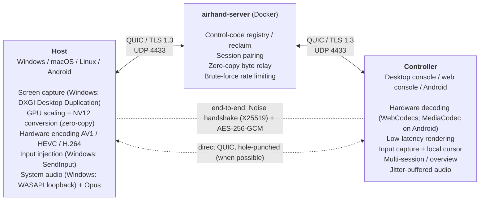

# How it works

[← Back to README](../README.md) · [简体中文](architecture.zh-CN.md)

## Architecture

For how the host is implemented on each platform, see the [table below](#the-host-on-each-platform). How the two ends also talk without the relay: see [Direct path](#direct-path).

The first bidirectional stream on every QUIC connection is the **signaling stream**. The controller includes the first end-to-end handshake message in its connection request (`ClientMsg::Connect::init`). Once approved, the relay passes it on unchanged in `ServerMsg::Incoming`, so the host can answer without another round trip.

Every **unidirectional session stream** starts with a 9-byte header, `session_id u64 LE | lane u8`. Control (0) and bulk (1) each use one persistent stream per end. Video (2–5) uses one stream per frame, and files (6) use one stream per fetch. The relay derives the priority and stream limits from the lane number. It then forwards available `Bytes` chunks in batches without copying payloads or waiting for a full batch. The session ends when either end's control lane ends. See `crates/airhand-proto/src/stream.rs`.

After the [Noise handshake](security.md#end-to-end-encryption) on the control lane, every frame and datagram is encrypted end to end with AES-256-GCM. A counter at the end of the ciphertext must be sequential on control and bulk; video and audio allow gaps and reordering, but reject replays. Stream messages have a `u32 LE` length prefix. Signaling, control and bulk carry CBOR; video carries [media packets](#video). The controller decrypts media in place and hands the packets to the UI unchanged.

Audio, pings, pongs, acknowledgements and probes use **QUIC datagrams**: an 8-byte session ID and a kind byte in the clear, followed by the ciphertext. The relay uses the session ID to find the other end and forwards the packet unchanged. When the send buffer is full, control datagrams favor new values over old ones instead of waiting. Audio datagrams can include copies of the two preceding packets. See `crates/airhand-proto/src/datagram.rs`.

On reconnect the controller presents its resume token. If the host is offline, the relay remembers the request and sends `HostOnline` when it returns (see `crates/airhand-proto/src/signal.rs`).

All three UIs talk to the controller service with the same JSON (the desktop and web consoles over the same WebSocket protocol, Android over JNI): operations on a session are `airhand_link::controller::Command`, session events are `SessionEvent`. `crates/airhand-link/tests/protocol.json` holds protocol samples (media packets, input events, commands) generated by a Rust test; the TypeScript and Kotlin tests read the same file, so the three implementations can't drift apart silently.

The host's connection to the server (registering, reclaiming the code, disconnecting all controllers, changing the code), the session's lanes and the session itself live in `airhand_link::host`, shared by the desktop and Android hosts. Everything protocol-level happens once, in `host::serve`: detecting a silent controller, sending `Bye` when the local user disconnects everyone, validating quality settings. Pings are answered, and frame acknowledgements handed to the platform (`host::Platform::acks`), right in the session's read task rather than in that loop: the loop may be waiting for the platform to do something slow (switching displays waits for the encoder thread to exit), and late pongs and acknowledgements would look like a slower network to the controller's RTT and to the host's rate control. Each platform implements the `host::Platform` trait for what really differs: capture, encoding, input injection, and showing who is connected. Pairing (the pairing code, paired controllers and the budget of failed attempts, `host::pairing`) is shared too; each platform only decides where it's stored (`config.toml` on desktops, the app's private files on Android). Messages to the controller go through `host::Outbox`, which picks the lane per message (clipboard and cursor shapes on the bulk lane) and keeps only the latest value of pure state (display list, cursor visibility), sent ahead of queued messages, the same design as the controller's command queue.

**The mouse** is sent in one of two ways, and whoever decides where the cursor is also draws it:

- Absolute positions: where the local pointer is on the picture, the remote cursor is. The controller decides the position, so the local cursor shows it (with the host's shape) and moves with no delay;
- Relative movement: only how far it moved, injected by the host like a real mouse (Windows `SendInput`, macOS `CGEvent` with deltas, X11 XTEST relative motion). Where the cursor ends up is up to the host (pointer speed and acceleration, screen edges, games pulling the cursor back), so a local cursor can't show it: to see the cursor, the host draws it into the picture (`QualitySettings::draw_cursor`).

The console has three mouse modes built on that (the mouse menu in the toolbar, remembered per device):

- **Auto** (default): absolute positions; when the host hides its cursor (holding the right button to turn the camera in a game, first-person games) it switches to relative movement and locks the local pointer (Pointer Lock with raw movement). The game keeps pulling the cursor back and only looks at how far it moved, so absolute positions fight it (the camera jumps, and stops turning at the edge of the picture). If the cursor comes back while a mouse button is held, that only counts once every button is released: a defensive measure, in case the cursor flickers while the camera turns (jitter in the host's detection, or a game doing it), which would otherwise lock and release over and over; no game has been seen doing this. A cursor drawn into the picture doesn't count as hidden (Windows switches to a software cursor while a window is dragged or resized; `CursorVisibility::InFrame`): absolute positions as usual, and the local cursor stays visible by default (it follows your hand); it can be turned off in the mouse menu or the Android settings;
- **Desktop**: always absolute positions, never locked (for videos, drawing and other programs that hide the cursor but shouldn't lock the mouse);
- **Game**: always locked and relative, with the host drawing its cursor into the picture: Windows copies the frame on the GPU and reads back just the cursor's patch to draw it the way the system does (inverted parts included), X11 draws it in memory, macOS has ScreenCaptureKit draw it. Cursor movement alone also produces a new frame. Whether the host hides its cursor doesn't matter, and the pointer is locked only once per session.

While locked, holding Esc frees the mouse (in fullscreen the keyboard lock hands Esc to the page and the browser no longer uses it to release, so the console does this itself): Auto mode won't lock by itself until the next click; in Game mode the mouse isn't sent until a click on the picture locks it again (that click isn't sent). Ctrl+Alt+Shift+M switches Game mode on and off. In every mode the button state while locked only follows presses and releases: on Windows, mouse moves during pointer lock report `buttons` as 0 (taking that for a release is what once made World of Warcraft lock and release over and over while the camera turned). On Android, trackpad slides and touch drags send relative movement and an external mouse is captured (pointer capture); the menu also has a mouse lock. macOS hosts can't detect a hidden cursor: use Game mode there.

The two ends first complete the end-to-end handshake: they check each other's identity (the controller only accepts the host key it remembered; the host decides whether to let this controller in: paired before, or entered the pairing code just now, on computers and phones alike; the control code alone is never enough), and verify that the session versions match. Then the host answers with `Hello` (platform, whether it accepts multi-touch, which system actions it supports) and starts sending video, as soon as it has sent its handshake verdict and without waiting for the controller's confirmation (see "Starting the session" below). Nobody at the host has to approve anything: once the controller has confirmed the handshake the host shows it (the tray's list on a computer; a notification on a phone, with the safety code).

### Direct path

Through the relay every byte is encrypted and decrypted by QUIC twice, retransmitted by two separate loops and queued on the relay; when the relay is far away (cross-border) that is very noticeable. The end-to-end encryption doesn't care how frames travel, so once a session has started the two ends also open a **direct path** and send the very same sealed frames (same keys, same counters) over it (`crates/airhand-link/src/direct/`, protocol notes in `crates/airhand-proto/src/lib.rs`):

- **Addresses**: at session start the server tells each end the public address it sees *for that end* (`ServerMsg::Incoming::observed`, `SessionGrant::observed`). After the session has started (after the host let this controller in), the host sends its candidates and the fingerprint of its direct-path certificate (`HostMsg::Direct`) over the encrypted control lane, and the controller answers with its own (`ControllerMsg::Direct`). Each end keeps the address and mapped port seen by the relay and the local addresses selected by its routes to the relay and the internet. It fills the remaining slots from active interfaces, including LAN interfaces when the default route goes through a VPN. All local candidates use the relay socket's bound port. Each round offers up to eight addresses, covering different interfaces first and rotating the remaining addresses on retries. The relay socket is dual-stack, so the two ends can connect over public IPv6 even when the relay is reached over IPv4: IPv6 usually has no NAT and often works where IPv4 hole punching fails (symmetric or carrier-grade NAT). The relay never sees LAN addresses, and a controller that hasn't been let in never learns the host's address
- **Punching**: both ends use **the UDP socket they use for the relay** (same port, so the same NAT mapping the server saw). The host sends a few 4-byte punch packets (not QUIC, quinn drops them) to the controller's candidates to open its own NAT; the controller starts a QUIC connection (ALPN `airhand-direct/1`) to each of the host's candidates, the first one to connect wins. Several candidates can reach the same host (a LAN address and IPv6, a hairpinned public address, two addresses of one machine), so several connections may complete: the controller decides, opens its control lane on the winner right away and closes the rest, and the host uses the connection on which that lane arrives rather than the first one it accepted (otherwise the two ends could pick different connections and the path would never be usable). The host's endpoint only accepts direct connections while one of its sessions is offering candidates. With a symmetric NAT (or a firewall dropping UDP) this fails, and the session simply stays on the relay; the host retries a couple of times and gives up
- **Authentication**: each end has a throwaway self-signed certificate whose fingerprint it sends over the encrypted control lane (`DirectOffer::cert`), and mutual TLS on the direct connection only accepts those two fingerprints (just like WebRTC puts DTLS certificate fingerprints into its signaling): when the TLS handshake completes, each side already knows the other is this session's other end, a man in the middle can't impersonate either side, and nothing needs to be proven after connecting. The frames on it are end-to-end encrypted anyway
- **The control lane and control datagrams go both ways**: every frame is written to the relay (a complete copy) and, while the direct path is up, also to the direct path (lanes there are unidirectional streams with the same session header). The receiver merges them by counter and drops duplicates (`crates/airhand-link/src/merge.rs`; a control datagram is the same copy on both paths, and the replay window drops whichever arrives second): input, acknowledgements and pings always take whichever path is faster, and nothing is lost if the direct path dies. On the relay copy the counters must still follow one another, as before. The bulk lane (clipboard, cursor images) only uses the relay: it isn't latency-sensitive, and a 1 MiB clipboard doesn't need to be sent twice
- **Video and audio take one path**, chosen by the host: every 250 ms it sends a probe on each path (a control datagram, `HostDatagram::Probe`), which the controller answers on the same path (`ControllerDatagram::Echo`); per path the host takes the smallest round trip of the last 10 s, i.e. the latency of the path itself (the path carrying the video always has some queueing, which is the rate control's business; comparing that against an idle path would make the video flip back and forth). It switches to direct as soon as the direct path is measured and isn't slower than the relay (by more than 2 ms; when they're about the same, direct saves the relay's bandwidth), and back to the relay only after the relay has been clearly faster (5 ms or 10%) for 3 s. The direct path can be slower than the relay (carriers routing around each other); then the video simply stays on the relay. Paths only change between frames, and the receiver puts video frames back in counter order (new-path frames wait for the old path's last ones)
- **When the direct path breaks** (no echo for a second, or writing to it stalls): the host moves video and audio back to the relay immediately, tells its rate control that frames in flight are gone (`host::Acks::path_changed`, so the encoder isn't stuck waiting for acknowledgements that will never come; the delay baselines are re-measured on every switch) and encodes a keyframe; the receiver doesn't wait for frames lost on the direct path, because **a keyframe never waits for earlier frames** (and after 1 s it stops waiting anyway and asks for a keyframe; the delta frames until that keyframe arrives aren't handed to the UI, since they'd decode to garbage without their reference frames, but they are still acknowledged). Input and control messages are unaffected (the relay has a full copy). Once the direct connection is gone the host offers another round
- The console shows which path the video takes (Direct / Relayed after the latency, `SessionEvent::Stats::direct`)

### Frame streams and reference invalidation

Video used to be a single ordered QUIC stream: one lost packet in a frame held back every later frame that had already arrived (head-of-line blocking), and through the relay there are two QUIC connections with their own retransmissions, so a loss on either leg stalls it. When the retransmission is lost too, or the path is congested, the whole video stream stops for several round trips. Protocol v10 splits it up ("Frame streams" in `airhand_proto::session`):

- **One stream per frame**: each short stream on a video lane carries exactly one frame and then ends; a lane may open many of them (on the relay and on the direct path). A loss only stalls that one frame, later frames still arrive. The server still just forwards bytes and allows at most 256 open frame streams per end per session (`MAX_FRAME_STREAMS`, enough for every stream when several displays are shown); if one end abandons a stream (reset), the forwarded one is reset too
- **Each frame says which frame it references** in the video header (TLV extension, type 1, `VideoHeader::reference`): a delta frame depends only on that frame (and whatever that one depends on, back to a keyframe). The controller uses it to hand only **decodable** frames to the decoder (`crates/airhand-link/src/merge.rs`): once the referenced frame has been decoded, the frame can be decoded no matter which frames in between are missing; undecodable frames aren't given to the UI and are acknowledged on its behalf. The UIs don't need to know (the header length skips the extension as before)
- **A frame that doesn't come**: when later frames have arrived and an earlier one is still missing after one and a half round trips plus 30 ms (60–800 ms), the controller sends `ControllerDatagram::Lost { decoded }` (the last frame handed to the decoder), repeating it every two round trips until a decodable frame arrives. The wait has to outlast QUIC's own retransmission: the sender resends a lost packet 9/8 of a round trip after sending it, and the resend takes another half round trip. Waiting only one round trip reported about half of all single lost packets before their retransmission arrived, needlessly abandoning frames in flight and encoding recovery frames (`merge::loss_wait`; `losses_are_not_reported_before_the_retransmission` in `host::write` checks it over real, lossy QUIC). When the retransmission is lost too or the path is clogged, recovery comes half a round trip later
- **The host recovers**: it abandons the frames after `decoded` that are in flight (their streams are reset so stale data is never retransmitted, and they no longer count as in flight), and the next frame references only frames the controller already has (`crates/airhand-link/src/refs.rs`): if the encoder supports **long-term reference frames** it is predicted from the newest one not newer than `decoded` (reference invalidation: later frames don't reference the abandoned ones either), which is much smaller than a keyframe; otherwise it is a keyframe. A keyframe costs much more than waiting for a retransmission (it is large, takes several frame times to send, and every later frame waits for it), so when only a keyframe will do (including Android hosts) the host recovers only on the **second** report for the same point (the same `decoded`): if the retransmission arrives after the first report, nothing needs encoding (`refs::KeyframeGate`). Repeated requests while a recovery frame is in flight are ignored. The host marks a long-term reference at most every 250 ms (two slots in turn, the older one is replaced only once the controller has acknowledged the newer one), so there's always one before whatever the controller has decoded
- **Fallback**: if recovery never happens (all the datagrams were lost, the encoder doesn't comply), the controller still asks for a keyframe after 1 s (`RequestKeyframe`, on the control lane, which can't be lost)

Which encoders use long-term references (Windows Media Foundation hardware encoders, `CODECAPI_AVEncVideoLTRBufferControl` / `MarkLTRFrame` / `UseLTRFrame`):

| Encoder | Long-term references | Notes |
|---|---|---|
| H.264 (NVIDIA, Intel) | ✅ | Microsoft only specifies the behavior for H.264 encoders; tested: after dropping a few frames, the recovery frame and the ones after it decode bit-identically to the stream without loss (ffmpeg in strict mode) |
| AV1 (NVIDIA) | ✅ | Same, bit-identical in tests |
| AV1 (Intel) | ❌ | Claims every frame went into slot 0 and doesn't comply: the smoke test when the encoder is created (mark a frame, then encode one referencing only it, and check the report) catches it |
| HEVC | ❌ | NVIDIA's reports say only the long-term reference was used, yet it still references the abandoned frames (they decode differently, and the reports don't show it); Intel's doesn't support it |
| VideoToolbox, OpenH264, Android MediaCodec | ❌ | Not wired up yet (VideoToolbox has `kVTEncodeFrameOptionKey_ForceLTRRefresh` and friends, to be added later); recovery uses a keyframe |

`ltr_trusted` (`client/src-tauri/src/host/encoder/mf.rs`) decides which encoders use them; verify a new one with the `ltr_recovery_decodes_without_the_lost_frames` test (needs ffmpeg) before adding it. Abandoned frames make the H.264 `frame_num` skip a few values: the standard lets decoders treat that as lost frames and carry on, which ffmpeg (also the browsers' software H.264 decoder) does in tests; OpenH264's decoder doesn't support long-term references used this way, but controllers never use it to decode. If a decoder really fails, the console still asks for a keyframe.

Frame streams are mandatory in v10. Every 500 ms the controller reports the number of completed and stalled frames per display. Idle displays skip empty reports.

### Multiple displays

When the host has several displays, the controller can see and control several of them at once (one by default; see "Multiple displays" in `airhand_proto::session`). Each display is one video **stream**, and streams share no encoding, rate control or recovery state; only the session itself (control lane, datagrams, the relay and direct paths) is shared:

- Each display has its own lane (`SessionLane::Video(i)`), key, counter and receiver task. Up to four displays share a limit of 256 concurrent frame streams per side.
- **Video header** byte 12 is the stream; the UI hands the packet to that stream's decoder, and the controller checks it matches the lane the frame came on
- **Feedback** all carries the stream: acknowledgements (`ControllerDatagram::Ack::stream`; the console's binary ack gained a byte), lost frames, reception reports, keyframe requests and encoder info. For stream 0 the trailing stream number can be omitted. The host keeps per-stream in-flight and rate control (`host::Flows`), long-term references and stall reports: losing a frame on one stream only recovers that stream. When the streams compete for bandwidth, each one sees the queueing delay and backs off
- **Which displays**: the controller sends `ControllerMsg::View` with the displays to show (item `i` is stream `i`) and, per stream, how large a picture it needs for the size it's shown at (`StreamView::max_short`, combined with the quality setting's cap by taking the stricter; the quality settings themselves apply to every stream alike). The displays to start with are in the handshake intro (`ControllerIntro::view`), so a reconnect doesn't build a single-display encoder first. The host drops missing, duplicate and excess entries (`HostHello::streams`, `host::resolve_view`) and reports what each stream shows in `HostMsg::Displays::shown`; a stream whose display changed gets a new pipeline (starting with a keyframe), one whose size changed only gets new settings. When displays are plugged or unplugged, each stream follows its display by name, and a stream whose display is gone is dropped. `SelectDisplay` remains as shorthand for showing one display (the Android controller uses it)
- **Input**: absolute mouse moves carry the stream (`InputEvent::MouseMove::stream`) and the host maps them with that stream's display; keys and relative movement don't involve the picture
- **The cursor** is one per session: every stream's capture reports it (Windows Desktop Duplication reports per output), and only the display that has the cursor counts (`client/src-tauri/src/host/cursor.rs`). Otherwise, while dragging a window on one display (a software cursor drawn into the frame), the other display keeps saying "shown, on another display" and the controller flips between the two
- **UI** (`client/src/lib/screens.ts`): displays are arranged by their position on the remote desktop (in a row if the positions don't make sense), scaled together to fit the window, with tile edges on whole device pixels so neighbours meet exactly; inside its tile each stream is shown 1:1 or scaled just like a single display, with its own canvas and decoder (both in the Worker) and its own enhancement. The mouse sends coordinates for whichever tile it's over (the nearest one in a gap); keyboard focus and pointer lock sit on the element containing the tiles
- **Separate windows** (`client/src/lib/popout.ts`): a stream can be moved to a same-origin blank page the main window opens with `window.open` (in the desktop app the console window's `on_new_window` turns it into a Tauri window, `client/src-tauri/src/popout.rs`). Everything in it is built by the main window: the stream gets a new canvas created in that window and handed to the same Worker (a transferred canvas can't change windows; the Worker swaps in a new decoder, which asks for a keyframe itself), the mouse and keyboard there are another `RemoteInput`, and the toolbar is rendered into it by the main window's React through a portal. There's still one connection and one decoder per stream; each stream's requested resolution follows the size and scaling of the window it's in, and the main window arranges the remaining ones
- The Android host has a single screen (`streams` is 1, so the console doesn't offer "Show all displays"); the Android controller shows one display

### Protocol evolution

- **Two versions, both exact**: `ClientHello` and `ServerHello` each report one signaling version. The relay does not process requests from a different version. Only the session endpoints see and verify the session version, in the end-to-end handshake. There are no version ranges, fallbacks or protocol capability bits.
- **Device capabilities are data, not protocol versions**: `HostHello` advertises touch, codecs and displays; `HostMsg::Mic` reports whether a microphone can be used. Clipboard file access still depends on platform permissions and the relay's file limit.
- **CBOR messages use explicit numbers**: unknown messages can be skipped, but known malformed messages are errors. Unknown variants with fields can only be skipped as a whole message, in a `cbor::opt` field, or in a `cbor::open_vec` list. These are decoding rules, not support for connecting from older builds.
- **Starting the session**: the controller's introduction in the handshake carries the initial quality settings and whether it wants sound, so the host builds the right encoder once instead of starting with defaults and rebuilding a moment later. The host starts capturing and sending video as soon as it has sent its verdict, without waiting for the controller's confirmation (saving a round trip, and overlapping the encoder's start-up with it); it only shows the controller (and, on a phone, notifies the person holding it) after decrypting the confirmation (the controller's first encrypted frame on the control lane), and ends the session if it doesn't arrive within 10 s. A replayed first `Noise_IK` message gets an answer but can't produce the confirmation, and can't decrypt the video either (only the real controller can derive the session keys)

The web console splits the controller on the right in two: the QUIC connection and session handling run in `airhand-web` (the container), while decoding, rendering and input capture stay in the browser, with one WebSocket in between. Media packets are forwarded to the browser unchanged (with a 4-byte session number in front), and the browser acknowledges the frames.

The desktop console speaks the same WebSocket protocol (`crates/airhand-link/src/console.rs`) to a server inside the app that only listens on 127.0.0.1, with a random token in the URL and only the console page's Origin accepted. It doesn't use Tauri's IPC for sessions: its commands and channels run on the main thread, where a stream of frames would hold up input and acknowledgements. In both consoles the WebSocket, WebCodecs decoding and drawing to an OffscreenCanvas run in a Worker (`client/src/lib/console-worker.ts`); the page's main thread only handles JSON and the UI, and decoded audio goes from the Worker straight to the AudioWorklet.

The console's Worker acknowledges each frame as it arrives, so the last hop is counted too. Acknowledgements are cumulative, so frames arriving within 8 ms of each other are acknowledged once (as 10-byte binary WebSocket messages, not JSON; with several displays each stream is acknowledged separately). An acknowledgement also carries the frame's arrival time (the controller's clock, taken by the controller service in Rust): the later of when the frame started arriving from the network and when the previous frame was handed on, which is when its length prefix would have been read if video were one ordered stream ("Arrival time" in `airhand_link::merge`). The host subtracts its own send time and the recent minimum, which gives how long the frame queued on the way (including waiting for an earlier frame's retransmission), excluding the UI hop and the frame's own transmission time; the bytes received between two such times give the delivery rate (see below). Acknowledgements and pings are control datagrams and never queue behind input. Datagrams can be lost, and if the lost one is the last acknowledgement (the picture stopped, or the host's in-flight window is full and waiting for it) the host would wait forever, so without a newer acknowledgement the controller resends the latest one every 30 ms, three times, and then once a second with each ping. Controller commands are bounded to 128 messages / 2 MiB. Quality settings keep only their latest value and are sent ahead of queued input; adjacent mouse movements are coalesced. Input queued for more than two seconds (or a full queue) is dropped and replaced by a "release all keys", and the session carries on instead of replaying stale operations; a genuinely lost host is detected by the 20-second timeout. Writing to QUIC doesn't block while the network is down, so input that was already written waits in QUIC's send buffer and still goes out once the network recovers. Each input batch therefore also carries the time the controller received it (the same clock as pings): the host keeps the minimum of "time received − that time" as its baseline (clock offset plus the fastest trip, no clock synchronization needed), and input arriving more than two seconds later than the baseline isn't executed but replaced by one "release all keys" (`InputClock` in `airhand_link::host`). The baseline may rise by at most 1 ms per second, enough to follow clock drift; five seconds of nothing but late messages means the path itself got slower, and the baseline is taken again. A desktop host hands the input it receives to a per-session injection thread and the session task doesn't wait for it (typing a long text on X11 takes seconds): pings, frame acknowledgements and disconnects are still handled meanwhile, and later input isn't read late and mistaken for stale. WebSocket output has both a message limit and a 32 MiB byte budget.

Video flow control and the bitrate live in `airhand_link::flow`, one per session. End-to-end congestion control can only happen there: the relay splits the QUIC connection in two, and each half's congestion control only sees its own hop. Unacknowledged video is limited in **bytes**: bitrate × (base RTT + 50 ms), the base RTT being the sliding 10-second minimum, at most 32 frames and 4 MiB (the relay's connection to a controller has one send window shared by all its sessions, and video filling it would also hold up `Bye`); when nothing is in flight one frame can always go, however large. The bitrate is updated on every acknowledgement. If the last three frames all queued more than 30 ms (or queued at all while the byte limit was already holding frames back), it drops to 85% of the bandwidth measured while the link was busy (by at least 10%), then waits a round trip plus the queue before looking again; if two cuts don't shrink the queue, the path itself got slower (a new route, another download filling the router's buffer) and the current delay becomes the new baseline. With less than 10 ms of queueing and the encoder actually using at least half the estimate, it rises by about 15% a second (4% near the bandwidth of the last congestion) up to the quality setting; an idle screen doesn't raise it. The encoder only gets a new value when it moves by 5% or more. With adaptive bitrate off the encoder keeps the configured bitrate, but the byte limit still follows the estimate, so a slow network costs frames instead of building up lag. If the oldest frame remains unacknowledged for 20 seconds, the session ends so the controller can reconnect even if control heartbeats still work.

**Loss lowers the bitrate too**: queueing only shows a bottleneck buffer filling up. On the public Internet, and especially on residential uplinks (which is where a host sends its video), high-rate UDP is often policed: a policer drops what exceeds its rate instead of queueing it. Google measured this in 2016 (*An Internet-Wide Analysis of Traffic Policing*, SIGCOMM): in Asia 6.6% of lossy transfers were policed, losing 24.9% on average (2.9% when not policed), and there are many reports of Chinese residential ISPs limiting UDP uploads. quinn's BBR is BBRv1, without the long-term bandwidth sampling Linux's version uses against policers. So the arrival time includes waiting for an earlier frame's retransmission (see above): after a lost packet the later frames count as arriving late, and rate control treats that as queueing and cuts the bitrate at once, just as when video was a single ordered stream. With each frame's own arrival time only, on a path policed to 5 Mbps (40 ms round trip, 8 Mbps cap) the bitrate stayed at 8 Mbps, kept losing and waiting for retransmissions, frame latency rose from 35 ms to 93 ms and the frame rate fell from 48 to 34; with it the result matches 0.2.3 (`waiting_for_retransmissions_lowers_the_bitrate` in `host::write` checks it over real, lossy QUIC). The cost is that heavy random loss on a path with plenty of bandwidth also lowers the bitrate a lot (to about a fifth at 1% random loss): latency comes first. The host also estimates packet loss from the proportion of stalled frames and recent frame sizes. Above 2% it stops increasing bitrate. Above 10% it reduces bitrate at most once per second.

Control frames are limited to 64 KiB. Long input batches are split at UTF-8 boundaries, preserving order and their original timestamp. Bulk frames are limited to 2 MiB, and both ends check message lane assignments. The host uses separate control and bulk inboxes, so clipboard traffic cannot fill the input inbox.

The Android controller's reliable Kotlin inbox is bounded to 256 messages / 32 MiB. Audio keeps the latest 16 packets in a separate queue, and stats keep only their latest value. Audio cannot evict video waiting for an ACK. Reliable overflow ends the session with a separately retained terminal event, allowing the UI to reconnect.

The Android host shares one encoder but accounts for each viewer separately (bytes in flight and bitrate estimate). Slow viewers skip frames and resume at a keyframe while other viewers continue; encoding waits only when every viewer's window is full, and the shared encoder uses the highest estimate among the viewers still receiving. Shared quality combines the viewers' requests: the highest frame rate and target bitrate, the strictest nonzero size limit, and the common H.264 baseline when codec preferences differ. A background viewer therefore cannot force the foreground viewer down to 5 fps. Sharing one encoder still means viewers cannot receive different codecs or resolutions simultaneously.

Cursor visibility and the shape reference (`HostMsg::Cursor`, latest value only) use the control lane, while images (`CursorImage`) use the bulk lane. References include a slot and generation, so late images cannot undo the latest visibility or overwrite a reused slot. The link library merges them before forwarding the existing media format to each UI.

The desktop input thread checks cancellation between every event and every text piece of at most 512 characters; the frontend splits by Unicode code point. Clipboard reads and writes each use one background task. Reads are cached by the system clipboard sequence; sessions only collect completed results. Writes are serialized and keep only the latest pending update, suppressing intermediate echoes. Browser clipboard writes are also serialized, with the latest pending value replacing old retries; update generations discard reads superseded by remote changes.

Fixed codes are queried from an in-memory index. A dedicated SQLite worker coalesces updates per code. When a binding really changes (a new binding, a new secret) the registration waits outside broker locks until that write is committed, then publishes; the wait is by write sequence number, so later writes from other hosts don't delay it. Shutdown also flushes. Runtime write failures retain in-memory ownership and retry. Failure to open or read the configured database, or an unsupported schema version, prevents server startup instead of replacing existing ownership with an empty index. A persistence-barrier timeout is logged and service continues in memory; a forced exit can then lose uncommitted updates.

Host secrets are issued by the server (a nonce plus an HMAC with the server's own key, stored in `airhand.db`): getting a free code back requires a secret issued for that code, so registration can't be used to probe which codes are in use. When the user at the host disconnects all controllers, the host asks the server for a new secret (`Rekey`), which voids every resume token handed out so far. A host that sent `Rekey` but never got the answer (it got disconnected) registers next time with `rekey` set, and the server changes the secret while giving the code back: the server may never have received the `Rekey`, or restarted before recording it, which would make the old secret valid again and bring the old tokens back with it.

`Rekey` carries the secret the host has received and handed to local persistence (`secret`). Repeated requests with the same previous secret return the same result, so losing successive replies cannot discard ownership. The host allows one outstanding rekey; further kicks are coalesced into another rekey after the reply.

A resume token has two halves: the first is the server's signature (with its own key) over the **control code**, proving that whoever holds it connected to that code before (verifiable while the host is offline and after a server restart); the second is derived from the code and the host's current secret, so it stops matching when the secret changes. That lets the server tell "the host is offline" (`Offline`, wait for it) apart from "the token is void" (`Revoked`: the host is online but changed its secret, or the token wasn't issued for this code at all). Opening an offline device from My devices just waits; the controller no longer tries the control code alone to rule out a void token (which would count as a wrong guess). After `Revoked`, a connection the user asked for (opened from My devices) tries again without the token; an automatic reconnect stops.

### Source layout

| Directory | Contents |
|---|---|
| `crates/airhand-proto` | Protocol: signaling and the version handshake, the end-to-end handshake messages, session control messages, media packets, framing and compatibility rules. Encoding and decoding only: no IO and no async runtime, so it builds for wasm and every parser takes plain bytes (easy to fuzz) |
| `crates/airhand-link` | The client side of the relay link: QUIC, certificate pinning, reconnects, end-to-end encryption (`secure`: identities, Noise handshake, per-lane encryption), reading and writing frames on streams (`wire`), where a session's lanes and datagrams come from (`lanes`) and which path they go out on (`paths`: relay and direct), the direct path between the two ends (`direct`: hole punching, TLS that only accepts the peer's certificate fingerprint, which path the video takes) and merging frames from several paths by counter (`merge`, which only hands out video frames that can be decoded), the host's in-flight and rate control (`flow`), which frame each frame references and where to recover from after a loss (`refs`), files on the clipboard (`files`: offers, listings and fetching with credit, shared by both ends), UI-independent controller sessions and UI commands (`Command`), the host's server connection and sessions (`host`), `Problem`. Shared by the desktop client, the web console and Android (everything but `wire` and `udp`, UDP sockets with enlarged buffers, is behind the default `client` feature; the relay server only uses those two); `tests/protocol.json` holds the protocol samples shared by all three |
| `server/` | Relay server (quinn + rustls) and its `Dockerfile`. `src/broker/`: `registry` (control codes, connection requests), `relay` (pairing and forwarding session lanes and datagrams), `limits` (rate limits), `tokens` (secrets and resume tokens); the lock order is checked in debug builds (`lock.rs`) |
| `web/` | Web console service (axum: static files + WebSocket, HTTP and HTTPS on one port), its `Dockerfile` and `docker-compose.yml`. A separate Cargo workspace, like `client/src-tauri/` |
| `client/src-tauri/` | Desktop client, Rust side: host `host/`, tray, console window and commands, putting files copied on the other side on the system clipboard (`clipfiles/`) |
| `android/native/` | Android Rust core (JNI): the controller uses `airhand-link`; the host's network side (the server connection, the session and its lanes come from `airhand_link::host`, Android only implements `host::Platform`; in-flight control and rate control are the same as the desktop). A separate Cargo workspace like `client/src-tauri/` and `web/` |
| `android/app/` | Android app (Kotlin + Jetpack Compose): phone and TV interfaces, MediaCodec decoding / encoding, screen recording, accessibility service (remote control) |
| `client/src/` | `lib/session.ts` manages sessions, `connection-attempt.ts` isolates connection generations, `media.ts` parses media packets, `video.ts` owns decoding / video queues, `input.ts` owns input (including relative movement and pointer lock), `screens.ts` arranges several displays shown at once; console UI (React 19 + TypeScript, no UI library), shared by the desktop and web consoles, which differ only in `client/src/lib/backend/`; strings in `client/src/locales/` |
| `assets/icon.svg` | Application icon source |

### The host on each platform

On Windows all of this runs in the system service (see [Windows service](#windows-service)):

| Stage | Windows | macOS | Linux (X11) | Android |
|---|---|---|---|---|
| Screen capture | DXGI Desktop Duplication | ScreenCaptureKit | MIT-SHM shared memory + DAMAGE change notifications; RandR for multiple monitors | MediaProjection (a virtual display rendering straight into the encoder) |
| Cursor shape | DXGI | NSCursor | XFIXES | — |
| Cursor drawn into the picture (Game mode) | Desktop Duplication's hardware cursor, reading back just its patch (frames on the GPU) | ScreenCaptureKit `showsCursor` | XFIXES cursor image + polling the pointer position | — |
| Video encoding | Media Foundation hardware encoders, OpenH264 fallback | VideoToolbox hardware encoders (H.264 / HEVC), OpenH264 fallback | OpenH264 | MediaCodec (hardware encoders preferred) |
| Input injection | SendInput (scan codes; relative movement like a real mouse) | CGEvent (virtual key codes; relative movement with deltas) | XTEST (evdev physical key codes; relative motion) | Accessibility service (gestures, system actions, text input) |
| Hidden cursor (Auto mode switches to relative movement) | DXGI + `GetCursorInfo` (a software cursor drawn into the image, e.g. while dragging or resizing a window, still counts as shown) | Not detected (use Game mode) | XFIXES (fully transparent cursor) | — |
| Audio capture | WASAPI loopback | ScreenCaptureKit (system mix) | PulseAudio / PipeWire output monitor | AudioPlaybackCapture (Android 10+) |
| Controller's microphone | Steam Streaming Microphone (WASAPI, see [Microphone](#microphone)) | Public Core Audio tap and aggregate device (14.2+) | Session-owned PipeWire source | Not yet |
| Clipboard | Change detection via the clipboard sequence number | NSPasteboard change count | XFIXES selection-owner change notifications | Write only (controller → phone) |
| Files on the clipboard (see [Files on the clipboard](#files-on-the-clipboard)) | OLE virtual files (placed and read by the tray) | Receive from menu bar, send by copying | FUSE + X11 clipboard | Content URIs; the phone's files go out through the share menu |
| Console UI | WebView2 | WKWebView | WebKitGTK (WebCodecs decoding via GStreamer) | Jetpack Compose (MediaCodec decoding) |

## Windows service

The same `airhand.exe` plays several roles depending on its command line (`client/src-tauri/src/winsvc/`):

| Process | Runs as | Does |
|---|---|---|
| `airhand.exe` | the signed-in user | Tray and console |
| `airhand.exe --service` | SYSTEM, session 0 | The Airhand service: starts the host in the console session (the one at the physical screen) and watches it; moves it when the console session changes (switching users, signing out) and restarts it if it exits |
| `airhand.exe --agent` | SYSTEM, console session | The host: server connection, capture, encoding, input, audio, clipboard |
| `airhand.exe --install` / `--uninstall` / `--stop-service` | administrator | Called by the installer |

- Desktop Duplication and `SendInput` only work on the desktop the calling thread is on. UAC prompts, the lock screen and the sign-in screen are on the secure `Winlogon` desktop, which only SYSTEM can open; the capture and input threads switch to whichever desktop currently receives input before using it (`client/src-tauri/src/host/desktop.rs`)
- The tray and the host talk over a named pipe per session (`\\.\pipe\airhand-host-<session>`), one JSON message per line. Only interactive users can connect, they can't open another instance of the pipe to impersonate the host, and the tray checks that the pipe belongs to SYSTEM
- Files on the clipboard go through the tray (`client/src-tauri/src/winsvc/clip.rs`, pipe `\\.\pipe\airhand-clip-<session>`, same security settings as above). Explorer can't call into a data object placed on the clipboard by a SYSTEM process, so files copied on the other side are placed by the tray, which fetches them from the host over the pipe when pasting. Files copied locally are read by the tray as the signed-in user; otherwise a controller could use SYSTEM to read files that user can't. Without a tray only text syncs
- The service and the host have no console: they log with `OutputDebugString` (see [Debugging the Windows service](development.md#debugging-the-windows-service))

## Video

| Stage | How it works |
|---|---|
| Capture | Frames are only produced when the screen changes (DXGI on Windows, ScreenCaptureKit on macOS, DAMAGE on X11), so an idle desktop uses almost no bandwidth. The frame rate is limited by the frames' own timestamps (`client/src-tauri/src/host/pace.rs`, the same on Android), not by when the previous frame was done, so processing time never adds up to lag or periodically skipped frames |
| Refinement when still | A frame with a large change (switching windows, scrolling) only gets about one frame's worth of bitrate, so text comes out blurry. 200 ms after the screen stops changing, the last frame is encoded a few more times; the encoder only has to code the residual, so within a few frames it is close to the original (until the encoder has nothing meaningful left to add, at most 8 frames), then nothing more is sent |
| Preprocessing | **GPU zero-copy**: frames never leave the GPU. On Windows the duplicated desktop is copied into our own texture, and the hardware encoder scales, rotates and converts it to NV12 (BT.709 limited range) with `ID3D11VideoProcessor` on the same D3D11 device, then hands it to the hardware MFT through `MFCreateDXGISurfaceBuffer` + `IMFDXGIDeviceManager` (only encoders on the capturing GPU are used); on macOS ScreenCaptureKit outputs NV12 at the encoding size directly and the `CVPixelBuffer` goes to VideoToolbox as is. This skips the readback, a copy of tens of MB, CPU scaling and color conversion (`client/src-tauri/src/host/encoder/mod.rs`) **CPU fallback** (software encoding, unsupported GPUs, or Linux): frames in memory are scaled when necessary with `fast_image_resize` (SIMD, parallel horizontal stripes) and converted from BGRA to NV12/I420 with `yuvutils-rs`; buffers are reused. |
| Encoding | **Hardware first**: Media Foundation hardware encoders (NVENC / Quick Sync / AMF) for **AV1 / HEVC / H.264**, low-latency mode, no B-frames, very long GOP; on macOS VideoToolbox (H.264 / HEVC, low-latency rate control for H.264). Without one it falls back to **OpenH264 in screen-content mode**. Formats are ranked **AV1 > HEVC > H.264**; the most efficient one both sides support (the host can encode, the controller can decode) is picked automatically |
| Rate control | The controller ACKs every frame. The host caps **in-flight bytes** (≈ bitrate × (base RTT + 50 ms)); on a slow network it waits and **skips to the newest frame** instead of building up lag. The bitrate follows the measured queueing delay and bandwidth on every ACK (waiting for an earlier frame's retransmission counts as queueing, so loss and policing cut it at once: latency first). Estimated loss above 10% also cuts the bitrate, and above 2% stops it rising |
| Transport | QUIC with **BBR**. Control and video use separate bounded queues and QUIC streams, audio uses QUIC datagrams, avoiding video stream head-of-line blocking. Video uses one stream per frame ([frame streams](#frame-streams-and-reference-invalidation)), so a lost packet doesn't hold up later frames. Connection bandwidth is still shared; the console's final hop (loopback on the desktop) remains a single WebSocket. When a [direct path](#direct-path) can be punched and isn't slower than the relay, video and audio take it and bypass the server |
| Loss recovery | QUIC retransmits lost packets. On `Lost`, the host abandons stale frames for that display and recovers from a delivered long-term reference or a keyframe. |
| Decoding | The controller decodes on the GPU with **WebCodecs** (`optimizeForLatency`) and paints straight into a `desynchronized` Canvas |
| Display | The picture is **scaled only once**: the controller requests the resolution the picture actually occupies in the window, in device pixels (never above the user's cap), the host scales straight to it, and the controller shows it 1:1 aligned to device pixels (see `client/src/lib/fit.ts`). A second scaling in the browser (especially by a factor close to 1, or at half-pixel offsets) makes text blurry. **Enhancement** (optional, in the quality panel, off by default): when the picture has to be enlarged (the resolution cap is smaller than the window), the canvas becomes the displayed size and the worker upscales the VideoFrame with Catmull-Rom on a shared WebGL2 OffscreenCanvas (clamped to the nearest 4 pixels, so no ringing), applies adaptive sharpening on brightness (the idea of AMD CAS, luma only: sharpening 4:2:0 chroma just amplifies color fringes), and draws it straight onto the session's 2D canvas; at 1:1 it only sharpens, and it does nothing when shrinking. 1080p → 4K takes about 0.5 ms per frame (RTX 4080 laptop, about the same as a plain draw; going through `transferToImageBitmap` costs about 2 ms more). The last frame is kept so a resized area or toggling enhancement redraws at once even when the picture is still. Without WebGL2 it falls back to the 2D canvas's high-quality scaling (see `client/src/lib/enhance.ts`). **Pinch-zoom on Android**: when zoomed in, the controller asks for a sharper picture based on how large the whole picture is shown (rounded up to 720 / 1080 / 1440 / 2160, native once it reaches the remote screen, and only what the local decoder can take; never below the quality setting), 400 ms after the fingers stop, and goes back when zoomed out; when only the resolution changes (same aspect ratio) the zoomed view stays where it is (see `VideoFit.zoomMaxShort`) |
| Cursor | The remote cursor's **shape** is mirrored to the local cursor and movement is handled locally, so there is **no perceptible cursor lag** (in Game mode the host draws the cursor into the picture instead, see the mouse above). Shapes are cached in slots (32 per session, the host decides what goes where): the frames an animated cursor (a busy spinner, say) keeps cycling through are sent as images once, after that only their slot goes over the control stream, and the UI caches the rendered cursor per slot too |
| Background sessions | Sessions that aren't on screen drop to 5 fps |

Measured locally (RTX 4080 laptop, 4K display output at 1080p, from handing a frame to the encoder to getting the bitstream, median, `cargo run --release --example encode_bench`): GPU zero-copy H.264 about 5 ms, HEVC about 4.5 ms, AV1 about 3 ms; OpenH264 software encoding about 50 ms.

## Audio

The host's system sound (not the microphone) is streamed to the controller:

| Stage | How it works |
|---|---|
| Capture | Loopback capture of the default output device, converted to 48 kHz stereo; follows the default device when it changes (e.g. you plug in headphones) |
| Encoding | Opus at 96 kbps, 20 ms per packet; **no packets during silence** |
| Transport | **QUIC datagrams**, forwarded by the server per session: a lost packet isn't retransmitted and later packets don't wait for it (stalling the whole stream for a retransmission takes a round trip or two, 100–200 ms across the internet); datagrams go ahead of all streams in each QUIC packet. Lost packets are still recovered: **each datagram also carries copies of the two packets before it** (when they fit, like WebRTC's RED; the format is under "声音数据报" in `crates/airhand-proto/src/media.rs`). When one or two datagrams in a row are lost, the next one brings the missing packets along only 20 or 40 ms late, well within the jitter buffer; reordered packets, and packets still in flight on the old path when switching between the relay and the direct path, are filled in the same way. This roughly triples the audio traffic (about 40 KB/s), negligible next to video. The first packet after silence carries no copies (they belong to the previous sound). A full queue drops packets rather than blocking capture, and QUIC's datagram send buffer is only 16 KiB: when it is full a packet waits at most 40 ms for room and is then dropped, instead of falling further behind. The controller only accepts packets newer than everything it has accepted (by capture time, using sequence numbers for ties), so copies and late packets are dropped and the UI still gets one audio packet at a time. `start` cannot reset ordering, while newer capture times still allow a restarted capture source. The Opus encoder caps packets so that one fits in a datagram on its own; oversized packets (only possible from encoders that can't be capped, such as Android's MediaCodec) are dropped |
| Playback | WebCodecs decoding → AudioWorklet adaptive jitter buffer: about 40 ms on a stable network. Each packet's lateness is measured against its capture time as it arrives, and the buffer grows right away to cover it (rather than learning only from underruns); the largest lateness of roughly the last minute is also the floor it shrinks back to, so an occasional hiccup doesn't cause another dropout as soon as the buffer shrinks. Lateness doesn't only come from the network: in WebKit (the macOS / Linux WebView) a Worker's WebSocket is relayed through the page's main thread, so a busy main thread delays audio in batches. A ±1–2% speed adjustment cancels the clock drift between the two sound cards, and a large backlog is skipped |

Only the session you are looking at plays audio (none do in the multi-screen overview); the other hosts are told to stop capturing.

When the host can't capture sound (no audio output device, or no PulseAudio / PipeWire running on Linux, for example), the controller shows a message, the speaker in the toolbar gets a yellow dot and the sound menu gives the reason. The host retries every 2 seconds, and the message goes away once it recovers.

### Microphone

The controller's microphone can go the other way, into a virtual microphone on the host, so programs there hear it like a local one (see the "Microphone" section of `crates/airhand-proto/src/session.rs`):

| Stage | How |
|---|---|
| State | After `Hello` the host says whether it can take a microphone (`HostMsg::Mic`: unsupported / no virtual microphone / ready / another controller has it / failed, with a technical detail) and again when that changes. The console only shows the microphone button when it can |
| Capture | Only the session you're looking at, and only when the user turned it on: `getUserMedia` with the browser's echo cancellation, noise suppression and gain control (the remote sound coming out of this computer's speakers isn't recorded back) → AudioWorklet mixes to mono, resamples to 48 kHz and posts 20 ms blocks straight to the console's Worker (`client/src/lib/mic.ts`, `mic-worklet.ts`) |
| Encoding | WebCodecs Opus, 48 kHz mono, 32 kbps, 20 ms per packet, in the Worker; the same packet format as the host's sound (`media.ts` `audioPacket`), sent to the controller service as a binary WebSocket message `2 \| sid \| packet` (`mic-encoder.ts`) |
| Transport | The controller service adds copies of the previous packets and seals them into audio datagrams like the host does (controller → host has its own key), on the path the video comes on (direct or relay). Controller and relay drop packets when they can't keep up |
| Playback | The host's read task decrypts, drops copies and hands packets straight to the platform (`airhand_link::host::MicSink`). The shared desktop playout thread decodes them (Opus packet loss concealment covers up to 3 missing packets), buffers 60 ms (drops the excess after a stall so latency doesn't build up) and keeps 40 ms queued in the device (`client/src-tauri/src/host/mic/`) |
| Virtual microphone | Windows: **Steam Streaming Microphone**, Steam Remote Play's virtual sound card, found by its interface name (not the localized display name). Bytes written to its "Speakers" side come out of its "Microphone" side unchanged, without format conversion, so both sides must use the same format: if their default formats match, shared mode (the system converts); otherwise exclusive mode in the microphone side's format (on this test machine the speaker side is 48 kHz stereo and the microphone side 44.1 kHz mono: writing in the speaker format turns a 1 kHz tone into 459 Hz). Only opened while a controller's microphone is on, one controller at a time. When the device is missing, the host installs the microphone driver from its local copy of Steam and starts forwarding once the endpoints are ready |
| Mac / Linux virtual microphone | On Mac a public Core Audio tap takes only the host process’s mono output. `CATapMuted` keeps it off the speakers. On Linux the host publishes a client-owned PipeWire `Audio/Source` node. Both use a bounded PCM ring and zero-fill underruns. |

`e2e_mic` sends a 1 kHz tone from a protocol-level controller through a real relay, deliberately drops datagrams and checks the frequency and continuity recorded from the host’s audio device on each platform. `native_mic_cleanup` checks crash recovery, disconnect and uninstall on Mac and Linux.

## A/V sync (optional, off by default)

Audio goes through a jitter buffer while video is shown as soon as it arrives, so by default audio lags video slightly: about **70 ms** in our measurements (same machine, local relay, 4K output at 1080p; 49–78 ms per run). That's barely noticeable while working, but may be when watching video.

With **A/V sync** turned on (speaker menu in the toolbar):

- Video frames and audio packets both carry the host's capture time on the same clock (DXGI present time and WASAPI QPC timestamps). The controller measures the capture → display/playback latency of each stream separately; **the clock offset between the two computers cancels out**, so no time sync is needed
- Normally each frame is delayed until it lines up with the audio. If the video is the slower one (tight bandwidth), the audio is buffered longer instead (up to 300 ms); a single slow frame doesn't trigger this
- Measured residual offset: **−3 to −4 ms** on average (negative = audio slightly early), worst case −31 ms, inside the range generally considered imperceptible (audio ahead by up to about 45 ms)
- Trade-off: video appears about 70 ms later, so typing and dragging feel slower; it suits watching video, not working. The cursor is drawn locally and is unaffected. The toolbar shows "Sync +N ms"

The delay from painting to the Canvas to the pixels lighting up is estimated at 8 ms (not measured with a camera).

## Files on the clipboard

Copy files or folders on one side and paste them on the other, in either direction. **Copying only sends a list; the contents travel when you paste**: copying a huge folder doesn't start a transfer, and nothing is sent unless you paste. The protocol is in `airhand_proto::files`, and the implementation shared by both ends is in `airhand_link::files` (one `Files` per session; host and controller can both give and take). It follows the clipboard sync switch: when the controller turns sync off, files aren't synced either.

Below, "the giver" is the end whose clipboard has the files and "the taker" is the end that pastes.

**Messages** (`FileMsg`, wrapped in `HostMsg::Files` from the host and `ControllerMsg::Files` from the controller):

- **Offer** `Offer`: only the items the user selected (name, file or folder, size, modification time); folders aren't expanded. It goes on the bulk lane. An offer replaces whatever was on the other side's clipboard, and later text replaces the offer. Once the taker has put it on its clipboard it answers `Ready`: when the controller presses the paste key in the session while files it just copied aren't placed yet, the key is held until `Ready` arrives (at most 1 second; the offer is on the bulk lane and the key on the control lane, and there's no ordering between lanes)
- **Listing a folder** `List` / `Listing`: only when pasting, in pages of 1000 entries. Windows needs the whole tree at once when pasting (at most 100,000 entries); FUSE lists whichever folder is opened
- **Fetching a file** `Fetch`: one file from some offset, carrying the size and modification time from the listing, which the giver checks (a file changed after copying answers `changed`). Then there are `Credit`, `Cancel` and `Failed`. Everything except offers and listings goes on the control lane
- The giver only serves what's in its two latest offers (the taker may still be copying from the previous one). Every path segment is checked (not empty, `.` or `..`, no separators) and the first one must be an item of the offer. There's no general-purpose file reading interface

**File lane** (lane 6, `SessionLane::File`): for each fetch the giver opens one frame stream. It starts with the fetch number in plain text (4 bytes), followed by encrypted frames of at most 256 KiB of content each, and ends at the end of the file.

- One key per fetch, derived from the session key by direction and fetch number, with a counter that starts at 0 and goes up one by one. The relay can't move frames over from another fetch, reorder them or drop them; if it cuts the stream short, the taker sees the length doesn't match. Fetch numbers are assigned by the taker and strictly increase; the giver refuses numbers that don't (the same key never encrypts two different contents)
- **Credit**: the giver sends at most 2 MiB (`WINDOW`) beyond what the local program has read. So at most that much per fetch piles up on the relay, never filling the windows the other streams on the same connection need (all sessions of one host share a connection)
- The taker fetches at most 4 files at once (more wait in line), the giver serves at most 8, and the server relays at most 16 file streams per side per session
- **Priorities**: control 10, video and bulk 1, files 0. Transferring files doesn't push back video or clipboard text
- When a local program jumps around in a file (Explorer's `IStream::Seek`, random reads through FUSE) the current fetch is cancelled and a new one starts at the new offset. When the connection breaks halfway (the direct path drops, say), fetching resumes where it stopped, up to 3 times

**Which path, and how much over the relay**: file streams use the direct path while it's up. When only the relay is available, the total of one paste (one offer) through the relay can't exceed the server's limit `AIRHAND_MAX_FILE_SIZE` (50 MiB by default; `0`: the relay carries no files; `unlimited`: no limit). The server tells both ends the limit in the version handshake (`ServerHello::file_limit`).

- The first time the giver has to send something from an offer through the relay, it works out the size of the whole offer (walking folders, stopping once over the limit); if it's too large it answers `tooLarge` and the taker says it's too large to go through the relay. This isn't done when copying: at that point nobody knows which path will be used, and copying shouldn't walk a large folder
- The server can't see the contents and only enforces the limit per stream: once a file stream has relayed more than `wire_size(limit)` bytes (content plus each frame's length and encryption overhead) both ends are reset (error code `RELAY_LIMIT`). Two ends that deliberately split one paste into many streams get past it: it's a resource limit, not a security boundary
- No rate limit, and no total per session; the error code `RELAY_QUOTA` is reserved. The server counts the file bytes it relays: one log line when each session ends, and in the stats every 5 minutes
- If the direct path drops halfway, the retry goes through the relay and the same limit applies

**Links**: links inside a folder (symbolic links, Windows directory junctions) aren't followed; they are listed as links with their target. A link in the middle of a path is treated as missing, and the last segment can't be a link when a file is opened (`O_NOFOLLOW` on Unix). When the item the user selected is itself a link, its target is given (the user wants the content). The taker only recreates links whose target is relative and stays inside the folder, and skips the rest; currently only Linux (FUSE) recreates them, while Windows, Android and the web console skip them.

**Names**: the other side's names aren't necessarily valid here (Linux allows `:` and `?`; Windows ignores case). Before going on the clipboard they're adjusted to local rules: invalid characters become `_`, and names in one folder that only differ by case get renamed (`a (2).txt`). What can't be fixed is skipped (on Windows, paths longer than 259 characters counted from the copied folder).

**How each platform puts them on the clipboard** (files copied on the other side):

| Platform | How |
|---|---|
| Windows | OLE virtual files (`FileGroupDescriptorW` + `FileContents`, like Remote Desktop; `client/src-tauri/src/clipfiles/windows.rs`): Explorer asks for the tree and each file's contents only when pasting, `IStream::Read` fetches as much as it reads, and the progress bar and Cancel are Explorer's own. There's no `CF_HDROP`, so the local clipboard sync doesn't take it for locally copied files and offer them back. On exit there's no `OleFlushClipboard` (it would ask for every format). When the host runs in the system service the tray places them, see [Windows service](#windows-service) |
| Linux | A read-only FUSE file system (`fuser`) mounted at `$XDG_RUNTIME_DIR/airhand-clip/<pid>`, one subfolder per offer; the X11 clipboard offers `text/uri-list`, `x-special/gnome-copied-files` and the paths as text. A folder is listed from the other side when the file manager lists it, and a file is fetched as far as it is read. Mounts left behind by a crash are unmounted at startup. Without FUSE nothing is placed and only text syncs |
| macOS | Keeps the latest offer in memory and replies `Ready`. Choosing “Receive files to…” in the menu bar and confirming the destination starts directory listing and streaming. Each top-level item is staged on the destination volume and published with an exclusive rename when complete. See [Uninstalling](usage.md#macos) for the recovery record and cleanup. |
| Android | `ClipFilesProvider` serves content URIs (`content://<package>.clipfiles/...`) that are fetched only when another app reads them: a proxy file descriptor from Android 8 (`StorageManager.openProxyFileDescriptor`, random access), a pipe before that. Only files go on the clipboard; folders can only be saved to Downloads from the notification (through MediaStore from Android 10, into the app's own folder before that) |
| Web console | Not on the local clipboard (web pages can't write files there): a banner says the other side copied N items, and they are fetched when you click "Download". Chrome / Edge write into a folder / file you pick as they go; other browsers assemble the download in memory (several files or folders become an uncompressed ZIP), up to 1 GiB |

**How local files go out**: the desktop app reads the file list from the system clipboard (in the same poll as text, `client/src-tauri/src/clipboard.rs`), ignoring what it placed itself, and `LocalFs` reads the files. The web console takes a paste on the remote screen (the `paste` event's `clipboardData`) or files and folders dropped on it, and when `airhand-web` asks, the browser reads the `File` and answers (binary messages on the console WebSocket, see `console.rs`). The web console doesn't withdraw the offer when it reads an empty clipboard, because `readText` is empty when the clipboard holds files. On Android you use the system share menu ("Send to the other device"): Kotlin opens each file and hands the file descriptor to Rust (files only).

## Files on disk

- Everything Airhand saves (settings, this computer's control code, My devices) is in one `config.toml` (see [Configuration file](usage.md#configuration-file)). Logs never go to files: stderr, or `OutputDebugString` for the Windows service
- Host mode **doesn't create a WebView**. Receiving files on macOS uses a temporary folder and recovery record for the duration of the transfer
- The single-instance lock is a kernel object, not a lock file: a named mutex on Windows, an abstract-namespace Unix socket on Linux, a Mach port name registered with the bootstrap server on macOS
- The console's WebView needs a data directory: it lives in a random subdirectory of the temp directory, runs in private mode (no cookies or cache saved), and is deleted when the window closes or the program exits. If the process is killed, leftovers are removed on the next start. On macOS WKWebView needs no data directory and keeps no website data in private mode
- On macOS a few things live outside Airhand's directory, kept by the system or created by system frameworks in Airhand's name: Open at login (a system login item), the permission records (Screen & System Audio Recording, Accessibility…), a few directories WebKit and Metal create in the system's temporary and cache directories (mostly empty), and the settings macOS records when you move or turn off the menu bar icon (`~/Library/Preferences/app.airhand.client.plist`, not used by Airhand itself). See [Uninstalling → macOS](usage.md#macos) for the full list and how to remove all of them
- On Linux, the few things that can only be handed over as files (the tray icon for AppIndicator, WebKitGTK's GStreamer plugin cache) live in a random per-process directory under `XDG_RUNTIME_DIR` (a RAM disk) that is removed on exit, including on SIGTERM / SIGINT. Files copied on the other side are mounted at `XDG_RUNTIME_DIR/airhand-clip/<pid>` (FUSE, nothing on disk; see [Files on the clipboard](#files-on-the-clipboard)). The Mesa / NVIDIA on-disk shader caches are turned off
- The UI language you pick is saved in `config.toml` (`language`); other console settings (closed tabs…) live in memory only
- Android: settings, saved devices and the phone's control code are only stored in the app's private directory, never backed up or transferred, and removed by the system on uninstall (see [Where the data is stored](android.md#where-the-data-is-stored))
- All of the above is about the desktop client. The web console is a service you deploy: it keeps its self-signed HTTPS certificate in `web/data/`, and the browser also keeps settings in memory only; My devices isn't saved there and is cleared when the page reloads (plus a session cookie when a password is set)
