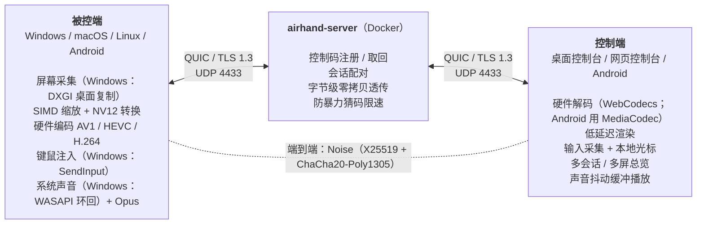

# 工作原理

[← 返回 README](../README.zh-CN.md) · [English](architecture.md)

## 架构

被控端各平台的具体实现见[下面的表](#被控端在各平台上的实现)。

每条 QUIC 连接上的第一条双向流是**信令流**。每建立一个远控会话，双方各再开几条双向流（“通道”：会话控制、视频、音频、大块），服务器按会话 ID 和通道编号配对，之后**只转发字节**。服务器不知道会话有几条通道、各是什么（只限制数量），以后加通道不用升级服务器；控制通道（0 号）结束，整个会话就结束。控制通道上先做**端到端握手**（Noise，见 `crates/airhand-proto/src/handshake.rs` 和[安全](security.zh-CN.md#端到端加密)），之后每条通道的每一帧、每个声音数据报都是密文（ChaCha20-Poly1305，每条通道每个方向一把密钥），服务器看不到、也改不了会话的内容。声音包平时不走音频流，而是一包一个 **QUIC 数据报**（开头是明文的 8 字节会话 ID，后面是密文）：服务器只看会话 ID，发送方是这个会话的一端就原样转给另一端（见 `crates/airhand-proto/src/lib.rs` 的 `datagram`）。每条通道各自有序，跨通道没有顺序保证；音画用采集时间同步。每条消息都是 `u32` 长度前缀加内容：信令流和会话的控制、大块通道上是带编号的 CBOR 消息（不认识的消息、字段跳过，见下面的[协议的演进](#协议的演进)）；视频、音频流上是**媒体包**（头（现在 24 字节）+ 码流 / Opus 包，见 `crates/airhand-proto/src/media.rs`）。大的消息（最多 1 MiB 的剪贴板文本、光标图像）走大块通道，优先级和画面一样：放在控制通道上的话，上行 5 Mbps 时 1 MiB 的剪贴板会把确认、Ping 和输入挡住一秒多，自适应码率会误判为拥塞，输入也可能被当成过时的丢掉。媒体包头的第 4 个字节是头的长度：以后可以往后加字段，旧的界面从这个位置取负载、不认识的部分不管；控制端原地解密、看一眼头，**原样**交给界面（WebView、浏览器、Android），不重新编码、不多拷贝。控制端重连时带上连上时得到的重连凭证；被控端不在线时服务器记下它，被控端重新上线时发 `HostOnline` 通知（见 `crates/airhand-proto/src/signal.rs` 的“重连凭证”）。

界面和控制端服务之间（Tauri 命令、网页版的 WebSocket、Android 的 JNI）用同一套 JSON：对会话的操作都是 `airhand_link::controller::Command`，会话事件都是 `SessionEvent`。`crates/airhand-link/tests/protocol.json` 是 Rust 测试生成的协议样例（媒体包、输入事件、命令），TypeScript 和 Kotlin 的测试读同一个文件，三边的实现对不上测试就会失败。

被控端与服务器的连接（注册、取回控制码、断开所有控制端、更换控制码）、会话各条通道的收发，以及会话本身都在 `airhand_link::host`，桌面版和 Android 共用。协议层的事只有一份，在 `host::serve`：同意流程、回应 Ping、失联检测、本机用户断开所有控制端时发 `Bye`、画质设置的校验；各平台实现 `host::Platform`，只管真正不同的事：采集、编码、注入输入、怎么请本机用户同意。发给控制端的消息经 `host::Outbox`：按消息挑通道（剪贴板、光标形状走大块通道），只关心最新值的状态（Pong、显示器列表、光标可见性）只留最新的一个、排在前面发，和控制端的命令队列是同一个设计。

**鼠标**平时用绝对坐标（本机指针在画面的哪里，被控端光标就在哪里）。被控端的光标隐藏时（例如游戏里按住右键转视角、第一人称游戏）改发相对移动：游戏这时自己把光标拉回原位、只看移动了多少，绝对坐标会和它打架（视角乱跳、拖到画面边上就转不动）。被控端用真实鼠标的方式注入相对移动（Windows `SendInput`、macOS 带移动量的 `CGEvent`、X11 XTEST 相对移动）。控制台这时锁定本机指针（Pointer Lock，原始移动量），按 Esc 解除；也可以手动锁定（Ctrl+Alt+Shift+M 或工具栏）。Android 控制端的触控板滑动、触屏拖动发相对移动，外接鼠标被抓住（pointer capture）；菜单里也有“锁定鼠标”。macOS 被控端检测不到光标隐藏，玩游戏时手动锁定。

会话控制流上两端先做端到端握手：互相确认身份（控制端只认记下的被控端公钥；被控端决定让不让这个控制端进来：配对过的、输对了配对码的，或者被控端允许任何人连），协商会话版本和能力位。之后被控端回 `Hello`（平台、能不能接收多点触摸、支持哪些系统操作），开始发画面。被控端也可以先回“等待同意”，请坐在它面前的人允许之后再发 `Hello`（Android 默认这样，同意过的控制端按公钥认出来，见 `crates/airhand-proto/src/session.rs` 的模块说明）。

### 协议的演进

- **两个版本**：信令版本（客户端 ⇄ 服务器，包括会话头和数据报的会话 ID）和会话版本（被控端 ⇄ 控制端，服务器从来不看）。都不要求相等：各自支持一个区间，取双方都支持的最高版本。服务器只检查信令版本，所以会话层的改动从来不用升级服务器；会话版本在加密的握手里协商
- **版本握手的开头永远不变**：`ClientHello` / `ServerHello` 开头是 v9 之前的 postcard 编码（`version | role | name | os`、`Welcome { version }` / `Incompatible { server_version }`），新加的东西（版本区间、能力位）是跟在后面的 CBOR。旧的服务器和客户端不管后面多出来的字节，所以任何两个版本之间都能告诉对方“不兼容”（`version_handshake_prefix_is_frozen` 测试守着这一点）
- **不认识的消息跳过，不断开**：消息是 minicbor 的 CBOR，每个变体、每个字段都有显式的编号。新版本才有的消息跳过；认识但解不出来的照样是错误，包括在没有标明可以跳过的地方出现了不认识的变体（要是悄悄把整条 `Hello` 跳过，会话就卡在那里，也没有报错）。字段只能以 `Option` 的形式加。只有编号的枚举（编码格式、平台、结束原因、握手模式……）都是“开放枚举”：不认识的值解成 `Unknown(原值)`，日志里还看得到原值。带字段的枚举只有三个标明了的地方能跳过：整条消息、`opt`（可选的字段）、`open_vec`（列表里的元素），为什么见 `crates/airhand-proto/src/cbor.rs`
- **端到端握手没有版本号**：握手怎么做由模式（`Known` / `First` / `Pairing`）决定，要改就加一个新的模式；被控端不认识控制端用的模式时列出自己会的，控制端据此判断该更新哪一边
- **会话开始**：控制端在握手里的介绍带着开始时的画质和要不要声音，被控端一开始就按它建编码器，不用先按默认设置建一个、过一会儿再重建。被控端解开控制端的第一帧密文之后才算这个控制端进来了（显示它、开始采集）：重放的 `Noise_IK` 第一条消息能得到回答，但走不到这一步
- **能力位**：版本握手和端到端握手里各带一组 `Features`（信令和会话两套编号）。只用双方都支持的（会话的两端各自算出同一个 `Negotiated { version, features }` 交给会话代码），不认识的位不管，位永远不复用。设备的能力（触摸、编码器、显示器）是 `HostHello` 里的数据，不是能力位
- 只有没法兼容的改动才加版本号

网页控制台把右边的控制端拆成两半：QUIC 连接和会话管理在 `airhand-web`（容器）里，解码、渲染、输入采集仍在浏览器里，两者之间是一条 WebSocket。媒体包原样转发给浏览器（前面加 4 字节的会话编号），浏览器收到画面后回确认。

桌面控制台也由 WebView 收到画面后回确认，ACK 覆盖 Rust → WebView 的 IPC。确认是累积的，8 ms 之内连着到的几帧只确认一次（浏览器发的是 9 字节的二进制 WebSocket 消息，不走 JSON）。输入队列最多 128 条 / 2 MiB：确认、Ping、画质设置只留最新值，排在输入前面发；相邻的鼠标移动会合并。输入排队超过 2 秒（或者队列满了）就丢掉，补发一个“释放所有按键”，会话继续，不在网络恢复后回放过时操作；真正失联由 20 秒的超时发现。断网时往 QUIC 里写不会阻塞，已经写出去的输入在 QUIC 的发送缓冲里等着，网络恢复后照样发出去，所以每批输入还带着控制端收到它的时刻（和 Ping 同一个时钟）：被控端记下“收到的时刻 − 这个时刻”的最小值作为基准（两边时钟之差 + 最快的一次传输，不需要对时），比基准晚到超过 2 秒的输入不执行，换成一个“释放所有按键”（`airhand_link::host` 的 `InputClock`）。基准每秒最多上调 1 ms，跟得上两边时钟的漂移；连续 5 秒都是晚到的消息说明这一路本身变慢了，重新取基准。桌面被控端把收到的输入交给每个会话自己的注入线程，会话的任务不等它注入完（X11 上输入一长段文字要好几秒）：这期间照常回应 Ping、处理画面确认和断开，后面的输入也不会因为读得晚被当成过时的。浏览器 WebSocket 输出另有条数和 32 MiB 字节预算。

画面的在途帧窗口是基础 RTT（最近 10 秒的滑动最小值）× 帧率 + 2，最多 32 帧，长距离链路上帧率也能跑满。

Android 被控端只有一个编码器，但每个观看者分别计在途帧：慢的一端跳过画面，恢复后从关键帧重新接入，其它观看者继续接收。只有所有观看者都没有窗口时才等待。共享画质按会话需求合并：帧率和目标码率取较高值，分辨率服从最严格的非零上限，编码偏好不一致时用共同基线 H.264；因此后台会话不会把前台的帧率改成 5 fps。共享编码仍意味着各观看者不能同时使用不同的编码格式和分辨率。

双方协商了 `CURSOR_UPDATES` 能力位时，光标可见性和完整形状引用走控制通道，图像走大块通道。引用带槽位和代际：图像晚到时不会改变最新的可见性，也不会覆盖已经复用的槽位。链路库统一合并后，再交给三端界面原有的媒体解析器。没有这个能力位的旧端继续使用原来的光标消息。

桌面输入线程在每个事件、每段最多 512 个字符的文字之间检查取消；前端按 Unicode 码点分块。剪贴板写入由一个有界的后台任务串行执行，待执行的更新只保留最新值，写入期间不把中间内容回传。

固定控制码使用内存索引查询，SQLite 由独立线程写入、按控制码合并更新。绑定有实质变化（新绑定、换了密钥）时，注册在全局锁外等这一次写入落盘后才发布；按写入序号等，之后别的被控端的写入不会让它多等。退出时也会等待刷写；数据库故障时保留内存中的归属并重试，不把读写错误当作“控制码无人持有”。持久化超过等待期限会记日志并按内存状态继续，此时强制退出仍可能丢失未写入的更新。

被控端的密钥由服务器签发（随机数加上用服务器自己的密钥算的 HMAC，服务器的密钥存在 `airhand.db` 里）：取回空闲的控制码要出示为这个控制码签发的密钥，所以不能用注册来探测哪些控制码有人在用。被控端的用户断开所有控制端时，被控端请服务器换一个密钥（`Rekey`），之前发出的重连凭证全部作废。发了 `Rekey` 却没等到回答（断线了）的被控端，下次注册时带上 `rekey`，服务器还回控制码的同时换密钥：服务器可能根本没收到 `Rekey`，或者收到之后还没记下来就重启了，手里的旧密钥又成了有效的，旧凭证也就跟着恢复。

重连凭证有两半：前一半是服务器用自己的密钥给**控制码**签的名，证明拿着它的控制端连上过这个控制码（被控端不在线、服务器重启过也能验证）；后一半由控制码和被控端现在的密钥算出，换了密钥就对不上。所以服务器对带凭证的请求能分清“对方不在线”（`Offline`，等它上线）和“凭证作废了”（`Revoked`：对方在线但换过密钥，或者凭证根本不是为这个控制码发的），从我的设备打开一台不在线的设备时控制端只需要等，不用为了排除“凭证作废了”再拿控制码试一次（那样会算一次猜错）。`Revoked` 之后：用户自己要连的（从我的设备打开）不带凭证再连一次；断线后自动重连的就此停下。

### 代码目录

| 目录 | 内容 |
|---|---|
| `crates/airhand-proto` | 协议：信令和版本握手、端到端握手的消息、会话控制消息、媒体包、帧格式和兼容规则。只做编解码：不碰 IO、不依赖异步运行时，能编译成 wasm，解析对方数据的函数都只吃字节（方便 fuzz） |
| `crates/airhand-link` | 客户端到中转服务器的链路：QUIC 连接、证书固定、断线重连，端到端加密（`secure`：身份、Noise 握手、每条通道的加密），从流里读写帧（`wire`），会话的几条流，与界面无关的控制端会话和界面命令（`Command`），被控端的服务器连接和会话（`host`），`Problem`。桌面客户端、网页控制台和 Android 共用（除了 `wire` 都在默认的 `client` feature 里，中转服务器只用 `wire`）；`tests/protocol.json` 是三边共用的协议样例 |
| `server/` | 中转服务器（quinn + rustls）及其 `Dockerfile`。`src/broker/`：`registry`（控制码登记、连接请求）、`relay`（会话通道的配对和转发、数据报）、`limits`（限速）、`tokens`（密钥和重连凭证）；锁的先后在调试构建里有检查（`lock.rs`） |
| `web/` | 网页控制台服务（axum：静态网页 + WebSocket，HTTP / HTTPS 同一端口）及其 `Dockerfile`、`docker-compose.yml`。和 `client/src-tauri/` 一样是独立的 Cargo 工作区 |
| `client/src-tauri/` | 桌面客户端 Rust 部分：被控端 `host/`、托盘、控制台窗口和命令 |
| `android/native/` | Android 的 Rust 核心（JNI）：控制端用 `airhand-link`；被控端的网络部分（服务器连接、会话和它的各条通道用 `airhand_link::host`，Android 只实现 `host::Platform`；在途帧控制和自适应码率与桌面版相同）。和 `client/src-tauri/`、`web/` 一样是独立的 Cargo 工作区 |
| `android/app/` | Android 应用（Kotlin + Jetpack Compose）：手机和电视界面、MediaCodec 解码 / 编码、屏幕录制、无障碍服务（远程操作） |
| `client/src/` | `lib/session.ts` 管理会话，`connection-attempt.ts` 隔离连接代际，`media.ts` 解析媒体包，`video.ts` 管理解码 / 画面队列，`input.ts` 管理输入（含相对移动和指针锁定）；控制台界面（React 19 + TypeScript，不依赖 UI 库），桌面版和网页版共用，区别只在 `client/src/lib/backend/`；文案在 `client/src/locales/` |
| `assets/icon.svg` | 应用图标源文件 |

### 被控端在各平台上的实现

Windows 上这些都运行在系统服务里（见 [Windows 服务](#windows-服务)）：

| 环节 | Windows | macOS | Linux（X11） | Android |
|---|---|---|---|---|
| 屏幕采集 | DXGI Desktop Duplication | ScreenCaptureKit | MIT-SHM 共享内存 + DAMAGE 变化通知，RandR 多显示器 | MediaProjection（虚拟显示器直接输出到编码器） |
| 光标形状 | DXGI | NSCursor | XFIXES | — |
| 视频编码 | Media Foundation 硬件编码，OpenH264 兜底 | VideoToolbox 硬件编码（H.264 / HEVC），OpenH264 兜底 | OpenH264 | MediaCodec（优先硬件编码器） |
| 输入注入 | SendInput（扫描码；相对移动同真实鼠标） | CGEvent（虚拟键码；相对移动带移动量） | XTEST（evdev 物理键码；相对移动） | 无障碍服务（手势、系统操作、文字输入） |
| 光标隐藏（改用相对移动） | DXGI | 检测不到（手动锁定） | XFIXES（全透明光标） | — |
| 声音采集 | WASAPI 环回 | ScreenCaptureKit（系统混音） | PulseAudio / PipeWire 的输出监视器 | AudioPlaybackCapture（Android 10+） |
| 剪贴板 | 剪贴板序号检测变化 | NSPasteboard 变化计数 | XFIXES 选择所有者变化通知 | 只能写入（控制端 → 手机） |
| 控制台界面 | WebView2 | WKWebView | WebKitGTK（WebCodecs 由 GStreamer 解码） | Jetpack Compose（MediaCodec 解码） |

## Windows 服务

同一个 `airhand.exe` 按命令行参数扮演不同的角色（`client/src-tauri/src/winsvc/`）：

| 进程 | 身份 | 做什么 |
|---|---|---|
| `airhand.exe` | 登录的用户 | 托盘和控制台 |
| `airhand.exe --service` | SYSTEM，会话 0 | 系统服务 Airhand：在控制台会话（物理屏幕前的那个会话）里启动被控端并看护它；控制台会话变了（切换用户、注销）就把它挪过去，退出了就重新启动 |
| `airhand.exe --agent` | SYSTEM，控制台会话 | 被控端：连接服务器、采集、编码、注入键鼠、声音、剪贴板 |
| `airhand.exe --install` / `--uninstall` / `--stop-service` | 管理员 | 安装程序调用 |

- 桌面复制和 `SendInput` 只对调用线程所在的桌面有效。UAC 确认框、锁屏和登录界面在安全桌面 `Winlogon` 上，只有 SYSTEM 能打开；采集线程和注入线程在用之前先切到当前接收输入的桌面上（`client/src-tauri/src/host/desktop.rs`）
- 托盘和被控端之间是每个会话一个的命名管道（`\\.\pipe\airhand-host-<会话>`），每行一条 JSON 消息。只有交互登录的用户能连接，不能再开一个同名管道实例冒充被控端，托盘还会核对管道属于 SYSTEM
- 服务和被控端没有控制台：日志用 `OutputDebugString` 输出（见开发文档的[调试 Windows 服务](development.zh-CN.md#调试-windows-服务)）

## 画面

| 环节 | 做法 |
|---|---|
| 采集 | 只在画面变化时产生帧（Windows 靠 DXGI，macOS 靠 ScreenCaptureKit，X11 靠 DAMAGE），静止的桌面几乎不占带宽 |
| 静止后补画质 | 画面大面积变化（切换窗口、滚动）的那一帧只能分到大约一帧的码率，文字是糊的。画面停下来 200 ms 后把最后一帧再编几次，编码器只补残差，几帧之内就接近原画（补到编码器不再输出有意义的数据为止，最多 8 帧），之后就不再发帧 |
| 预处理 | `fast_image_resize`（SIMD，Catmull-Rom）缩放，按行分成几条用多个核同时缩放（缩放在每帧的关键路径上，Apple M1 上 2880×1800 → 1080p 从约 18 ms 降到约 9 ms，结果与整幅缩放逐像素相同），`yuvutils-rs`（AVX2）BGRA→NV12/I420，缓冲区全部复用 |
| 编码 | **硬件优先**：Media Foundation 硬件编码器（NVENC / Quick Sync / AMF），支持 **AV1 / HEVC / H.264**，低延迟模式、无 B 帧、超长 GOP；macOS 上是 VideoToolbox（H.264 / HEVC，H.264 用低延迟码率控制）；没有硬件编码器时回退到 **OpenH264 屏幕内容模式**。格式按 **AV1 > HEVC > H.264** 的优先级，自动选用双方都支持（对方能编码、本机能解码）的里压缩率最高的 |
| 码率控制 | 控制端每帧都回 ACK，被控端限制**在途帧数**（≈ RTT × 帧率 + 2），网络慢时等待并**跳到最新一帧**，不会越积越卡；自适应码率按拥塞情况下调，恢复后逐步回升 |
| 传输 | QUIC + **BBR**；控制、画面使用独立的有界队列和 QUIC 流，声音走 QUIC 数据报，避免视频流内的丢包 / 背压阻塞其它流。仍共享连接带宽；网页版最后一段仍是单条 WebSocket |
| 解码 | 控制端用 **WebCodecs** GPU 解码（`optimizeForLatency`），解完马上画到 `desynchronized` Canvas |
| 显示 | 画面**只缩放一次**：控制端按画面在窗口里实际显示的设备像素大小请求分辨率（不超过用户选的上限），被控端一次缩到位，控制端按 1:1 显示并对齐到设备像素（见 `client/src/lib/fit.ts`）。浏览器再缩放一次（尤其是比例接近 1、或者落在半个像素上）会让文字发虚 |
| 光标 | 远端光标的**形状**同步到本地光标，移动在本地完成，**感觉不到延迟**。形状按槽位缓存（每个会话 32 个，由被控端决定哪个槽位放什么）：动画光标（例如忙碌时的转圈）反复用到的那几帧只在第一次发图像，之后控制流上只发槽位，界面也按槽位缓存生成好的光标 |
| 后台会话 | 不在屏幕上的会话自动降到 5 fps |

本机实测（RTX 显卡，4K 屏输出 1080p）：硬件 AV1 每帧编码约 7 ms，H.264 约 9 ms；OpenH264 软件编码约 40 ms。

## 声音

被控端的系统声音（不含麦克风）会同步到控制端：

| 环节 | 做法 |
|---|---|
| 采集 | 环回采集默认输出设备，转换为 48 kHz 立体声；默认设备变化（例如插上耳机）时自动跟随 |
| 编码 | Opus 96 kbps，每包 20 ms；**没有声音时不发包** |
| 传输 | **QUIC 数据报**，服务器按会话转发：丢了的包不重传，后面的包也不用等它（声音停顿几十毫秒，比整条流卡住等重传好）；在 QUIC 包里排在所有流的前面。发送队列满了丢包，不阻塞采集；QUIC 的数据报发送缓冲只有 64 KiB，网络跟不上时丢掉最旧的，而不是越积越晚。数据报可能乱序，控制端按包序号丢掉迟到的包。放不进一个数据报的包（很少见）走音频流 |
| 播放 | WebCodecs 解码 → AudioWorklet 自适应抖动缓冲：稳定网络约 40 ms，抖动时自动加大、稳定后回落；用 ±1~2% 的变速抵消两端声卡的时钟偏差，积压过多时直接跳过 |

只有当前正在看的会话播放声音（多屏总览时都不播放），其它被控端会被通知停止采集。

被控端采集不到声音时（例如没有声音输出设备、Linux 上没有运行 PulseAudio / PipeWire），控制端会显示提示，工具栏的喇叭上有黄点，声音菜单里也写着原因；被控端每 2 秒重试一次，恢复后提示自动消失。

## 音画同步（可选，默认关闭）

声音要经过抖动缓冲，画面则是一到就显示，所以默认声音会比画面晚一点：实测约 **70 ms**（同机、本地中转、4K 屏输出 1080p；单次 49~78 ms）。操作电脑时几乎察觉不到，看视频时可能会。

在工具栏的喇叭菜单里打开**音画同步**后：

- 画面帧和声音包都带有被控端同一个时钟上的采集时间（DXGI 的呈现时间、WASAPI 的 QPC 时间戳），控制端分别测出两条流“采集 → 显示 / 播放”的延迟，**两台电脑之间的时钟差会相互抵消**，不需要对时
- 通常把每一帧推迟到与声音对齐再显示；如果画面反而更慢（带宽紧张），就让声音多缓冲一会儿去等画面（最多 300 ms），偶尔一帧慢不会触发
- 实测残余音画差平均 **−3~−4 ms**（负数 = 声音略早），最大 −31 ms，在一般认为察觉不到的范围内（声音提前不超过约 45 ms）
- 代价：画面晚约 70 ms 显示，打字、拖动窗口会觉得变慢，所以适合看视频、不适合操作；鼠标指针是本地绘制的，不受影响。工具栏会显示“同步 +N ms”

画到 Canvas 之后到屏幕真正亮起来的时间按 8 ms 估算（没有用摄像头实测）。

## 磁盘上的文件

- Airhand 要保存的东西（设置、本机的控制码、我的设备）都在一个 `config.toml` 里（见[配置文件](usage.zh-CN.md#配置文件)）。日志从不写文件：写到 stderr，Windows 服务写到 `OutputDebugString`
- 被控端模式**不创建 WebView**，Airhand 自己不会产生任何文件（macOS 的系统框架以 Airhand 的名义建的目录见下）
- 单实例锁用的是内核对象而不是锁文件：Windows 是命名互斥量，Linux 是抽象命名空间的 Unix 套接字，macOS 是登记在 bootstrap 服务里的 Mach 端口名
- 控制台的 WebView 需要数据目录：放在临时目录下的随机子目录，开启隐私模式（不保存 Cookie 和缓存），关闭窗口或退出程序时删除；进程被强制结束时，下次启动会清理残留。macOS 的 WKWebView 不需要数据目录，隐私模式下不保存网页数据
- macOS 上还有几样东西由系统记着、不在 Airhand 的目录里：登录时自动启动（系统的登录项）、“屏幕与系统录音”“辅助功能”等权限记录；WebKit 和 Metal 还会以 Airhand 的 bundle ID 在系统的临时 / 缓存目录（`getconf DARWIN_USER_TEMP_DIR`、`DARWIN_USER_CACHE_DIR`）里建几个目录（`*app.airhand.client`，大多是空的，最多是一点 GPU 着色器缓存）。卸载时怎么一起清掉见[卸载](usage.zh-CN.md#卸载)
- Linux 上几样只能以文件形式交出去的东西（交给 AppIndicator 的托盘图标、WebKitGTK 的 GStreamer 插件缓存）放在 `XDG_RUNTIME_DIR`（内存盘）里本进程专用的随机目录，退出时删除（收到 SIGTERM / SIGINT 也一样）；Mesa / NVIDIA 的着色器磁盘缓存直接关闭
- 控制台的其它设置（界面语言、关闭的标签……）只保存在内存里
- Android：只在应用自己的私有目录里保存设置、连接过的设备和本机的控制码，不备份、不迁移，卸载时由系统全部删除（见[数据保存在哪里](android.zh-CN.md#数据保存在哪里)）
- 以上说的是桌面客户端。网页控制台是部署在服务器上的服务：它把自签名的 HTTPS 证书存在 `web/data/` 里，浏览器那边也只在内存里保存设置，我的设备不保存、刷新页面后清空（登录密码时会有一个会话 Cookie）
