# 工作原理

[← 返回 README](../README.zh-CN.md) · [English](architecture.md)

## 架构

```mermaid
flowchart LR
    host["<b>被控端</b><br>Windows / macOS / Linux / Android<br><br>屏幕采集（Windows：DXGI 桌面复制）<br>GPU 缩放 + NV12 转换（零拷贝）<br>硬件编码 AV1 / HEVC / H.264<br>键鼠注入（Windows：SendInput）<br>系统声音（Windows：WASAPI 环回）+ Opus"]
    relay["<b>airhand-server</b>（Docker）<br><br>控制码注册 / 取回<br>会话配对<br>字节级零拷贝透传<br>防暴力猜码限速"]
    ctrl["<b>控制端</b><br>桌面控制台 / 网页控制台 / Android<br><br>硬件解码（WebCodecs；Android 用 MediaCodec）<br>低延迟渲染<br>输入采集 + 本地光标<br>多会话 / 多屏总览<br>声音抖动缓冲播放"]
    host <-->|"QUIC / TLS 1.3<br>UDP 4433"| relay
    relay <-->|"QUIC / TLS 1.3<br>UDP 4433"| ctrl
    host -. "端到端：Noise 握手（X25519）+ AES-256-GCM" .- ctrl
    host <-. "直连 QUIC，打洞（打得通时）" .-> ctrl
```

被控端各平台的具体实现见[下面的表](#被控端在各平台上的实现)。两端怎么不经过中转直接说话，见[直连](#直连)。

每条 QUIC 连接上的第一条双向流是**信令流**。控制端发起会话时把端到端握手的第一条消息一起交给服务器（`ClientMsg::Connect::init`），服务器批准之后原样放进给被控端的通知里（`ServerMsg::Incoming::init`）：被控端收到通知就能回答，不用等控制端拿到批准、开好通道之后再发，省一个往返。会话的每条“通道”（控制、画面、大块）是一条**单向流**：每端只为自己要发的通道开流，开头写 16 字节的会话头（会话 ID、通道编号、优先级）；服务器向另一端开一条单向流、写同样的头，之后**只转发字节**。服务器不配对、不知道会话有几条通道、各是什么（每端每条通道只能开一次，数量有上限），以后加通道不用升级服务器；任何一端的控制通道（0 号）结束，整个会话就结束。控制通道上做完**端到端握手**（Noise，见 `crates/airhand-proto/src/handshake.rs` 和[安全](security.zh-CN.md#端到端加密)）之后，每条通道的每一帧、每个数据报都是密文（AES-256-GCM，每条通道每个方向一把密钥），服务器看不到、也改不了会话的内容。每段密文后面带着它的计数（nonce）：控制、大块通道上的必须一个接一个（中转删不掉、调换不了一条输入）；画面、声音的只要没收到过就行，以后画面也可以分几条流发、丢掉过时的帧，不用再改加密格式。声音走 **QUIC 数据报**（开头是明文的 8 字节会话 ID 和 1 字节的种类（声音、控制），后面是密文；每个声音数据报除了最新的一包，还带着之前两包的副本，见下面的[声音](#声音)）：服务器只看会话 ID，发送方是这个会话的一端就原样转给另一端（见 `crates/airhand-proto/src/lib.rs` 的 `datagram`）。Ping / Pong、画面确认、量两条路的探测这些只看最新值、丢了也不要紧的控制消息也是数据报（`session::ControllerDatagram` / `HostDatagram`）：不排在控制通道里别的消息后面，也不会被丢了的包挡住。每条通道各自有序，跨通道没有顺序保证；音画用采集时间同步。每条消息都是 `u32` 长度前缀加内容：信令流和会话的控制、大块通道上是带编号的 CBOR 消息（不认识的消息、字段跳过，见下面的[协议的演进](#协议的演进)）；画面通道上是**媒体包**（头（现在 24 字节）+ 码流，见 `crates/airhand-proto/src/media.rs`；声音数据报里是同样格式的声音包）。大的消息（最多 1 MiB 的剪贴板文本、光标图像）走大块通道，优先级和画面一样：放在控制通道上的话，上行 5 Mbps 时 1 MiB 的剪贴板会把输入挡住一秒多，输入可能被当成过时的丢掉。媒体包头的第 4 个字节是头的长度：以后可以往后加字段，旧的界面从这个位置取负载、不认识的部分不管；控制端原地解密、看一眼头，**原样**交给界面（WebView、浏览器、Android），不重新编码、不多拷贝。控制端重连时带上连上时得到的重连凭证；被控端不在线时服务器记下它，被控端重新上线时发 `HostOnline` 通知（见 `crates/airhand-proto/src/signal.rs` 的“重连凭证”）。

界面和控制端服务之间（桌面版和网页版是同一个 WebSocket 协议，Android 是 JNI）用同一套 JSON：对会话的操作都是 `airhand_link::controller::Command`，会话事件都是 `SessionEvent`。`crates/airhand-link/tests/protocol.json` 是 Rust 测试生成的协议样例（媒体包、输入事件、命令），TypeScript 和 Kotlin 的测试读同一个文件，三边的实现对不上测试就会失败。

被控端与服务器的连接（注册、取回控制码、断开所有控制端、更换控制码）、会话各条通道的收发，以及会话本身都在 `airhand_link::host`，桌面版和 Android 共用。协议层的事只有一份，在 `host::serve`：同意流程、失联检测、本机用户断开所有控制端时发 `Bye`、画质设置的校验。回应 Ping、把画面确认交给平台（`host::Platform::acks`）在会话的读任务里就做了，不经过这个主循环：主循环可能正等着平台做一件慢事（换显示器时要等编码线程退出），Pong 和确认晚了，控制端测到的往返时延、被控端的码率控制都会当成网络变慢。各平台实现 `host::Platform`，只管真正不同的事：采集、编码、注入输入、怎么请本机用户同意。发给控制端的消息经 `host::Outbox`：按消息挑通道（剪贴板、光标形状走大块通道），只关心最新值的状态（显示器列表、光标可见性）只留最新的一个、排在前面发，和控制端的命令队列是同一个设计。

**鼠标**平时用绝对坐标（本机指针在画面的哪里，被控端光标就在哪里）。被控端的光标隐藏时（例如游戏里按住右键转视角、第一人称游戏）改发相对移动：游戏这时自己把光标拉回原位、只看移动了多少，绝对坐标会和它打架（视角乱跳、拖到画面边上就转不动）。被控端用真实鼠标的方式注入相对移动（Windows `SendInput`、macOS 带移动量的 `CGEvent`、X11 XTEST 相对移动）。控制台这时锁定本机指针（Pointer Lock，原始移动量），长按 Esc 或 Ctrl+Alt+Shift+M 解除（全屏时键盘锁定把 Esc 交给了网页，浏览器不再用它解除，由控制台自己处理）；也可以手动锁定（Ctrl+Alt+Shift+M 或工具栏）。Android 控制端的触控板滑动、触屏拖动发相对移动，外接鼠标被抓住（pointer capture）；菜单里也有“锁定鼠标”。macOS 被控端检测不到光标隐藏，玩游戏时手动锁定。

两端先做完端到端握手：互相确认身份（控制端只认记下的被控端公钥；被控端决定让不让这个控制端进来：配对过的、输对了配对码的，或者被控端允许任何人连），协商会话版本和能力位。之后被控端回 `Hello`（平台、能不能接收多点触摸、支持哪些系统操作），开始发画面：发出握手的决定就开始，不等控制端的确认（见下面的“会话开始”）。被控端也可以先回“等待同意”，请坐在它面前的人允许之后再发 `Hello`（Android 默认这样，同意过的控制端按公钥认出来，见 `crates/airhand-proto/src/session.rs` 的模块说明）。

### 直连

经过中转时每个字节都要两次 QUIC 加解密、两套重传，中转上还要排队；中转离用户远（跨境）时尤其明显。端到端加密和传输无关，所以会话开始之后两端在中转之外再打通一条**直连**，同样的密文帧（同样的密钥、同样的计数）原样从直连发（`crates/airhand-link/src/direct/`，协议见 `crates/airhand-proto/src/lib.rs` 的“直连”）：

- **地址**：服务器在会话开始时告诉每一端**它自己**的公网地址（`ServerMsg::Incoming::observed`、`SessionGrant::observed`）。会话开始之后（被控端的用户同意了之后），被控端在加密的控制通道上发自己的候选地址和直连证书的指纹（`HostMsg::Direct`：这个公网地址，它往中转去时用的地址，以及往公网去时用的 IPv4（多半是局域网地址）和 IPv6 地址，端口都是连中转的那个），控制端回答自己的（`ControllerMsg::Direct`）。连中转的 socket 是双栈的：中转走 IPv4 时两端也能用公网 IPv6 直连，IPv6 一般没有 NAT，IPv4 打不通（对称 NAT、运营商级 NAT）时它往往通。中转看不到局域网地址，还没被放进来的控制端也拿不到被控端的地址
- **打洞**：两端都用**连中转的那个 UDP socket**（同一个端口，也就是服务器看到的那个 NAT 映射）。被控端往控制端的地址发几个 4 字节的打洞包（不是 QUIC 包，quinn 收到直接丢掉），打开自己 NAT 上的映射；控制端往被控端的每个地址发起 QUIC 连接（ALPN `airhand-direct/1`），先连上的胜出。好几个地址可能通到同一个被控端（局域网地址和 IPv6、回环的公网地址、同一台电脑的两个地址），会连上好几条：由控制端决定，它在胜出的那条上马上开控制通道、其余的关掉，被控端用的是控制通道到的那一条，而不是自己先接受的那一条（否则两边可能各挑一条，直连通了却一直用不上）。被控端只在有会话在发候选地址时才接受直连。对称 NAT（或者防火墙挡了 UDP）打不通，会话就一直走中转；被控端再试两次就不试了
- **认证**：两端各有一张临时生成的自签名证书，指纹在加密的控制通道上交换（`DirectOffer::cert`），直连的 TLS 双向认证只认这两个指纹（和 WebRTC 把 DTLS 证书的指纹放进信令一样）：TLS 握手完成时就确认了对面是这个会话的另一端，中间人冒充不了任何一边，连上之后也不用再证明一次。直连上的帧本来就是端到端加密的
- **控制通道、控制数据报两条路都发**：每一帧都写进中转（完整的一份），直连通着的话再从直连发一份（直连上的通道也是单向流，开头是同样的会话头）。接收端按计数合并、重复的丢掉（`crates/airhand-link/src/merge.rs`；控制数据报两条路上是同一份，后到的被重放窗口挡掉）：输入、确认、Ping 总是走更快的那条，直连突然断了也不丢。中转那一份上的计数照样必须一个接一个。大块通道（剪贴板、光标图像）只走中转：对延迟不敏感，1 MiB 的剪贴板也不用发两遍
- **画面、声音只走一条路**，被控端决定：每 250 ms 在两条路上各发一个探测（控制数据报 `HostDatagram::Probe`），控制端从同一条路回答（`ControllerDatagram::Echo`），被控端取每条路最近 10 秒里最小的往返时延，也就是路本身的时延（画面走的那条路上难免排着一点队，那是码率控制的事；拿它和闲着的那条比，画面就会来回换）。直连一量出来、不比中转慢（最多慢 2 ms：差不多时走直连，省下中转的流量）就换到直连；中转一直明显更快（5 ms 或 10%）3 秒才换回中转。直连可能比中转还慢（两端的运营商之间绕路），这时画面就留在中转上。换路只在两帧之间生效，接收端按计数把画面排好（新路上的帧等旧路上最后几帧）
- **直连断了**（一秒没有回声，或者往直连上写不进去）：被控端马上把画面、声音改回中转，告诉自己的码率控制在途的帧没了（`host::Acks::path_changed`：编码器不会一直等那些永远不会来的确认；每次换路时延的基准也从头量），并编一个关键帧；接收端不再等断在直连上的帧，因为**关键帧不用等前面的帧**（等了 1 秒还等不到也不等了，并要一个关键帧；那个关键帧到之前的增量帧缺了参考帧，解出来是花屏，不交给界面，但照样确认）。输入和控制消息不受影响（中转上有完整的一份）。直连的连接断了之后被控端再发一轮地址
- 控制台在延迟后面显示画面走的是哪条路（直连 / 中转，`SessionEvent::Stats::direct`）

### 协议的演进

- **两个版本**：信令版本（客户端 ⇄ 服务器，包括会话头和数据报的会话 ID）和会话版本（被控端 ⇄ 控制端，服务器从来不看）。都不要求相等：各自支持一个区间，取双方都支持的最高版本。服务器只检查信令版本，所以会话层的改动从来不用升级服务器；会话版本在加密的握手里协商
- **版本握手里冻结的只有版本区间**：`ClientHello` / `ServerHello` 都是 CBOR map，0、1 号键永远是能说的版本区间（`signal::Versions`）。服务器先只读这两个键、算出双方都能说的最高版本，没有交集就回答自己的区间，所以任何两个版本之间都能告诉对方“不兼容”，握手里别的字段照样可以增减（`version_handshake_is_frozen` 测试守着这一点）
- **不认识的消息跳过，不断开**：消息是 minicbor 的 CBOR，每个变体、每个字段都有显式的编号。新版本才有的消息跳过；认识但解不出来的照样是错误，包括在没有标明可以跳过的地方出现了不认识的变体（要是悄悄把整条 `Hello` 跳过，会话就卡在那里，也没有报错）。字段只能以 `Option` 的形式加。只有编号的枚举（编码格式、平台、结束原因、握手模式……）都是“开放枚举”：不认识的值解成 `Unknown(原值)`，日志里还看得到原值。带字段的枚举只有三个标明了的地方能跳过：整条消息、`opt`（可选的字段）、`open_vec`（列表里的元素），为什么见 `crates/airhand-proto/src/cbor.rs`
- **端到端握手没有版本号**：握手怎么做由模式（`Known` / `First` / `Pairing`）决定，要改就加一个新的模式；被控端不认识控制端用的模式时列出自己会的，控制端据此判断该更新哪一边
- **会话开始**：控制端在握手里的介绍带着开始时的画质和要不要声音，被控端一开始就按它建编码器，不用先按默认设置建一个、过一会儿再重建。被控端发出握手的决定就开始采集、发画面，不等控制端的确认（省一个往返，编码器的初始化也和它重叠）；解开控制端的确认（控制通道上的第一帧密文）之后才显示这个控制端、才请本机用户同意，10 秒等不到就结束。重放的 `Noise_IK` 第一条消息能得到回答，但拿不出确认，也解不开画面（只有真正的控制端算得出会话密钥）
- **能力位**：版本握手和端到端握手里各带一组 `Features`（信令和会话两套编号）。只用双方都支持的（会话的两端各自算出同一个 `Negotiated { version, features }` 交给会话代码），不认识的位不管，位永远不复用。设备的能力（触摸、编码器、显示器）是 `HostHello` 里的数据，不是能力位
- 只有没法兼容的改动才加版本号

网页控制台把右边的控制端拆成两半：QUIC 连接和会话管理在 `airhand-web`（容器）里，解码、渲染、输入采集仍在浏览器里，两者之间是一条 WebSocket。媒体包原样转发给浏览器（前面加 4 字节的会话编号），浏览器收到画面后回确认。

桌面控制台用的是同一个 WebSocket 协议（`crates/airhand-link/src/console.rs`），连的是程序里只监听 127.0.0.1 的服务：地址里带随机令牌，只接受控制台页面的 Origin。会话不走 Tauri 的 IPC：它的命令和 Channel 都在主线程上执行，画面一多就会挡住输入和确认。两种控制台里，WebSocket、WebCodecs 解码和绘制到 OffscreenCanvas 都在 Worker 里（`client/src/lib/console-worker.ts`），页面的主线程只处理 JSON 和界面，解码后的声音从 Worker 直接交给 AudioWorklet。

控制台的 Worker 收到画面就回确认，最后这一段也算在里面。确认是累积的，8 ms 之内连着到的几帧只确认一次（9 字节的二进制 WebSocket 消息，不走 JSON）。确认里还带着这一帧开始从网络上到达的时刻（控制端的时钟，控制端服务在 Rust 里读到这一帧的长度前缀时记下）：被控端拿它减去自己的发送时刻，再减去最近的最小值，就是这一帧在路上多排了多久的队，不含界面那一段，也不含这一帧自己要传多久；两次到达之间收到的字节数就是交付速率（见下）。确认和 Ping 是控制数据报，不排在输入后面；数据报会丢，丢的要是最后一个确认（画面停了、或者被控端的在途帧满了正等着它），被控端就一直等，所以没有新的确认时控制端把最近的一个每 30 ms 重发一次、共 3 次，之后随每秒的 Ping 再发一次。输入队列最多 128 条 / 2 MiB：画质设置只留最新值，排在输入前面发；相邻的鼠标移动会合并。输入排队超过 2 秒（或者队列满了）就丢掉，补发一个“释放所有按键”，会话继续，不在网络恢复后回放过时操作；真正失联由 20 秒的超时发现。断网时往 QUIC 里写不会阻塞，已经写出去的输入在 QUIC 的发送缓冲里等着，网络恢复后照样发出去，所以每批输入还带着控制端收到它的时刻（和 Ping 同一个时钟）：被控端记下“收到的时刻 − 这个时刻”的最小值作为基准（两边时钟之差 + 最快的一次传输，不需要对时），比基准晚到超过 2 秒的输入不执行，换成一个“释放所有按键”（`airhand_link::host` 的 `InputClock`）。基准每秒最多上调 1 ms，跟得上两边时钟的漂移；连续 5 秒都是晚到的消息说明这一路本身变慢了，重新取基准。桌面被控端把收到的输入交给每个会话自己的注入线程，会话的任务不等它注入完（X11 上输入一长段文字要好几秒）：这期间照常回应 Ping、处理画面确认和断开，后面的输入也不会因为读得晚被当成过时的。浏览器 WebSocket 输出另有条数和 32 MiB 字节预算。

画面的在途控制和码率在 `airhand_link::flow`，每个会话一份。端到端的拥塞控制只能在这里做：中转把 QUIC 连接拆成了两段，两段的拥塞控制各管各的。未确认的画面按**字节**限：码率 ×（基础 RTT + 50 ms），基础 RTT 是最近 10 秒的滑动最小值，最多 32 帧、4 MiB（中转往控制端的连接上所有会话共用一个发送窗口，画面占满了它，同一连接上的 `Bye` 也写不进去）；没有在途的帧时，再大的一帧也能发。码率随每次确认调整：最近三帧排的队都超过 30 ms（或者排着队、在途字节又已经挡住了要发的帧），降到链路忙着时量到的带宽的 85%（至少降 10%），然后等一个往返加上排着的队再看；降了两次排队还是不见少，说明是路本身变慢了（换了路由、别的下载占着路由器的缓冲区），以现在的时延为新的基准。排队不到 10 ms、编码器也确实用到了估计值的一半以上时，每秒约加 15%（接近上次拥塞时的带宽时约 4%），不超过画质设置；画面静止时不加。估计值变化 5% 以上才交给编码器。关掉自适应码率时编码器一直用设定的码率，在途字节照样按估计值限：网络慢时少发几帧，不让延迟越积越多。最老的一帧超过 20 秒仍未确认时，会话结束并由控制端重连，避免心跳正常但画面永久冻结。

控制帧上限为 64 KiB；长输入保留顺序和原始时间戳，按 UTF-8 字符边界分批。大块通道上限为 2 MiB，消息的通道归属在发送和接收两端检查。被控端的控制和大块消息使用独立信箱，批量剪贴板不会占满输入的位置。

Android 控制端交给 Kotlin 的可靠队列限制为 256 项 / 32 MiB；音频独立保留最近 16 包，统计只保留最新值。音频不能挤掉等待确认的视频。可靠队列溢出时，保留一个独立的结束事件并关闭会话，让界面重连。

Android 被控端只有一个编码器，但每个观看者分别计在途字节、分别估计码率：慢的一端跳过画面，恢复后从关键帧重新接入，其它观看者继续接收。只有所有观看者都没有窗口时才等待；共享的编码器用还在接收的观看者里估计得最高的码率。共享画质按会话需求合并：帧率和目标码率取较高值，分辨率服从最严格的非零上限，编码偏好不一致时用共同基线 H.264；因此后台会话不会把前台的帧率改成 5 fps。共享编码仍意味着各观看者不能同时使用不同的编码格式和分辨率。

光标可见性和形状引用（`HostMsg::Cursor`，只留最新值）走控制通道，图像（`CursorImage`）走大块通道。引用带槽位和代际：图像晚到时不会改变最新的可见性，也不会覆盖已经复用的槽位。链路库统一合并后，再交给三端界面原有的媒体解析器。

桌面输入线程在每个事件、每段最多 512 个字符的文字之间检查取消；前端按 Unicode 码点分块。剪贴板读写各由一个后台任务执行：读取结果按系统剪贴板序号缓存，会话只取已完成的结果；写入串行执行，待执行的更新只保留最新值，写入期间不把中间内容回传。网页剪贴板也串行写入并保留最新待写值，用更新代际丢弃过期的读取结果；旧的写入失败不会恢复已被替换的重试。

固定控制码使用内存索引查询，SQLite 由独立线程写入、按控制码合并更新。绑定有实质变化（新绑定、换了密钥）时，注册在全局锁外等这一次写入落盘后才发布；按写入序号等，之后别的被控端的写入不会让它多等。退出时也会等待刷写；运行期间写入故障会保留内存中的归属并重试。配置的数据库在启动时无法打开、读取或版本不受支持时，服务器启动失败，不能退回空绑定表重新分配控制码。持久化超过等待期限会记日志并按内存状态继续，此时强制退出仍可能丢失未写入的更新。

被控端的密钥由服务器签发（随机数加上用服务器自己的密钥算的 HMAC，服务器的密钥存在 `airhand.db` 里）：取回空闲的控制码要出示为这个控制码签发的密钥，所以不能用注册来探测哪些控制码有人在用。被控端的用户断开所有控制端时，被控端请服务器换一个密钥（`Rekey`），之前发出的重连凭证全部作废。发了 `Rekey` 却没等到回答（断线了）的被控端，下次注册时带上 `rekey`，服务器还回控制码的同时换密钥：服务器可能根本没收到 `Rekey`，或者收到之后还没记下来就重启了，手里的旧密钥又成了有效的，旧凭证也就跟着恢复。

`Rekey` 带着被控端已收到并交给本机保存的密钥（`secret`），同一把旧密钥的重复请求返回同一个结果，连续丢了回答也不会丢掉归属。被控端同时只发一次换钥；期间再次断开所有控制端的操作合并为收到回答后的下一次换钥。

重连凭证有两半：前一半是服务器用自己的密钥给**控制码**签的名，证明拿着它的控制端连上过这个控制码（被控端不在线、服务器重启过也能验证）；后一半由控制码和被控端现在的密钥算出，换了密钥就对不上。所以服务器对带凭证的请求能分清“对方不在线”（`Offline`，等它上线）和“凭证作废了”（`Revoked`：对方在线但换过密钥，或者凭证根本不是为这个控制码发的），从我的设备打开一台不在线的设备时控制端只需要等，不用为了排除“凭证作废了”再拿控制码试一次（那样会算一次猜错）。`Revoked` 之后：用户自己要连的（从我的设备打开）不带凭证再连一次；断线后自动重连的就此停下。

### 代码目录

| 目录 | 内容 |
|---|---|
| `crates/airhand-proto` | 协议：信令和版本握手、端到端握手的消息、会话控制消息、媒体包、帧格式和兼容规则。只做编解码：不碰 IO、不依赖异步运行时，能编译成 wasm，解析对方数据的函数都只吃字节（方便 fuzz） |
| `crates/airhand-link` | 客户端到中转服务器的链路：QUIC 连接、证书固定、断线重连，端到端加密（`secure`：身份、Noise 握手、每条通道的加密），从流里读写帧（`wire`），会话的通道和数据报从哪里来（`lanes`）、往哪条路发（`paths`：中转、直连），两端之间的直连（`direct`：打洞、只认对方证书指纹的 TLS、画面走哪条路）和几条路上的帧按计数合并（`merge`），与界面无关的控制端会话和界面命令（`Command`），被控端的服务器连接和会话（`host`），`Problem`。桌面客户端、网页控制台和 Android 共用（除了 `wire` 和 `udp`（收发缓冲区调大了的 UDP socket）都在默认的 `client` feature 里，中转服务器只用这两个）；`tests/protocol.json` 是三边共用的协议样例 |
| `server/` | 中转服务器（quinn + rustls）及其 `Dockerfile`。`src/broker/`：`registry`（控制码登记、连接请求）、`relay`（会话通道的配对和转发、数据报）、`limits`（限速）、`tokens`（密钥和重连凭证）；锁的先后在调试构建里有检查（`lock.rs`） |
| `web/` | 网页控制台服务（axum：静态网页 + WebSocket，HTTP / HTTPS 同一端口）及其 `Dockerfile`、`docker-compose.yml`。和 `client/src-tauri/` 一样是独立的 Cargo 工作区 |
| `client/src-tauri/` | 桌面客户端 Rust 部分：被控端 `host/`、托盘、控制台窗口和命令 |
| `android/native/` | Android 的 Rust 核心（JNI）：控制端用 `airhand-link`；被控端的网络部分（服务器连接、会话和它的各条通道用 `airhand_link::host`，Android 只实现 `host::Platform`；在途控制和码率控制与桌面版相同）。和 `client/src-tauri/`、`web/` 一样是独立的 Cargo 工作区 |
| `android/app/` | Android 应用（Kotlin + Jetpack Compose）：手机和电视界面、MediaCodec 解码 / 编码、屏幕录制、无障碍服务（远程操作） |
| `client/src/` | `lib/session.ts` 管理会话，`connection-attempt.ts` 隔离连接代际，`media.ts` 解析媒体包，`video.ts` 管理解码 / 画面队列，`input.ts` 管理输入（含相对移动和指针锁定）；控制台界面（React 19 + TypeScript，不依赖 UI 库），桌面版和网页版共用，区别只在 `client/src/lib/backend/`；文案在 `client/src/locales/` |
| `assets/icon.svg` | 应用图标源文件 |

### 被控端在各平台上的实现

Windows 上这些都运行在系统服务里（见 [Windows 服务](#windows-服务)）：

| 环节 | Windows | macOS | Linux（X11） | Android |
|---|---|---|---|---|
| 屏幕采集 | DXGI Desktop Duplication | ScreenCaptureKit | MIT-SHM 共享内存 + DAMAGE 变化通知，RandR 多显示器 | MediaProjection（虚拟显示器直接输出到编码器） |
| 光标形状 | DXGI | NSCursor | XFIXES | — |
| 视频编码 | Media Foundation 硬件编码，OpenH264 兜底 | VideoToolbox 硬件编码（H.264 / HEVC），OpenH264 兜底 | OpenH264 | MediaCodec（优先硬件编码器） |
| 输入注入 | SendInput（扫描码；相对移动同真实鼠标） | CGEvent（虚拟键码；相对移动带移动量） | XTEST（evdev 物理键码；相对移动） | 无障碍服务（手势、系统操作、文字输入） |
| 光标隐藏（改用相对移动） | DXGI | 检测不到（手动锁定） | XFIXES（全透明光标） | — |
| 声音采集 | WASAPI 环回 | ScreenCaptureKit（系统混音） | PulseAudio / PipeWire 的输出监视器 | AudioPlaybackCapture（Android 10+） |
| 剪贴板 | 剪贴板序号检测变化 | NSPasteboard 变化计数 | XFIXES 选择所有者变化通知 | 只能写入（控制端 → 手机） |
| 控制台界面 | WebView2 | WKWebView | WebKitGTK（WebCodecs 由 GStreamer 解码） | Jetpack Compose（MediaCodec 解码） |

## Windows 服务

同一个 `airhand.exe` 按命令行参数扮演不同的角色（`client/src-tauri/src/winsvc/`）：

| 进程 | 身份 | 做什么 |
|---|---|---|
| `airhand.exe` | 登录的用户 | 托盘和控制台 |
| `airhand.exe --service` | SYSTEM，会话 0 | 系统服务 Airhand：在控制台会话（物理屏幕前的那个会话）里启动被控端并看护它；控制台会话变了（切换用户、注销）就把它挪过去，退出了就重新启动 |
| `airhand.exe --agent` | SYSTEM，控制台会话 | 被控端：连接服务器、采集、编码、注入键鼠、声音、剪贴板 |
| `airhand.exe --install` / `--uninstall` / `--stop-service` | 管理员 | 安装程序调用 |

- 桌面复制和 `SendInput` 只对调用线程所在的桌面有效。UAC 确认框、锁屏和登录界面在安全桌面 `Winlogon` 上，只有 SYSTEM 能打开；采集线程和注入线程在用之前先切到当前接收输入的桌面上（`client/src-tauri/src/host/desktop.rs`）
- 托盘和被控端之间是每个会话一个的命名管道（`\\.\pipe\airhand-host-<会话>`），每行一条 JSON 消息。只有交互登录的用户能连接，不能再开一个同名管道实例冒充被控端，托盘还会核对管道属于 SYSTEM
- 服务和被控端没有控制台：日志用 `OutputDebugString` 输出（见开发文档的[调试 Windows 服务](development.zh-CN.md#调试-windows-服务)）

## 画面

| 环节 | 做法 |
|---|---|
| 采集 | 只在画面变化时产生帧（Windows 靠 DXGI，macOS 靠 ScreenCaptureKit，X11 靠 DAMAGE），静止的桌面几乎不占带宽。帧率按画面自己的时间戳节流（`client/src-tauri/src/host/pace.rs`，Android 同样），不按上一帧处理完的时刻，处理花的时间不会累积成延迟，也不会每隔一阵跳掉一帧 |
| 静止后补画质 | 画面大面积变化（切换窗口、滚动）的那一帧只能分到大约一帧的码率，文字是糊的。画面停下来 200 ms 后把最后一帧再编几次，编码器只补残差，几帧之内就接近原画（补到编码器不再输出有意义的数据为止，最多 8 帧），之后就不再发帧 |
| 预处理 | **GPU 零拷贝**（默认，画质面板里“缩放优先：低延迟”）：画面不离开显卡。Windows 把桌面复制的画面复制进自己的纹理，硬件编码器在同一个 D3D11 设备上用 `ID3D11VideoProcessor` 缩放、旋转、转成 NV12（BT.709 有限范围），`MFCreateDXGISurfaceBuffer` + `IMFDXGIDeviceManager` 直接交给硬件 MFT（只用和采集同一块显卡上的编码器）；macOS 让 ScreenCaptureKit 直接按编码尺寸输出 NV12，`CVPixelBuffer` 原样交给 VideoToolbox。省掉了读回、几十 MB 的拷贝、CPU 缩放和色彩转换（`client/src-tauri/src/host/encoder/mod.rs`） **CPU**（“缩放优先：文字清晰”而且需要缩小、软件编码、显卡不支持、Linux）：画面读回内存，`fast_image_resize`（SIMD，Catmull-Rom）缩放，按行分成几条用多个核同时缩放（Apple M1 上 2880×1800 → 1080p 从约 18 ms 降到约 9 ms，结果与整幅缩放逐像素相同），`yuvutils-rs`（AVX2）BGRA→NV12/I420，缓冲区全部复用。GPU 的缩放滤镜由驱动决定，缩小很多时文字不一定有 Catmull-Rom 清楚，所以留了这个选项；不需要缩放时两种一样，都走 GPU |
| 编码 | **硬件优先**：Media Foundation 硬件编码器（NVENC / Quick Sync / AMF），支持 **AV1 / HEVC / H.264**，低延迟模式、无 B 帧、超长 GOP；macOS 上是 VideoToolbox（H.264 / HEVC，H.264 用低延迟码率控制）；没有硬件编码器时回退到 **OpenH264 屏幕内容模式**。格式按 **AV1 > HEVC > H.264** 的优先级，自动选用双方都支持（对方能编码、本机能解码）的里压缩率最高的 |
| 码率控制 | 控制端每帧都回 ACK，被控端限制**在途字节**（≈ 码率 ×（基础 RTT + 50 ms）），网络慢时等待并**跳到最新一帧**，不会越积越卡；码率每次确认都按量到的排队时延和带宽调整（见上） |
| 传输 | QUIC + **BBR**；控制、画面使用独立的有界队列和 QUIC 流，声音走 QUIC 数据报，避免视频流内的丢包 / 背压阻塞其它流。仍共享连接带宽；控制台最后一段（桌面版在本机）仍是单条 WebSocket。打得通[直连](#直连)、并且它不比中转慢时，画面和声音走直连，不经过服务器 |
| 解码 | 控制端用 **WebCodecs** GPU 解码（`optimizeForLatency`），解完马上画到 `desynchronized` Canvas |
| 显示 | 画面**只缩放一次**：控制端按画面在窗口里实际显示的设备像素大小请求分辨率（不超过用户选的上限），被控端一次缩到位，控制端按 1:1 显示并对齐到设备像素（见 `client/src/lib/fit.ts`）。浏览器再缩放一次（尤其是比例接近 1、或者落在半个像素上）会让文字发虚。 **画面增强**（可选，画质面板里，默认关）：画面要放大显示时（分辨率上限比窗口小），canvas 改成显示的大小，Worker 在一个共用的 WebGL2 OffscreenCanvas 上把 VideoFrame 用 Catmull-Rom 放大（限制在最近 4 个像素的范围内，不产生振铃），再按亮度做自适应锐化（思路同 AMD CAS，只改亮度：4:2:0 的色度锐化了只会放大色边），然后直接画到会话的 2D canvas 上；1:1 时只锐化，要缩小时不处理。1080p → 4K 每帧约 0.5 ms（RTX 4080 笔记本，和直接画差不多；先 `transferToImageBitmap` 再画要多约 2 ms）。最后一帧留着，显示区域变了、开关增强时画面静止也能马上重画。不支持 WebGL2 时退回 2D canvas 的高质量缩放（见 `client/src/lib/enhance.ts`）。 **Android 双指放大**：放大后按整个画面显示的大小向对方要更清楚的画面（720 / 1080 / 1440 / 2160 往上取，够到对方屏幕就是原始分辨率，还要本机解码器放得下；不比画质设置里的低），手指停下 400 ms 后才发，缩回去之后恢复；分辨率变了、宽高比不变时保持放大的位置（见 `VideoFit.zoomMaxShort`） |
| 光标 | 远端光标的**形状**同步到本地光标，移动在本地完成，**感觉不到延迟**。形状按槽位缓存（每个会话 32 个，由被控端决定哪个槽位放什么）：动画光标（例如忙碌时的转圈）反复用到的那几帧只在第一次发图像，之后控制流上只发槽位，界面也按槽位缓存生成好的光标 |
| 后台会话 | 不在屏幕上的会话自动降到 5 fps |

本机实测（RTX 4080 笔记本，4K 屏输出 1080p，每帧从交给编码器到拿到码流，中位数，`cargo run --release --example encode_bench`）：GPU 零拷贝 H.264 约 5 ms、HEVC 约 4.5 ms、AV1 约 3 ms；CPU 路径（读回 + 缩放 + 色彩转换 + 同一个硬件编码器）约 30 ms；OpenH264 软件编码约 50 ms。

## 声音

被控端的系统声音（不含麦克风）会同步到控制端：

| 环节 | 做法 |
|---|---|
| 采集 | 环回采集默认输出设备，转换为 48 kHz 立体声；默认设备变化（例如插上耳机）时自动跟随 |
| 编码 | Opus 96 kbps，每包 20 ms；**没有声音时不发包** |
| 传输 | **QUIC 数据报**，服务器按会话转发：丢了的包不重传，后面的包也不用等它（整条流卡住等重传要一两个往返，跨网时一两百毫秒）；在 QUIC 包里排在所有流的前面。丢了也补得回来：**每个数据报还带着之前两包的副本**（放得下的话，和 WebRTC 的 RED 一样，格式见 `crates/airhand-proto/src/media.rs` 的“声音数据报”）。连着丢了一两个数据报，下一个到的时候把缺的一起带来，只晚 20、40 ms，抖动缓冲盖得住；乱序到的包、中转和直连换路时旧路上还没到的包也这样补上。代价是流量变成约 3 倍（约 40 KB/s），和画面比可以忽略。静音之后的第一包不带之前的（那是上一段声音的）。发送队列满了丢包，不阻塞采集；QUIC 的数据报发送缓冲只有 64 KiB，网络跟不上时丢掉最旧的，而不是越积越晚。控制端按采集时刻（相同时按序号）只收比收过的都新的包，副本、迟到的包都丢掉，交给界面的还是一个一个的声音包；`start` 不重置顺序，采集器重启后的新时刻仍能被接受。Opus 编码器按数据报的大小限长（单独一包放得下），放不进的（只可能来自不能限长的编码器，例如 Android 的 MediaCodec）丢掉 |
| 播放 | WebCodecs 解码 → AudioWorklet 自适应抖动缓冲：稳定网络约 40 ms。每个包到达时按采集时刻量它晚了多少，缓冲马上加大到能盖住（不等断粮了才学）；最近约一分钟里最大的晚到量也是回落的下限，偶尔卡一下的不会一回落就又断。晚到不一定来自网络：WebKit（macOS / Linux 的 WebView）里 Worker 的 WebSocket 经页面主线程转交，主线程忙一下声音就整批晚到。用 ±1~2% 的变速抵消两端声卡的时钟偏差，积压过多时直接跳过 |

只有当前正在看的会话播放声音（多屏总览时都不播放），其它被控端会被通知停止采集。

被控端采集不到声音时（例如没有声音输出设备、Linux 上没有运行 PulseAudio / PipeWire），控制端会显示提示，工具栏的喇叭上有黄点，声音菜单里也写着原因；被控端每 2 秒重试一次，恢复后提示自动消失。

## 音画同步（可选，默认关闭）

声音要经过抖动缓冲，画面则是一到就显示，所以默认声音会比画面晚一点：实测约 **70 ms**（同机、本地中转、4K 屏输出 1080p；单次 49~78 ms）。操作电脑时几乎察觉不到，看视频时可能会。

在工具栏的喇叭菜单里打开**音画同步**后：

- 画面帧和声音包都带有被控端同一个时钟上的采集时间（DXGI 的呈现时间、WASAPI 的 QPC 时间戳），控制端分别测出两条流“采集 → 显示 / 播放”的延迟，**两台电脑之间的时钟差会相互抵消**，不需要对时
- 通常把每一帧推迟到与声音对齐再显示；如果画面反而更慢（带宽紧张），就让声音多缓冲一会儿去等画面（最多 300 ms），偶尔一帧慢不会触发
- 实测残余音画差平均 **−3~−4 ms**（负数 = 声音略早），最大 −31 ms，在一般认为察觉不到的范围内（声音提前不超过约 45 ms）
- 代价：画面晚约 70 ms 显示，打字、拖动窗口会觉得变慢，所以适合看视频、不适合操作；鼠标指针是本地绘制的，不受影响。工具栏会显示“同步 +N ms”

画到 Canvas 之后到屏幕真正亮起来的时间按 8 ms 估算（没有用摄像头实测）。

## 磁盘上的文件

- Airhand 要保存的东西（设置、本机的控制码、我的设备）都在一个 `config.toml` 里（见[配置文件](usage.zh-CN.md#配置文件)）。日志从不写文件：写到 stderr，Windows 服务写到 `OutputDebugString`
- 被控端模式**不创建 WebView**，Airhand 自己不会产生任何文件（macOS 的系统框架以 Airhand 的名义建的目录见下）
- 单实例锁用的是内核对象而不是锁文件：Windows 是命名互斥量，Linux 是抽象命名空间的 Unix 套接字，macOS 是登记在 bootstrap 服务里的 Mach 端口名
- 控制台的 WebView 需要数据目录：放在临时目录下的随机子目录，开启隐私模式（不保存 Cookie 和缓存），关闭窗口或退出程序时删除；进程被强制结束时，下次启动会清理残留。macOS 的 WKWebView 不需要数据目录，隐私模式下不保存网页数据
- macOS 上还有几样东西不在 Airhand 的目录里，是系统记着的、或者系统框架以 Airhand 的名义建的：登录时自动启动（系统的登录项）、“屏幕与系统录音”“辅助功能”等权限记录、WebKit 和 Metal 在系统临时 / 缓存目录里建的几个目录（大多是空的）、用户挪动或关掉菜单栏图标时系统记下的设置（`~/Library/Preferences/app.airhand.client.plist`，Airhand 自己不用）。完整的清单和卸载时怎么一起清掉见[卸载 → macOS](usage.zh-CN.md#macos)
- Linux 上几样只能以文件形式交出去的东西（交给 AppIndicator 的托盘图标、WebKitGTK 的 GStreamer 插件缓存）放在 `XDG_RUNTIME_DIR`（内存盘）里本进程专用的随机目录，退出时删除（收到 SIGTERM / SIGINT 也一样）；Mesa / NVIDIA 的着色器磁盘缓存直接关闭
- 控制台的其它设置（界面语言、关闭的标签……）只保存在内存里
- Android：只在应用自己的私有目录里保存设置、连接过的设备和本机的控制码，不备份、不迁移，卸载时由系统全部删除（见[数据保存在哪里](android.zh-CN.md#数据保存在哪里)）
- 以上说的是桌面客户端。网页控制台是部署在服务器上的服务：它把自签名的 HTTPS 证书存在 `web/data/` 里，浏览器那边也只在内存里保存设置，我的设备不保存、刷新页面后清空（登录密码时会有一个会话 Cookie）
