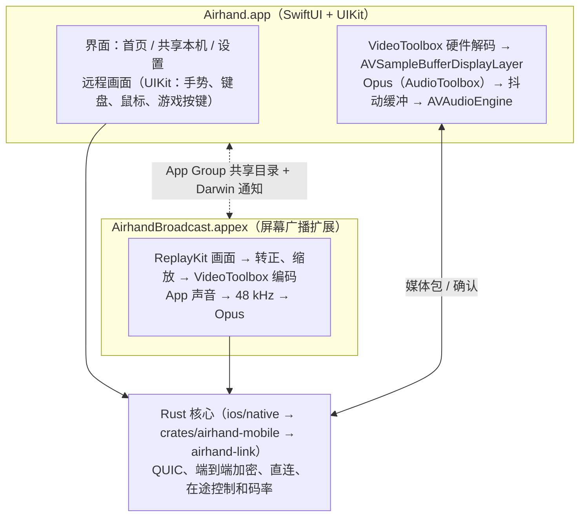

# iOS / iPadOS（iPhone、iPad）

[← 返回 README](../README.zh-CN.md) · [English](ios.md)

一个 App（`ios/`），iPhone 和 iPad 通用，iOS / iPadOS 17 及以上：

| 页签 | 能做什么 |
|---|---|
| **远程** | **控制别人**：看、操作电脑或手机（和 Android 手机版的功能一样） |
| **共享本机** | **被看**：用系统的屏幕广播把这台 iPhone / iPad 的屏幕和正在播放的声音给别人看。iOS 不允许别的应用注入触摸，所以**只能看、不能操作** |
| **设置** | 服务器、本机名称、控制码、默认画质和操作方式…… |

界面跟随系统语言（中文 / 英文），深色。

## 远程（控制别人）

- 首页输入对方的 **6 位控制码**，输满 6 位就自动连接（也可以点“粘贴”，从“控制码：123 456”这样的文字里找出来，不会弹出系统的粘贴确认）。连接的过程留在首页（按钮上转圈），连上了才进入远程画面；控制码不对、对方不在线等原因直接显示在输入框下面
- **配对码**：第一次连接一台设备时要输入对方显示的 6 位配对码（弹出输入框），之后对方记住这台 iPhone / iPad。对方的身份变了（重装过，或者有人冒充）时也要重新配对
- **我的设备**：连接成功的设备自动保存，点一下就连；对方不在线时卡片上显示“对方不在线 · 上线后自动连接”，对方一上线就自动进入远程画面。长按可以重命名、复制控制码、删除（删除后可以撤销）
- **链接**：`airhand://connect/123456?pairing=654321` 点一下就连（`pairing` 可以不带）
- 远程画面全屏显示，只有一个**可以拖动的小圆钮**（松手后贴到左 / 右边），点开是菜单：顶部是对方名称、编码格式、帧率、延迟、码率、直连还是中转、安全码；下面是键盘、声音、麦克风、操作方式、锁定鼠标、适应屏幕、旋转画面（iPhone）、发送文件、手势说明、回到首页、断开，以及快捷键、画质（预设、编码格式、音画同步）、剪贴板、显示器（多屏时）、防窥模式（对方是 Windows、Mac 时）、游戏按键这几页
- iPhone 上画面跟着对方横 / 竖（电脑一般是横屏），菜单里可以转；iPad 随意转

### 手势

两种**操作方式**（菜单里随时切换，设置里可以选默认；默认“自动”：控制电脑用触控板，控制手机用触屏）。第一次进入远程画面时会显示手势说明，菜单里也能打开：

| 手势 | 触控板（控制电脑） | 触屏（控制电脑） | 控制手机 |
|---|---|---|---|
| 单指滑动 | 移动指针（慢精细、快加速） | 按住左键拖动 | 每个手指都原样传过去（对方能接收多点触摸时） |
| 单击 | 左键单击，点两下 = 双击 | 在手指处单击 | 〃 |
| 长按 | 右键 | 在手指处右键 | 〃 |
| 点一下再按住拖动 | 按住左键拖动（选文字、拖窗口） | — | 〃 |
| 双指点击 | 右键 | 右键 | 〃 |
| 双指拖动 | 滚动（自然滚动，松手后有惯性） | 滚动 | 〃 |
| 双指捏合 | 放大画面，画面跟着指针走 | 放大 / 移动画面 | 〃 |
| 三指点击 | 打开 / 收起键盘 | 同左 | 〃（键盘在菜单里打开） |

双指放大之后，手指停下一会儿就向对方要更清楚的画面（720p / 1080p / 1440p / 4K 往上取，最多到对方屏幕的原始分辨率），缩回去之后恢复画质设置里的分辨率。

- 触控板模式下指针由本机画出来（形状来自对方），移动没有延迟；触屏模式点按处有一个淡出的圆作为反馈
- **键盘**：打开后画面缩到键盘上方，始终能看到全貌；键盘上面多一排特殊键：Esc、Tab、Ctrl、Alt、Shift、Win（Mac 上是 ⌘）、方向键、Home / End、PgUp / PgDn、Del、F1–F12。修饰键是“粘滞”的：点一下只对下一个键有效，再点一下锁定，再点取消（例如点 Ctrl 再打 c = Ctrl+C）。拼音等输入法组字时文字显示在特殊键上方，选好字才发过去
- **外接键盘**：按物理键发（游戏里按住 W 就是按住），系统拦下的组合键（⌘Tab、⌘空格、地球键）传不过去
- **外接鼠标 / 触控板（iPad）**：移动、左右中键、侧键、滚轮直接对应远端；本机不显示系统指针，画的是对方的光标形状。对方隐藏了光标（游戏里转视角）或者打开了“锁定鼠标”时，**锁定指针**、发原始移动量；长按 Esc 放开（iPadOS 只在 App 全屏时允许锁定指针）
- 控制手机时画面下方有**返回 / 主页 / 最近任务**（设置里可以关掉），快捷键页里是对方手机支持的系统操作；控制电脑时快捷键按对方系统列出（Windows / macOS / Linux）
- **剪贴板**：对方复制的文字自动放进本机剪贴板；菜单 → 剪贴板可以把本机复制的文字发到对方的剪贴板，或者直接打进对方的输入框（读本机剪贴板时 iOS 会问一次“允许粘贴”）
- **文件**：对方复制的文件会提示“对方复制了 N 项”，点“保存到‘文件’”才传，存在“文件 › 我的 iPhone › Airhand”；菜单 → 发送文件选好本机的文件，放进对方的剪贴板，到对方那里粘贴（复制时只发清单，粘贴时才传）
- **声音**：对方的声音同步过来（Opus + 自适应抖动缓冲，和桌面版同一套做法）；**音画同步**看视频时打开。**麦克风**：对方能接收时（Windows、macOS 14.2+、Linux 被控端），菜单里打开就把本机的麦克风转发过去，开着系统的回声消除
- **防窥模式**（Windows、Mac 被控端）：打开后对方所有的显示器黑屏、键盘鼠标不起作用，只有你看得到、操作得了。页面上写着现在怎么样（正在打开、开着、开不了的原因），没能打开时还会弹出提示。断开连接后自动恢复，断线重连时接着保持。详见[使用说明 → 防窥模式](usage.zh-CN.md#防窥模式)
- 切到别的应用一会儿（复制个东西）再回来，会话不断；在后台久了 iOS 会挂起 App，回来时自动重连（带着重连凭证，不用再输配对码）。回到首页时画面降到每秒 5 帧，点首页顶部的卡片回到远程画面

### 游戏按键

控制电脑时，菜单 → **游戏按键** 可以在画面上叠一层按钮和摇杆（和 Android 版相同）：

- **按钮**：按住就是按着那个键；可以是键盘上的键、鼠标键、滚轮，也可以是组合键（最多 3 个，按顺序按下、倒序松开）；可以设“点一下切换”、“拖动可以转视角”（射击模板的开火键按住拖动 = 一边开火一边瞄准）。手指滑出按钮也不会松开
- **摇杆**：WASD 或方向键，8 个方向，方向边界和死区都有回差；可以设“推出边缘时加按”一个键（Shift 奔跑）；默认从拇指落下的地方开始
- **转视角**：游戏隐藏了光标时，空白处拖动就是转视角（只发移动量、不加速，乘上方案里的灵敏度）
- 同一个键被几处按着时都松开才松开；打开菜单、切到后台、断线、打开键盘时按着的键全部松开
- **方案**：射击、技能（MOBA / ARPG）、方向键三套模板，可以新建、复制、重命名、删除；每台电脑分别记住开没开、用哪个方案
- **编辑布局**：画面压暗、铺一层点阵，拖动摆放（靠近别的按钮或画面中线时吸过去、画出对齐线、轻振一下），双指捏合调大小，点一下改设置（按键、文字、按法、转视角、大小；摇杆的方向、加按的键、浮动），可以复制、删除；工具栏有撤销、添加、方案设置（名称、不透明度、灵敏度、振动）、取消、完成，按住左边的把手可以把工具栏拖开

## 共享本机（被看）

“共享本机”页点 **开始共享屏幕**，在系统弹窗里选“开始直播”。开始后：

- 大字显示本机的**控制码**（固定不变，直到点“更换控制码”）和**配对码**，可以复制、分享（分享的文字里两个码都有）
- 有设备连上来时弹出**通知**（谁、从哪个 IP、安全码），“正在查看本机”列出它们，可以**全部断开**
- 配对码、忘掉已配对的设备、更换控制码和电脑、Android 一样
- 对方只能**看**（iOS 不允许别的应用注入触摸），看得到画面、听得到本机正在播放的声音（不会录麦克风）；控制端会提示“对方是 iPhone / iPad，只能看不能操作”
- 屏幕转到横屏时画面跟着转正；画面静止时不编码，停下后补几帧让文字清楚
- 共享在系统的**屏幕广播扩展**里进行：切到别的 App 也照样共享，状态栏左上角是红色的录制标记；点“停止共享”或者点那个红色标记都能停止

## 设置

服务器地址和证书指纹（编译时设置默认值，这里可以改；指纹留空时第一次连接记住服务器的证书，之后证书变了就拒绝连接）、本机名称（对方看到的名字）、更换控制码、配对过的设备、默认画质、编码格式、操作方式、是否默认播放声音、音画同步、控制手机时显示导航键、拖动窗口时显示本地光标、手势说明、清除已保存的设备、版本和协议版本。

## 数据保存在哪里

设置、保存的设备、本机的端到端加密身份、控制码、配对状态、游戏按键方案都在 App Group（`group.app.airhand.ios`）的共享目录里，只有 Airhand 自己和它的屏幕广播扩展能读，不备份，**卸载时系统一并删除**。收到的文件在 App 自己的“文稿/Airhand”里（“文件” App 能看到）。日志写到系统日志（子系统 `app.airhand`，Mac 上用“控制台” App 看）。

## 构建

需要一台 Mac：

- Xcode 27 或更新（带 iOS SDK；只能装在 Apple 芯片、macOS 26.6 或更新的 Mac 上；装好的应用仍然支持 iOS 17 及以上）
- Rust（[rustup](https://rustup.rs)）和两个目标：`rustup target add aarch64-apple-ios aarch64-apple-ios-sim`
- [XcodeGen](https://github.com/yonaskolb/XcodeGen)（`brew install xcodegen`，或者下载它的发布包）：`ios/project.yml` 生成 Xcode 工程

```bash
cd ios
# 没有正式签名的 IPA（只做了 ad-hoc 签名，带着 App Group 等权限）：build/Airhand.ipa
AIRHAND_SERVER=relay.example.com:4433 AIRHAND_SERVER_FP=<指纹> scripts/build-ipa.sh

# 用自己的 Apple 开发者账号签名（Xcode 里登录过这个账号），生成能直接安装的 build/export/Airhand.ipa
TEAM_ID=<团队 ID> EXPORT_METHOD=development AIRHAND_SERVER=... AIRHAND_SERVER_FP=... scripts/build-ipa.sh
# EXPORT_METHOD 还可以是 ad-hoc（登记过的设备）、app-store-connect（TestFlight / App Store）、enterprise
```

在 Xcode 里开发：`xcodegen generate` 之后打开 `ios/Airhand.xcodeproj`。编译时构建阶段会调用 `scripts/build-rust.sh` 按当前的 SDK 编译 Rust 核心（`ios/native`，静态库在 `ios/build/rust/<平台>/`）。

### 安装

iOS 只运行签过名的 App：

- **自己的 Apple 开发者账号**（个人或公司，每年 99 美元）：上面的 `TEAM_ID` 方式；`development` 装到登记过的设备上，`app-store-connect` 上传到 TestFlight（每个构建 90 天）或者 App Store
- **免费的 Apple ID**：用 Xcode 直接装到自己的设备上（Signing & Capabilities 里选自己的 Team），7 天后要重新装。免费账号签名时如果 Xcode 提示不支持 App Group，去掉这项权限之后远程控制照样能用，只是“共享本机”用不了
- **没有签名的 IPA**：用 Sideloadly、AltStore 之类的工具用自己的 Apple ID 重新签名后安装。注意重新签名后 App 和广播扩展要在**同一个 App Group** 里（工具一般会自动处理），否则“共享本机”读不到设置

上架 App Store 时要准备：在审核说明里给一个可用的测试服务器和被控端；出口合规（用了标准的加密算法）；在中国大陆上架还要做 App 备案。

## 工作原理



- **一份网络代码**：`crates/airhand-mobile` 是 Android 和 iOS 共用的手机核心（控制端服务的包装、被控端的服务器连接和会话、在途控制和码率、剪贴板文件），Android 在 `android/native` 里包一层 JNI，iOS 在 `ios/native` 里包一层 C 接口（`ios/native/include/airhand.h`，Swift 里 `import AirhandCore`）。命令、事件和 Android 一样是 JSON；会话数据是媒体包（Rust 的内存直接交给 Swift，不再复制）；Rust 不回调 Swift，Swift 的线程阻塞地 `poll`
- **控制端**和 Android 版是同一套逻辑（`ios/Airhand/Controller/RemoteSession.swift` 对应 `RemoteSession.kt`）：断线自动重连、对方离线时等它上线、凭证作废时的处理、后台降帧、放大时要更清楚的画面
- **画面**：Annex-B 换成长度前缀、参数集做成格式描述（AV1 从序列头拼 av1C），`VTDecompressionSession` 实时模式同步解码，解完标记“立即显示”交给 `AVSampleBufferDisplayLayer`，不排队等时钟。送进解码器后确认（音画同步时在有界等待队列里确认）；格式、参数集变了，出错，回到前台时重建解码器，从关键帧开始。本机能硬件解码哪些格式（H.264 总是；HEVC、AV1 看芯片）就告诉对方用哪些，按 AV1 > HEVC > H.264 选
- **声音**：Opus 用系统的 AudioToolbox 解码（不额外带 libopus），抖动缓冲、变速、音画同步时钟和 Android / 网页版是同一套算法；一个 `AVAudioEngine` 同时负责播放和麦克风（同一个引擎才能做回声消除）
- **输入**：手势（`Gestures.swift`，和 `Gestures.kt` 同一套规则）、软键盘（看不见的输入框，等输入法组完字再发）、外接键盘（HID 键码 → `KeyboardEvent.code`）、外接鼠标（`GCMouse` 的原始移动量、`UIHoverGestureRecognizer` 的位置、锁定指针）、游戏按键，最后都是协议里的输入事件，每 8 ms 合并成一批发出去
- **被控端**在屏幕广播扩展里（App 切到后台也照样共享）：`Shared/HostRunner.swift` 把 ReplayKit 交来的画面按方向转正、缩到对方要的短边上限，用 VideoToolbox 低延迟模式（H.264 / HEVC，无 B 帧，只在需要时出关键帧）编码；声音重采样到 48 kHz、每 20 ms 一包 Opus，没有声音时不发。在途控制、码率、关键帧都由 Rust 的 `VideoHub` 决定（和 Android 被控端相同）。扩展的内存上限很小（约 50 MB），只保留编码需要的几个缓冲区
- **App 和扩展之间**：设置、身份、控制码、配对状态放在 App Group 的共享目录里；扩展把实时状态（服务器、控制码、配对码、谁在看）写进 `host-live.json`，App 的命令（断开所有人、更换控制码、换配对码、忘掉配对、停止）写进 `host-command.json`，各自用 Darwin 通知叫对方去读
- 被控端在 `HostHello` 里报告平台 `ios`（协议里新增的平台）：桌面、网页和 Android 控制端据此不显示鼠标模式、提示“只能看”

## 测试

```bash
# 仓库根目录：Rust（协议、链路库、手机核心、服务器）
cargo test

# ios/：Swift 单元测试（模拟器）：和 Rust / TypeScript / Kotlin 共用的协议样例（媒体包、输入事件、命令）、
# Annex-B、AV1 的 av1C、Opus 编解码、抖动缓冲、手势
xcodegen generate
xcodebuild -project Airhand.xcodeproj -scheme Airhand -sdk iphonesimulator \
  -destination 'platform=iOS Simulator,name=iPhone 17' test
```

不用真机也能把控制端从头到尾测一遍：本机起一个服务器和一台模拟的被控端（彩色测试画面，OpenH264 编码，走和 iPhone 被控端相同的网络代码），模拟器里的 App 连上它：

```bash
# 仓库根目录：启动一个不固定证书的服务器
cargo build -p airhand-server
AIRHAND_CERT=target/e2e/cert.pem AIRHAND_KEY=target/e2e/key.pem ./target/debug/airhand-server &
# ios/native/：模拟的被控端，打印控制码、配对码，以及收到的输入事件
cargo run --release --example fake_host
# ios/：编译、装到模拟器上（服务器默认 127.0.0.1:4433）、直接连上那个控制码
scripts/sim-run.sh -AirhandConnect <控制码> -AirhandPairing <配对码>
```

调试构建还认这些启动参数：`-AirhandSelfTest 1`（连上后模拟一串手势和键盘输入，看 `fake_host` 打印的输入事件）、`-AirhandNoTips 1`、`-AirhandOpenMenu 1`、`-AirhandKeyboard 1`、`-AirhandGame 1`、`-AirhandEditGame 1`、`-AirhandTab share|settings`。

模拟器里没有屏幕广播，被控端用 `-AirhandHostSelfTest 1` 测：App 用合成的画面（走动的彩条）和声音（440 Hz）跑一遍和广播扩展相同的 `HostRunner`，“共享本机”页显示控制码和配对码，再用 Android 核心里的协议级控制端连上去，统计收到的画面和声音：

```bash
scripts/sim-run.sh -AirhandHostSelfTest 1 -AirhandTab share
# android/native/
cargo run --release --example probe -- <控制码> 8 --audio --pairing <配对码> --server 127.0.0.1:4433
```

两台模拟器（例如 iPhone 做被控端、iPad 做控制端）也可以互相连。

## 已知限制

- **iPhone / iPad 只能被看，不能被操作**：iOS 没有给别的应用注入触摸、按键的接口（没有 Android 无障碍服务那样的东西）
- 共享屏幕要用户自己点“开始直播”（系统规定），停止也可以在控制中心或者状态栏的红色标记里点
- App 在后台久了会被 iOS 挂起，远程会话断开，回来时自动重连；共享本机不受影响（在扩展里）
- 屏幕广播扩展的内存上限约 50 MB，分辨率很高的 iPad 上画面会按对方要的短边上限缩小后再编码
- AV1 硬件解码只有 A17 Pro、M3 及以后的芯片有；模拟器里只有 H.264（没有硬件 HEVC 解码）
- 锁定鼠标指针只在 iPad 上、App 全屏时可以；iPhone 接鼠标也能用，但不能锁定
- 外接键盘的 ⌘Tab、⌘空格、地球键等被系统拦下，传不过去（用菜单里的快捷键）
- 读本机剪贴板（菜单 → 剪贴板）时 iOS 会弹一次“允许粘贴”
- 局域网直连要“本地网络”权限，第一次直连时系统会问；不允许的话画面一直走中转（或者公网 IPv6）
- 在只有 IPv6 的网络（例如部分移动网络的 NAT64）上，服务器地址请填域名：填 IPv4 地址时系统不会合成 NAT64 地址，连不上
